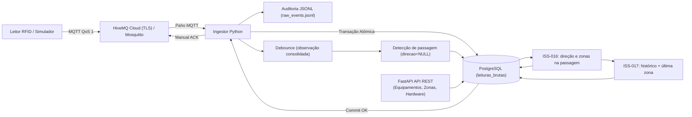

# RFID Hospital MVP

MVP experimental para rastreabilidade aproximada por zonas de equipamentos hospitalares móveis do Hospital Universitário Professor Alberto Antunes (**HUPAA/UFAL**) utilizando **RFID UHF passivo**. A localização do equipamento é inferida a partir de sua última passagem confirmada por uma zona de leitura, não por posicionamento contínuo.

> 📖 **Ponto Central de Documentação:** Para uma visão aprofundada da arquitetura, implementação dos subsistemas, decisões de engenharia e relatórios de validação para a banca examinadora, consulte o **[Guia Completo da Documentação (docs/README.md)](docs/README.md)**.

---

## 1. Estado Atual da Entrega (Status do MVP)

O projeto priorizou a solidez da infraestrutura, a confiabilidade da ingestão e a integridade do banco de dados antes da camada de inferência de negócios.

### ✅ O que está IMPLEMENTADO e testado:
- **Broker MQTT e Ingestão (ISS-001):** Suporte dual a HiveMQ Cloud (TLS 8883, autenticação e ACLs restritas) e Mosquitto local (1883) com o mesmo ingestor.
- **Ambiente de Desenvolvimento Local (ISS-003, ISS-004):** Docker Compose para PostgreSQL e Mosquitto locais com reset protegido; pipeline de CI no GitHub Actions com Lint, Testes e Migrations descartáveis.
- **Normalização e Contrato Canônico (ISS-005):** Adapters (`ez700`, `simulator`), geração determinística de `event_id` (`sha256:...`) e contrato canônico com timestamp UTC.
- **Persistência Idempotente e ACK Manual (ISS-006):** Inserção em `leituras_brutas` via `ON CONFLICT (event_id) DO NOTHING` e confirmação manual (`PUBACK`) estritamente após o commit.
- **Resiliência e Recuperação Automática (ISS-007):** Supervisor com backoff exponencial truncado, jitter de 20%, taxonomia estrita de falhas e retenção durável no broker MQTT durante quedas do banco.
- **Gestão de Equipamentos e Tags (ISS-008, ISS-009, ISS-010):** CRUDs FastAPI para Tipos de Equipamentos e Equipamentos; associação temporal de EPCs (`[inicio, fim)`) com constraint de unicidade parcial (`uq_tag_ativa`).
- **Hierarquia Hospitalar (ISS-011):** CRUDs FastAPI de Andares, Setores e Zonas com validação de ciclo de vida (*guards* de integridade) e consulta da árvore física completa.
- **Topologia de Hardware (ISS-012):** CRUDs FastAPI de Leitores, Antenas e Portais; índice único parcial de porta ativa (`uq_antena_ativa_por_porta_leitor`); desacoplamento entre leitor e portal.
- **Topologia Lógica de Portais (ISS-013):** Mapeamentos temporais de antenas para lados A/B, zonas e funções operacionais, preservando histórico de configuração.
- **Debounce Temporal (ISS-014):** Consolidação em memória por `(EPC, antena_id)` usando event time, tolerância configurável a reordenação e estatísticas de RSSI, sem remover leituras brutas.
- **Detecção de Passagem (ISS-015):** Correlação temporal de observações em lados opostos do mesmo portal, com evidências rastreáveis e `direcao=NULL`.
- **Inferência de Direção (ISS-016):** Interpretação da ordem temporal A→B/B→A com topologia histórica, zonas de origem/destino e estados `confirmed`, `ambiguous` e `unknown`. Tolerância temporal inicial configurável de 100 ms, ainda sem validação física.
- **Histórico de Movimentações (ISS-018):** Ledger append-only, resolução temporal EPC → equipamento, correção manual e consulta cronológica paginada.
- **Última Zona do Equipamento (ISS-017):** Passagem confirmada grava histórico e atualiza a projeção em uma transação; eventos atrasados não fazem a zona regredir e a reconciliação recupera falhas após o commit da direção.
- **Busca operacional (ISS-019):** `GET /api/ativos` filtra por nome/patrimônio, tipo, EPC, status e última zona com paginação; dashboard e mapas consultam esta API. Consulte [contrato e limites](docs/implementations/iss-019-busca-ativos.md).
- **Última localização na interface (ISS-021):** tabela e detalhe exibem andar → setor → zona e horário no fuso `America/Maceio`; o detalhe consulta o histórico paginado. Veja o [contrato e a validação](docs/implementations/iss-021-ultima-localizacao-interface.md).

### ⏳ Próximos Passos (Backlog Imediato):
- **Validação física:** Calibrar debounce, janela de passagem e tolerância de direção no HUPAA.

> [!NOTE]
> O aceite final com **leitores físicos Identix EZ700 e na rede Wi-Fi hospitalar** permanece como **PENDENTE DE VALIDAÇÃO FÍSICA**, aguardando infraestrutura de TI do HUPAA. Os testes atuais comprovam o pipeline lógico via simuladores e contêineres Docker.

---

## 2. Arquitetura Resumida



---

## 3. Execução Rápida Local (Ubuntu 24.04 / Docker)

Para subir o ambiente de desenvolvimento local completo (PostgreSQL 16, Mosquitto e Ingestor):

```bash
# 1. Configurar variáveis de ambiente para desenvolvimento local
cp .env.local.example .env.local

# 2. Iniciar contêineres locais (PostgreSQL e Mosquitto)
docker compose up -d

# 3. Carregar variáveis na sessão
set -a; source .env.local; set +a

# 4. Iniciar o ingestor (timestamps numéricos EZ700 usam a hora de recepção)
python -m rfid_ingestion

# Ou alternativamente via Make:
make local-up
make status-local
```

### Publicar eventos de teste com o simulador:
```bash
make simulator-local
tail -n 3 data/raw_events.jsonl
```

### Teste de laboratório assistido:

```bash
python -m pip install -r requirements.txt
python -m tools.lab_launcher
```

O launcher limpa a tela, mostra o menu, prepara o cadastro e abre observação
MQTT, logs do ingestor e leituras no banco. O cenário sintético padrão publica
100 mensagens de um item, da aproximação à passagem pelo portal. O menu oferece
teste local sintético,
local com leitor físico ou com broker e banco externos. Veja
[instruções para Windows 11 e Ubuntu](docs/lab_test_launcher.md).

### Iniciar a API FastAPI de cadastros:
```bash
uvicorn api.main:app --reload
# Acesse a documentação interativa em http://127.0.0.1:8000/docs
```

### Iniciar o frontend operacional (ISS-032B):

```bash
cd frontend
npm ci
npm run dev
# Abra http://localhost:5173/
```

O Dashboard consulta `GET /api/ativos`, `/api/dashboard/resumo` e `/api/dashboard/atividade`; os mapas HUPAA/EASY consultam `GET /api/ativos`. A planta continua esquemática e não indica posição exata. No EASY, as leituras recentes das antenas aparecem separadas da última zona confirmada. Veja a [integração da ISS-019](docs/implementations/iss-019-busca-ativos.md), os [roteiros e leituras ao vivo](docs/implementations/roteiros-laboratorio-mapa-ao-vivo.md), a [integração do painel](docs/implementations/iss-032-frontend-dashboard.md) e o [redesenho com mapas](docs/implementations/iss-032-redesign-mapas.md).

---

## 4. Comandos de Verificação e Testes

```bash
# Instalar dependências de desenvolvimento
python -m pip install -r requirements-dev.txt

# Executar linters
python -m ruff check --select E4,E7,E9,F,I .

# Executar testes unitários e de integração
python -m pytest -q

# Executar smoke tests de infraestrutura
bash tests/reader-connectivity/mqtt/smoke-test.sh
bash tests/infrastructure/compose-smoke-test.sh
bash tests/infrastructure/resilience-smoke-test.sh
```

---

## 5. Estrutura e Mapa da Documentação

A documentação detalhada foi reorganizada segundo a **[Issue #51](docs/implementations/iss-051-reorganizacao-documentacao.md)**:

- **[Ponto de Entrada da Documentação](docs/README.md)**
- **Arquitetura:**
  - [Visão Geral e Diagramas de Sequência](docs/architecture/system-overview.md)
  - [Modelo de Dados e Entidades](docs/architecture/data-model.md)
  - [Diagrama Entidade-Relacionamento](docs/architecture/er-diagrama.mermaid)
- **Implementações Técnicas:**
  - [ISS-001: Ingestão MQTT Local e HiveMQ](docs/implementations/iss-001-mqtt-ingestion.md)
  - [ISS-002b: Configuração Neon PostgreSQL](docs/implementations/iss-002b-neon-setup.md)
  - [ISS-002c: Migrations Alembic](docs/implementations/iss-002c-migrations.md)
  - [ISS-003: Ambiente Docker Compose](docs/implementations/iss-003-docker-compose.md)
  - [ISS-004: Pipeline de CI](docs/implementations/iss-004-ci.md)
  - [ISS-005: Normalização e Contrato Canônico](docs/implementations/iss-005-rfid-normalization.md)
  - [ISS-006: Persistência Idempotente e ACK Manual](docs/implementations/iss-006-raw-readings-persistence.md)
  - [ISS-007: Resiliência e Recuperação do Ingestor](docs/implementations/iss-007-ingestor-resilience.md)
  - [ISS-008/009/010: Gestão de Equipamentos e Tags](docs/implementations/iss-008-009-010-equipamentos-epc.md)
  - [ISS-011: Hierarquia de Localização Hospitalar](docs/implementations/iss-011-localizacao-hospitalar.md)
  - [ISS-012: Topologia de Hardware](docs/implementations/iss-012-topologia-hardware.md)
  - [ISS-013: Topologia Lógica de Portais](docs/implementations/iss-013-topologia-logica-portais.md)
  - [ISS-014: Debounce Temporal de Leituras](docs/implementations/iss-014-debounce-leituras.md)
  - [ISS-015: Detecção de Passagem](docs/implementations/iss-015-deteccao-passagem.md)
  - [ISS-016: Inferência de Direção](docs/implementations/iss-016-inferencia-direcao.md)
  - [ISS-018: Histórico de Movimentações](docs/implementations/iss-018-historico-movimentacoes.md)
  - [ISS-017: Última Localização](docs/implementations/iss-017-ultima-localizacao.md)
  - [ISS-019: Busca operacional de ativos](docs/implementations/iss-019-busca-ativos.md)
  - [ISS-021: Última localização e horário na interface](docs/implementations/iss-021-ultima-localizacao-interface.md)
- **Experimentos e Evidências:**
  - [Índice de Evidências e Matriz de Testes](docs/experiments/README.md)
  - [Evidências MQTT e Rede](docs/experiments/mqtt/)
  - [Evidências de Ingestão e Persistência](docs/experiments/ingestion/)
- **Decisões Arquiteturais:**
  - [Índice de ADRs](docs/decisions/README.md)

---

## 6. Materiais do Projeto

- [Google Drive — RFID Hospital MVP](https://drive.google.com/drive/folders/1AYqcT6jRI6UQNMan_DnyVXhEiNwMNgse?hl=pt-br)
