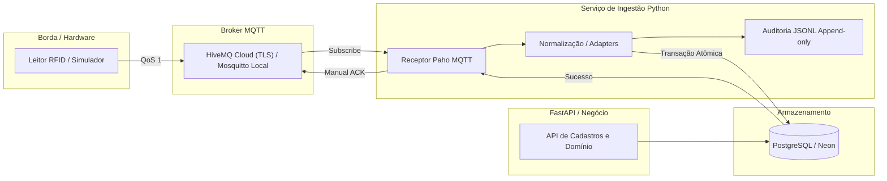

# Documentação — RFID Hospital MVP

Bem-vindo à documentação oficial do **RFID Hospital MVP**, desenvolvido para o Hospital Universitário Professor Alberto Antunes (**HUPAA/UFAL**).

Este documento é o ponto de entrada principal para desenvolvedores, avaliadores e banca examinadora entenderem o estado do projeto, seus fundamentos conceituais, sua arquitetura técnica e suas decisões de engenharia.

---

## 1. O que é este projeto?

O **RFID Hospital MVP** é uma solução de software experimental orientada a **rastreabilidade aproximada por zonas** de equipamentos médico-hospitalares móveis (como bombas de infusão, desfibriladores, macas e cadeiras de rodas) utilizando **RFID UHF passivo** (EPC Gen2).

O MVP infere localização aproximada por zonas. A implementação atual cobre ingestão, normalização, persistência idempotente, resiliência, detecção de passagem, inferência de direção, histórico auditável e projeção da última zona.

---

## 2. Qual problema ele resolve?

Em hospitais de grande porte como o HUPAA:
1. **Perda de tempo assistencial:** equipes de enfermagem e engenharia clínica gastam horas procurando equipamentos essenciais em diferentes andares e setores.
2. **Subutilização ou ociosidade oculta:** equipamentos retidos em zonas de expurgo ou quartos indevidos geram falsas demandas de aquisição ou locação emergencial.
3. **Falhas em manutenções preventivas:** dificuldade em localizar rapidamente ativos chamados para calibração ou manutenção programada.
4. **Instabilidade de rede física:** ambientes hospitalares sofrem com oscilações de Wi-Fi e energia; o sistema precisa resistir a falhas de conectividade e banco de dados sem perda ou duplicação de dados.

---

## 3. Estado Atual do MVP (Status da Entrega)

O projeto prioriza a confiabilidade da ingestão e da persistência antes da lógica de inferência de negócios.

### ✅ O que está IMPLEMENTADO e testado:
- **Broker MQTT e conectividade (ISS-001):** Suporte dual a HiveMQ Cloud (TLS 8883, autenticação, ACLs customizadas por tópico) e Mosquitto local (porta 1883 para desenvolvimento offline).
- **Ambiente de desenvolvimento e CI (ISS-003, ISS-004):** Docker Compose local com perfis explícitos (`local` e `managed`), pipeline do GitHub Actions com Lint (Ruff), Testes unitários/integração e validação estrita de Migrations.
- **Normalização e contrato canônico (ISS-005):** Ingestão de mensagens MQTT com adapters (`ez700`, `simulator`), geração determinística de `event_id` (`sha256:` de 64 hexadecimais) e contrato canônico imutável.
- **Persistência idempotente e ACK manual (ISS-006):** Armazenamento seguro de leituras brutas no PostgreSQL com deduplicação nativa (`ON CONFLICT (event_id) DO NOTHING`), ACK manual após commit e resolução topológica de antena ativa.
- **Resiliência e recuperação automática (ISS-007):** Supervisor dedicado com backoff exponencial truncado e jitter, taxonomia estruturada de falhas (diferenciando falhas temporárias de erros permanentes) e pausa segura de consumo com sondas periódicas durante quedas do PostgreSQL.
- **Domínio e cadastros base (ISS-008, ISS-009, ISS-010):** CRUD completo via FastAPI de tipos de equipamentos, equipamentos (com identificador interno normalizado) e associação temporal de EPCs (`[inicio, fim)`) garantindo no máximo um vínculo ativo por tag.
- **Hierarquia de localização hospitalar (ISS-011):** CRUD de Andares, Setores e Zonas com integridade relacional e guards contra exclusão/inativação de elementos em uso ou com filhos ativos.
- **Topologia de hardware (ISS-012):** CRUD de Leitores, Antenas e Portais; índice único parcial para porta ativa por leitor (`uq_antena_ativa_por_porta_leitor`); separação clara entre `reader_id` lógico do tópico e número serial físico.
- **Topologia lógica versionada de portais (ISS-013):** Mapeamento temporal de antenas a lados do portal (A/B), zonas adjacentes (`zona_a_id`/`zona_b_id`) e funções operacionais (`entrada`, `saida`, `auxiliar`) com preservação estrita de histórico (`[inicio, fim)`), índice único parcial por antena ativa e consulta consolidada em join único.
- **Debounce temporal de leituras (ISS-014):** Consolidação em memória por `(EPC, antena_id)` com event time, limite inclusivo, tolerância a eventos fora de ordem e RSSI agregado, mantendo todas as evidências em `leituras_brutas`.
- **Detecção de passagem (ISS-015):** Observações consolidadas em lados opostos do mesmo portal, usando topologia histórica e janela configurável, geram `passagens` com `direcao=NULL`.
- **Inferência de direção (ISS-016):** Passagens são enriquecidas com A→B/B→A, zonas de origem/destino, status categórico e regra auditável, respeitando topologia histórica e tolerância temporal.
- **Histórico de movimentações (ISS-018):** Ledger append-only com EPC, evidências, tempos de evento/processamento, correção manual e consulta paginada.
- **Última zona (ISS-017):** Integra histórico e projeção de equipamento na mesma transação, com event time, lock e reconciliação de passagens confirmadas.
- **Busca operacional (ISS-019):** API paginada por nome/patrimônio, tipo, EPC, estado derivado e última zona, consumida pelo dashboard e pelos mapas. Veja [contrato e validação](implementations/iss-019-busca-ativos.md).
- **Ativos por zona (ISS-020):** a consulta existente retorna equipamentos por última zona materializada, com recência e paginação. Veja [semântica e cenário de teste](implementations/iss-020-ativos-por-zona.md).
- **Usuários e autenticação (ISS-026):** login por e-mail com sessão opaca em cookie `HttpOnly`/`SameSite=Strict`, senhas Argon2id, bloqueio por conta, senha temporária com troca obrigatória, administração de usuários e primeiro administrador por terminal. Veja [contrato e validação](implementations/iss-026-usuarios-autenticacao.md) e o [ADR 0009](decisions/0009-autenticacao-sessao-opaca-cookie.md).
- **Perfis e permissões (ISS-027):** toda rota de negócio exige sessão e permissão de uma matriz única (`api/permissoes.py`): operacional consulta tudo exceto usuários, administrador faz tudo; negação única 403 `acesso_negado` com log. O dashboard ganhou login, troca de senha obrigatória e Sair. Veja [matriz, rotas e testes](implementations/iss-027-perfis-rbac.md).
- **Trilha de auditoria imutável (ISS-028):** registro central automático (listener do ORM) de toda mudança de cadastro e dos eventos de segurança (login, logout, bloqueio, acesso negado), com autor, origem, motivo e `correlation_id` por requisição; append-only garantido por trigger no banco; consulta só pela API (`/auditorias`, administrador). Veja [catálogo, garantias e limites](implementations/iss-028-auditoria.md).

### ⏳ O que está PLANEJADO (Próximos passos):
- **Validação física:** Ajuste dos parâmetros e verificação da sequência de leituras com hardware real no HUPAA.
- **Relatórios gerenciais e atualização em tempo real:** A busca e os mapas consultam a API; agregados históricos e atualização contínua ainda não foram implementados.

---

## 4. Arquitetura em Alto Nível

O sistema opera em uma esteira desacoplada e local-first:



---

## 5. Como uma leitura RFID viaja no sistema?

Para compreender a rastreabilidade e integridade do dado ponta a ponta:

1. **Geração na Borda:** Uma tag EPC fixada em um equipamento passa pelo campo de uma antena conectada a um leitor (ex.: Identix EZ700). O leitor publica um payload JSON no tópico específico: `easy/<env>/<site>/<portal_id>/<reader_id>/readings`.
2. **Recepção no Ingestor:** O cliente Paho MQTT recebe a mensagem com QoS 1 via sessão persistente (`clean_session=false`). O envelope bruto é registrado imediatamente no log append-only `data/raw_events.jsonl` para auditoria e replay forense.
3. **Normalização Canônica:** O adaptador correspondente valida tamanho, codificação UTF-8 e campos obrigatórios. Gera um `event_id` determinístico (`sha256:...`) invariante a horários de rede.
4. **Resolução Topológica:** O repositório consulta o PostgreSQL para resolver `(reader_id, porta_numero) -> antena_id`, considerando estritamente antenas marcadas como ativas (`ativo = true`).
5. **Persistência Idempotente:** É executado `INSERT INTO leituras_brutas ... ON CONFLICT (event_id) DO NOTHING`. Se a mensagem for reentregue pelo broker (devido a falhas anteriores), o banco ignora a inserção sem erro.
6. **Debounce:** Somente leituras realmente inseridas alimentam a consolidação temporal por EPC e antena; duplicatas de `event_id` não aumentam a contagem.
7. **Confirmação (ACK):** Somente após o commit bem-sucedido no PostgreSQL o ingestor envia o `manual_ack` ao broker MQTT.
8. **Resiliência a Falhas:** Se o PostgreSQL estiver fora do ar, o ACK **não** é enviado; o ingestor pausa o consumo no MQTT, aguarda com backoff e sonda o banco com `SELECT 1`. Ao restabelecer a conexão com o banco, o MQTT é reconectado, o broker reentrega a leitura pendente e o fluxo se completa sem perda de dados.

---

## 6. Ordem de Leitura Recomendada

Dependendo do seu perfil, siga os caminhos abaixo:

### 🎓 Para a Apresentação do Projeto / Banca Avaliadora
1. **Este documento (`docs/README.md`):** Compreensão do problema, escopo e status do MVP.
2. [Visão Geral da Arquitetura](architecture/system-overview.md): Diagramas de sequência, fluxo de dados e topologia hospitalar.
3. [Modelo de Dados e Entidades](architecture/data-model.md): Como o banco modela equipamentos, histórico de tags, localização e hardware.
4. [Persistência Idempotente (ISS-006)](implementations/iss-006-raw-readings-persistence.md): O coração da confiabilidade de captura.
5. [Resiliência e Recuperação (ISS-007)](implementations/iss-007-ingestor-resilience.md): Por que o sistema não cai em oscilações de rede e banco.
6. [Resumo de Evidências e Experimentos](experiments/README.md): Validações realizadas com simuladores, containers e testes de rede.

### 💻 Para Desenvolvedores e Engenheiros de Software
1. [Visão Geral da Arquitetura](architecture/system-overview.md)
2. [Modelo de Dados e Entidades](architecture/data-model.md) e [Diagrama ER](architecture/er-diagrama.mermaid)
3. Implementações centrais:
   - [Normalização e Contrato Canônico (ISS-005)](implementations/iss-005-rfid-normalization.md)
   - [Persistência e ACK Manual (ISS-006)](implementations/iss-006-raw-readings-persistence.md)
   - [Resiliência e Recuperação (ISS-007)](implementations/iss-007-ingestor-resilience.md)
   - [CRUDs de Equipamentos e Tags (ISS-008/009/010)](implementations/iss-008-009-010-equipamentos-epc.md)
   - [Hierarquia Hospitalar (ISS-011)](implementations/iss-011-localizacao-hospitalar.md)
   - [Topologia de Hardware (ISS-012)](implementations/iss-012-topologia-hardware.md)
   - [Topologia Lógica de Portais (ISS-013)](implementations/iss-013-topologia-logica-portais.md)
   - [Debounce Temporal de Leituras (ISS-014)](implementations/iss-014-debounce-leituras.md)
   - [Detecção de Passagem (ISS-015)](implementations/iss-015-deteccao-passagem.md)
   - [Inferência de Direção (ISS-016)](implementations/iss-016-inferencia-direcao.md)
   - [Histórico de Movimentações (ISS-018)](implementations/iss-018-historico-movimentacoes.md)
   - [Última Localização (ISS-017)](implementations/iss-017-ultima-localizacao.md)
   - [Recência da Localização (ISS-022)](implementations/iss-022-recencia-localizacao.md)
   - [Usuários e Autenticação (ISS-026)](implementations/iss-026-usuarios-autenticacao.md)
   - [Perfis e Permissões / RBAC (ISS-027)](implementations/iss-027-perfis-rbac.md)
   - [Trilha de Auditoria Imutável (ISS-028)](implementations/iss-028-auditoria.md)
   - [Frontend e Dashboard Operacional (ISS-032, Etapa A)](implementations/iss-032-frontend-dashboard.md)
   - [Redesenho do Dashboard e Mapas (ISS-032)](implementations/iss-032-redesign-mapas.md)
   - [Mapa por zonas e portais (ISS-023)](implementations/iss-023-mapa-portais.md)
   - [Atualização automática das telas (ISS-033)](implementations/iss-033-atualizacao-automatica.md)
   - [Mapa com abas, cluster por zona e script de desenvolvimento](implementations/mapa-abas-cluster-zonas.md)
4. Decisões Arquiteturais:
   - [Índice de ADRs](decisions/README.md)
5. Ambiente e Testes:
   - [Ambiente Docker Compose (ISS-003)](implementations/iss-003-docker-compose.md)
   - [Correção dos pacotes da imagem do ingestor](implementations/dockerfile-pacotes-inferencia.md)
   - [Launcher de testes de laboratório](lab_test_launcher.md)
   - [Correção dos observadores e ensaio sintético da Sprint 2](implementations/lab-launcher-sprint2-sintetico.md)
   - [Menu, observadores identificados e roteiro de 100 mensagens](implementations/lab-launcher-menu-abas-100-mensagens.md)
   - [Correção da aba Banco no launcher do Windows](implementations/lab-launcher-windows-observador-banco.md)
   - [Perfil de publicação no teste externo sintético](implementations/lab-launcher-publicador-hivemq.md)
   - [Verificação da fila de ingestão no ensaio externo sintético](implementations/lab-launcher-verificacao-fila-neon.md)
   - [Simulador visual do laboratório (substitui os roteiros sintéticos)](implementations/simulador-visual-laboratorio.md)
   - [Ingestor em lotes para banco remoto](implementations/hotfix-ingestor-lotes-banco-remoto.md)
   - [Guia de Migrations (ISS-002c)](implementations/iss-002c-migrations.md)
   - [Pipeline de CI (ISS-004)](implementations/iss-004-ci.md)

---

## 7. Mapa da Documentação

A documentação está dividida em 4 pilares:

```text
docs/
├── README.md                      <- Você está aqui (ponto de entrada)
├── architecture/                  <- Documentação de alto nível e modelos conceituais
│   ├── system-overview.md         <- Arquitetura do sistema, fluxos e diagramas Mermaid
│   ├── data-model.md              <- Modelagem relacional e dicionário de dados
│   └── er-diagrama.mermaid        <- Diagrama Entidade-Relacionamento
├── implementations/               <- Guias de engenharia por subsistema e issue
│   ├── iss-001-mqtt-ingestion.md  <- Ingestão MQTT local e HiveMQ Cloud
│   ├── iss-002b-neon-setup.md     <- Infraestrutura PostgreSQL no Neon
│   ├── iss-002c-migrations.md     <- Ciclo de vida de migrations com Alembic
│   ├── iss-003-docker-compose.md  <- Ambiente de desenvolvimento local e perfis
│   ├── iss-004-ci.md              <- Verificação contínua (Lint, Testes, Migrations)
│   ├── iss-005-rfid-normalization.md <- Adapters e contrato canônico determinístico
│   ├── iss-006-raw-readings-persistence.md <- Persistência idempotente e ACK manual
│   ├── iss-007-ingestor-resilience.md <- Resiliência, backoff, jitter e recuperação
│   ├── iss-008-009-010-equipamentos-epc.md <- Gestão de ativos e ciclo de vida de tags
│   ├── iss-011-localizacao-hospitalar.md <- Andares, setores e zonas
│   ├── iss-012-topologia-hardware.md <- Leitores, antenas, portais e integridade de porta
│   ├── iss-013-topologia-logica-portais.md <- Topologia lógica versionada de portais, lados, zonas e funções
│   ├── iss-014-debounce-leituras.md <- Consolidação temporal por EPC e antena
│   ├── iss-015-deteccao-passagem.md <- Evidências de passagem por portal
│   ├── iss-016-inferencia-direcao.md <- Direção e zonas da passagem
│   ├── iss-018-historico-movimentacoes.md <- Ledger auditável de movimentações
│   ├── iss-026-usuarios-autenticacao.md <- Login, sessões, bloqueio e administração de usuários
│   ├── iss-027-perfis-rbac.md <- Matriz de permissões, rotas protegidas e login no dashboard
│   ├── iss-028-auditoria.md <- Trilha append-only, registro central e consulta /auditorias
│   └── iss-051-reorganizacao-documentacao.md <- Registro desta reestruturação (AGENTS.md)
├── experiments/                   <- Relatórios e evidências de testes práticos
│   ├── README.md                  <- Síntese de experimentos e matriz de aceitação
│   ├── mqtt/                      <- Experimentos de mensageria e rede
│   └── ingestion/                 <- Evidências de ingestão, persistência e resiliência
└── decisions/                     <- Registros de Decisões Arquiteturais (ADRs)
    ├── README.md                  <- Sumário dos ADRs
    ├── 0001-local-mqtt-ingestion.md
    ├── 0002-managed-mqtt.md
    ├── 0003-modelagem-dados.md
    ├── 0004-ack-manual-persistencia-idempotente.md
    ├── 0005-resiliencia-sem-fila-em-memoria.md
    ├── 0006-desacoplamento-leitor-antena-portal.md
    ├── 0007-unicidade-parcial-antena-ativa.md
    ├── 0008-topologia-logica-versionada-portais.md
    └── 0009-autenticacao-sessao-opaca-cookie.md
```

---

## 8. Pendências e Limitações Honestamente Assumidas

Em conformidade com as boas práticas científicas e as diretrizes do projeto:
- **Ambiente de Hardware:** O projeto foi exaustivamente validado com simuladores e contêineres Docker reproduzindo os formatos do Identix EZ700. O aceite definitivo com **leitores físicos EZ700 e na rede Wi-Fi hospitalar** permanece como **PENDENTE DE VALIDAÇÃO FÍSICA** (aguardando liberação de infraestrutura de TI do HUPAA).
- **Validação física pendente:** O pipeline lógico completo usa dados sintéticos; debounce, passagem, direção e estabilidade temporal ainda precisam de ensaios com leitores reais.
- **Retenção de Leituras:** O expurgo ou particionamento de leituras brutas antigas depende de definição formal de governança com o hospital (RNF-015).
