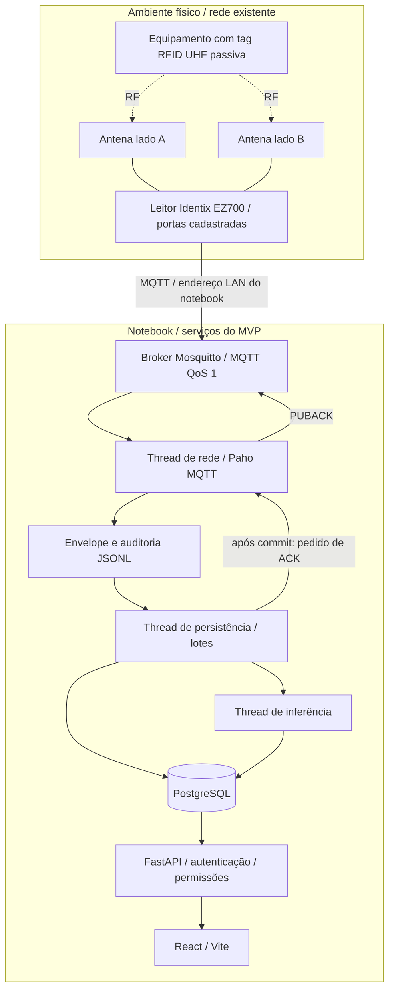
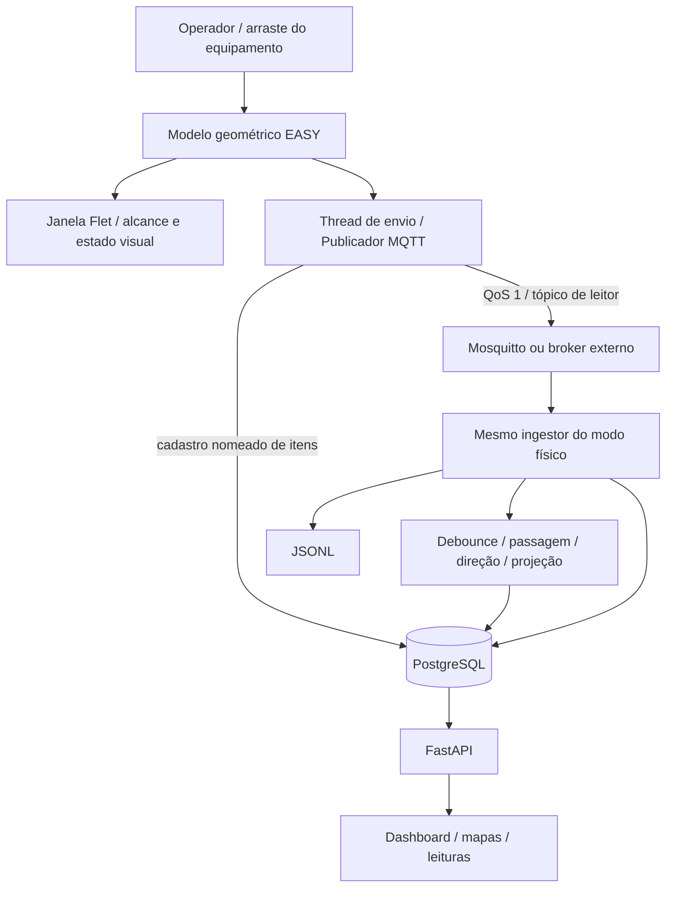
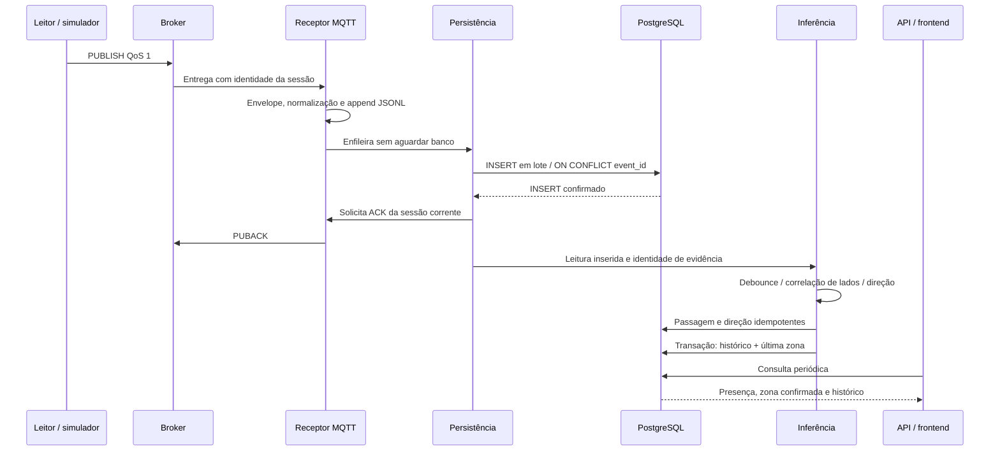

# Arquitetura do Rastreamento RFID HUPAA

Esta é a arquitetura da versão candidata do MVP. A execução prioriza um notebook
com serviços locais e permite substituir broker e banco por endpoints externos.
O software rastreia a última passagem confirmada por zonas; não calcula coordenadas.

## Arquitetura com leitores

Na variante externa, o broker e PostgreSQL estão fora do notebook, e ingestor,
API e interface continuam executados no ambiente configurado. O Compose `managed`
sobe somente migrations e ingestor. O computador usa a rede existente; não cria
hotspot. Leitores diferentes podem contribuir com antenas para o mesmo portal.

O leitor lógico vem do tópico `easy/<ambiente>/<site>/<portal>/<reader_id>/readings`.
O campo portal do tópico não substitui o cadastro temporal da topologia. A porta
física da mensagem resolve uma antena ativa do leitor; a topologia determina seu
significado em lado A/B, zona e função. O serial de fábrica é uma identidade distinta.

O payload observado está documentado no [tratamento do EZ700](../implementations/hotfix-ez700-contador-timestamp.md).
Números no timestamp do EZ700 são tratados como contador, sem unidade presumida:
o evento canônico usa a recepção UTC e mantém o valor original. O RSSI original
é preservado com unidade desconhecida; não é convertido arbitrariamente para dBm.

## Arquitetura com simulador

O modelo usa coordenadas normalizadas 0–100, duas salas, portal e antenas em
(28, 66) e (72, 66). Gera 1–12 itens com EPC aleatório de 96 bits e nomes dados
pelo operador. O alcance circular tem raio ilustrativo 16, ajustado à proporção
da planta. No alcance, cada item produz leitura a cada 0,2 s. O RSSI varia de
-5700 a -6700 como valor sintético, sem unidade física validada.

O simulador visual publica o formato compacto observado pelo adapter EZ700:
`epc`, `rssi`, `antenna`, `timestamp`. O timestamp é um contador sintético de
sete dígitos; o `reader_id` vem do tópico. Existe também o publicador de CLI
`rfid_ingestion.simulator`, útil para testes de contrato dos adapters.

A publicação tem acompanhamento de PUBACK e falha se houver desconexão ou
confirmação pendente além do prazo. A janela não espera o banco ou a rede na
thread visual. O cadastro e o pipeline são reais; a interação RF é simulada.

## Fluxo de processamento

O ingestor separa rede, persistência e inferência em threads. Lotes têm até 200
mensagens e o polling de processamento usa 0,2 s. O repositório de lotes mantém
uma conexão dedicada em autocommit: um único INSERT é a unidade atômica. O cache
de resolução de antenas tem TTL de 30 s. Mudanças de topologia podem levar esse
tempo para aparecer no caminho de ingestão.

Eventos inválidos ou sem hardware resolvido recebem rejeição explícita e
diagnóstico; não viram localização. A auditoria JSONL guarda o envelope recebido.
O arquivo usa flush, sem fsync por evento. Não é uma fila de replay automático.

### Identidade e tempo

O `event_id` SHA-256 inclui tópico, adapter, discriminador temporal e bytes
originais. Reentrega idêntica é deduplicada; isso não é garantia universal de
identidade física. Reinício do contador do leitor pode repetir bytes antigos.
Para contador EZ700, o horário de recepção inclui atrasos de rede/fila e depende
do relógio do notebook. O tempo do evento e o tempo monotônico de processamento
têm responsabilidades distintas.

O relógio da inferência não avança além da chegada mais antiga ainda pendente.
Assim, atraso do banco não se transforma em falso silêncio de uma tag que já
foi recebida. Debounce mantém estado por `(EPC, antena)`; passagem, por `(EPC, portal)`.

### Inferência e projeção

1. O debounce consolida eventos próximos, tolera reordenação e mantém referências
   à primeira e à última leitura. As leituras brutas continuam no banco.
2. O detector correlaciona lados opostos do mesmo portal, verifica atividade na
   origem e conserva propostas até persistência. Uma âncora no destino permite
   reconhecer retorno após o período refratário.
3. A direção usa evidências e topologia vigentes no tempo do evento. O resultado
   pode ser `confirmed`, `ambiguous` ou `unknown`.
4. Uma direção confirmada resolve o vínculo temporal EPC/equipamento e acrescenta
   histórico. Sob lock de equipamento, atualiza a projeção na mesma transação.
   Eventos atrasados não substituem uma zona mais nova; empates conflitantes são
   sinalizados. Recuperadores periódicos retomam direção/projeção pendentes.

| Parâmetro inicial | Padrão | Significado |
|---|---|---|
| `RFID_DEBOUNCE_WINDOW_MS` | 250 ms | Intervalo de consolidação |
| `RFID_OUT_OF_ORDER_TOLERANCE_MS` | 1000 ms | Tolerância à reordenação |
| `RFID_PASSAGE_MAX_INTERVAL_MS` | 3000 ms | Intervalo máximo entre lados |
| `RFID_PASSAGE_REFRACTORY_MS` | 1000 ms | Supressão logo após travessia |
| `RFID_PASSAGE_OVERLAP_GRACE_MS` | 300 ms | Tolerância à sobreposição |
| `RFID_PASSAGE_ORIGIN_HOLD_MS` | 1000 ms | Janela de atividade da origem |
| `RFID_DIRECTION_AMBIGUITY_MS` | 100 ms | Proximidade temporal ambígua |

São parâmetros de partida, sujeitos à calibração física no HUPAA. O estado em
memória de debounce/passagem não tem replay completo automático após reinício;
persistir leituras não garante recuperar toda inferência interrompida antes de
gravar a passagem. Sessões MQTT persistentes, QoS e armazenamento do broker
precisam estar configurados para recuperar mensagens ainda não confirmadas.
As filas internas não são duráveis nem possuem limite explícito de tamanho;
carga sustentada superior à capacidade do banco pode aumentar o uso de memória.

## API e interface

Routers validam contratos/permissões, services aplicam regras de domínio e
transações; SQLAlchemy e constraints PostgreSQL protegem unicidade e referências.
Sessões opacas usam cookie HttpOnly/SameSite=Strict; o banco guarda hash do token.
Senhas usam Argon2id. A trilha de auditoria acompanha alterações de cadastro,
vínculos, correções e usuários sem registrar senhas ou tokens.

Dashboard, mapas, detalhe e histórico consultam periodicamente o backend (2 s);
leituras do laboratório usam 1 s. Presença “Lida agora” usa janela de 30 s;
recência da zona é um critério separado. `disponivel` é exibido como “Em trânsito”
por convenção de interface, sem medir velocidade ou comprovar deslocamento contínuo.
As tabelas usam [grupos e ordem estável](../implementations/ordenacao-estavel-tabelas.md).

## Organização e documentação complementar

O [guia de mapeamento no HUPAA](../operations/implantacao-hupaa.md) relaciona
zonas da planta, leitores/portas, topologia temporal de portais e vínculo das
tags com equipamentos. As posições físicas e a cobertura permanecem dependentes
do levantamento e dos ensaios no setor escolhido.

- [Operação e perfis](../operations/execution.md)
- [Guia de módulos e contratos transacionais](../reference/code-guide.md)
- [Modelo de dados](data-model.md) e [diagrama ER](er-diagrama.mermaid)
- [Decisões arquiteturais](../decisions/README.md)

## Disponibilidade dos leitores e portais

O monitor observa leituras válidas e, quando habilitado, heartbeat independente
no tópico `heartbeat`. Persiste contato sem gerar passagem e reavalia silêncio
periodicamente. A API usa o relógio da consulta para classificar online,
degradado, offline e nunca conectado; portais agregam leitores ativos e lados
A/B vigentes. A disponibilidade observada não mede alcance RF.
[Contrato, limites, segurança e agregação](../implementations/iss-024-status-leitores.md).
