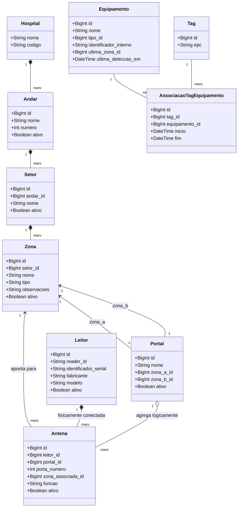

# Visão Geral da Arquitetura — RFID Hospital MVP

Este documento apresenta a arquitetura técnica de alto nível do **RFID Hospital MVP**, detalhando o fluxo de captura e persistência de leituras RFID, a modelagem de domínio hospitalar e de hardware, e as fronteiras entre o que está implementado e as inferências futuras.

---

## 1. Princípios Arquiteturais

1. **Local-First e Desacoplado:** A captura de dados na borda opera com autonomia. O ingestor processa mensagens MQTT localmente ou via nuvem sem depender de sistemas externos para continuar coletando.
2. **Entrega At-Least-Once com Idempotência Estrita:** A camada de mensageria opera com QoS 1. O sistema garante que reentregas de rede nunca produzam leituras duplicadas no banco relacional.
3. **Determinismo Canônico:** O identificador do evento (`event_id`) é uma função hash SHA-256 dos dados e do contexto da leitura, sem depender de relógios de recepção ou UUIDs aleatórios.
4. **Auditoria Forense Append-Only:** Toda mensagem recebida é imediatamente persistida em arquivo JSONL antes de qualquer transação de banco de dados.
5. **Separação entre Captura e Negócio:** Leituras brutas são preservadas integralmente, mesmo que pertençam a tags ainda não cadastradas ou a equipamentos desconhecidos.

---

## 2. Fluxo de Ingestão de Leitura RFID

O diagrama abaixo ilustra o caminho percorrido por uma leitura RFID desde a emissão pela tag física até a persistência no banco de dados e as etapas futuras de inferência:

```mermaid
flowchart TD
    subgraph Borda["Camada de Borda"]
        TAG["Tag RFID UHF (EPC)"]
        LEITOR["Leitor RFID / Simulador"]
        TAG -.->|Radiofrequência| LEITOR
    end

    subgraph Mensageria["Camada de Mensageria"]
        BROKER["Broker MQTT (HiveMQ Cloud / Mosquitto Local)<br/>Tópico: easy/.../portal-01/reader-01/readings"]
    end

    subgraph Ingestao["Serviço de Ingestão (Python / Paho)"]
        RECEPTOR["Receptor MQTT (clean_session=false, QoS 1)"]
        JSONL["Auditoria JSONL Append-only<br/>(data/raw_events.jsonl)"]
        PARSER["Parser & Validador UTF-8 / JSON"]
        CANONICAL["Normalizador Canônico<br/>Gera event_id sha256:..."]
    end

    subgraph Persistencia["Armazenamento Relacional (PostgreSQL)"]
        REPO["Repositório RawReadingRepository"]
        RESOLV["Resolução Topológica:<br/>(reader_id, porta) ➔ Antena Ativa"]
        INSERT["INSERT INTO leituras_brutas<br/>ON CONFLICT (event_id) DO NOTHING"]
    end

    subgraph Futuro["Processamento Futuro (ISS-013+)"]
        DEBOUNCE["Debounce Temporal (ISS-014)"]
        INFERENCE["Inferência de Passagem e Direção (ISS-015)"]
        UPDATE_LOC["Atualização de Zona do Ativo (ISS-016)"]
    end

    LEITOR -->|Publica Payload JSON| BROKER
    BROKER -->|Entrega Mensagem| RECEPTOR
    RECEPTOR --> JSONL
    RECEPTOR --> PARSER
    PARSER --> CANONICAL
    CANONICAL --> REPO
    REPO --> RESOLV
    RESOLV --> INSERT
    INSERT -->|Commit OK| REPO
    REPO -->|Transação Concluída| RECEPTOR
    RECEPTOR -->|ACK Manual (PUBACK)| BROKER

    INSERT -.->|Leituras Persistidas| DEBOUNCE
    DEBOUNCE -.-> INFERENCE
    INFERENCE -.-> UPDATE_LOC

    classDef future fill:#f9f,stroke:#333,stroke-dasharray: 5 5;
    class DEBOUNCE,INFERENCE,UPDATE_LOC future;
```

---

## 3. Topologia de Domínio e Hardware

A modelagem de entidades reflete com fidelidade a realidade física do ambiente hospitalar (HUPAA/UFAL) e o arranjo dos equipamentos de leitura:



### Regras Estruturais e Invariantes:

1. **Antenas pertencem estritamente a Leitores (`antenas.leitor_id`):**
   - Uma antena física é cabeada em uma porta específica de um leitor. Esse vínculo é físico e imutável.
2. **Antenas associam-se opcionalmente a Portais (`antenas.portal_id`):**
   - Uma antena pode monitorar uma passagem vinculada a um portal, ou pode operar de forma avulsa (ex.: antena de teto ou ponto de inventário pontual).
   - O campo `portal_id` é `NULLABLE` e editável.
3. **Portais agregam antenas de leitores distintos:**
   - Não existe relação direta `leitores.portal_id` (removida na ISS-012). Um portal físico entre duas zonas pode possuir uma antena conectada ao Leitor A (ex.: apontada para a Zona A) e outra antena conectada ao Leitor B (apontada para a Zona B).
4. **Identidade Lógica do Leitor (`reader_id` vs `identificador_serial`):**
   - `reader_id` é o identificador lógico atribuído na configuração de rede/MQTT e utilizado no segmento do tópico (`easy/.../<reader_id>/readings`).
   - `identificador_serial` é o número de série gravado de fábrica pelo fabricante. Ambos são `NOT NULL` e `UNIQUE`, mas completamente desacoplados.
5. **Vínculo Temporal de Tags a Equipamentos (`[inicio, fim)`):**
   - Equipamentos não possuem coluna `epc` fixa. O vínculo é registrado na tabela `associacoes_tag_equipamento`.
   - Um índice único parcial (`uq_tag_ativa`) assegura no banco de dados que uma tag só pode estar associada a no máximo um equipamento ativo (`WHERE fim IS NULL`).
6. **Leituras Brutas Desacopladas de Cadastro:**
   - A tabela `leituras_brutas` registra o `epc` em formato string sem chave estrangeira direta para a tabela `tags`.
   - Isso garante que tags novas ou desconhecidas detectadas por um leitor **nunca sejam descartadas**, preservando a telemetria bruta para posterior conciliação.
7. **Resolução de Antena Ativa e Reconfiguração de Hardware:**
   - O índice único parcial `uq_antena_ativa_por_porta_leitor` restringe a no máximo uma antena com `ativo = true` por porta física do leitor.
   - Antenas inativas históricas são preservadas para integridade referencial de leituras passadas. A ingestão sempre filtra por `Antena.ativo = true`.

---

## 4. Demarcação de Recursos Futuros (Não Implementados no MVP Atual)

Para fins de avaliação e clareza do escopo do MVP, os seguintes módulos estão **explicitamente delimitados como etapas futuras**:

| Recurso | Status Atual | Issue Prevista | Descrição |
|---|---|---|---|
| **Consistência Portal-Antena** | Pendente | **ISS-013** | Validação a nível de aplicação de que a `zona_associada_id` da antena coincide com a `zona_a_id` ou `zona_b_id` do portal ao qual foi associada. |
| **Debounce Temporal** | Pendente | **ISS-014** | Agrupamento de leituras consecutivas do mesmo EPC na mesma antena dentro de uma janela de tempo para supressão de ruído de rádio. |
| **Motor de Inferência de Passagem** | Pendente | **ISS-015** | Criação de registros na tabela `passagens` a partir da correlação de leituras entre antenas de entrada/saída de um portal. |
| **Inferência de Direção** | Pendente | **ISS-015** | Determinação do vetor de movimento (`entrada` ou `saida`) comparando timestamps de detecção em antenas distintas de um portal. |
| **Localização Dinâmica de Ativos** | Pendente | **ISS-016** | Atualização automática dos campos `ultima_zona_id`, `ultima_deteccao_em` e `ultima_passagem_id` em `equipamentos`. |
| **Histórico de Movimentações** | Pendente | **ISS-016** | Preenchimento automático de `historico_movimentacoes` a partir de passagens confirmadas. |

---

## 5. Referências e Detalhamento

- [Modelo de Dados Detalhado (Dicionário de Entidades)](data-model.md)
- [Diagrama Entidade-Relacionamento Mermaid](er-diagrama.mermaid)
- [Persistência de Leituras Brutas e Idempotência (ISS-006)](../implementations/iss-006-raw-readings-persistence.md)
- [Resiliência e Recuperação do Ingestor (ISS-007)](../implementations/iss-007-ingestor-resilience.md)
- [Topologia de Hardware (ISS-012)](../implementations/iss-012-topologia-hardware.md)
