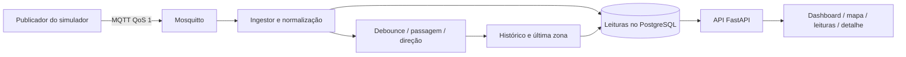
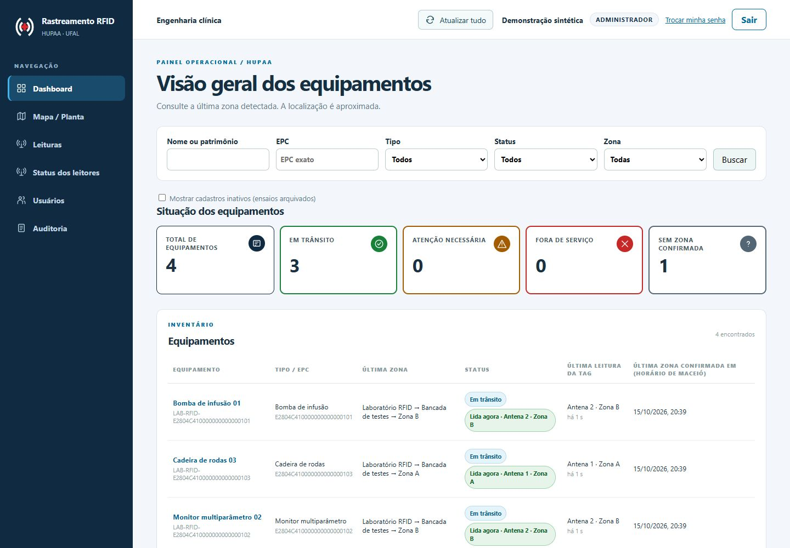
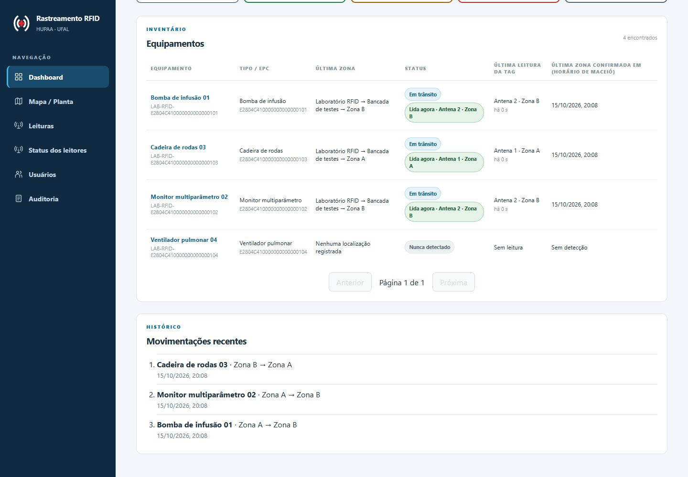
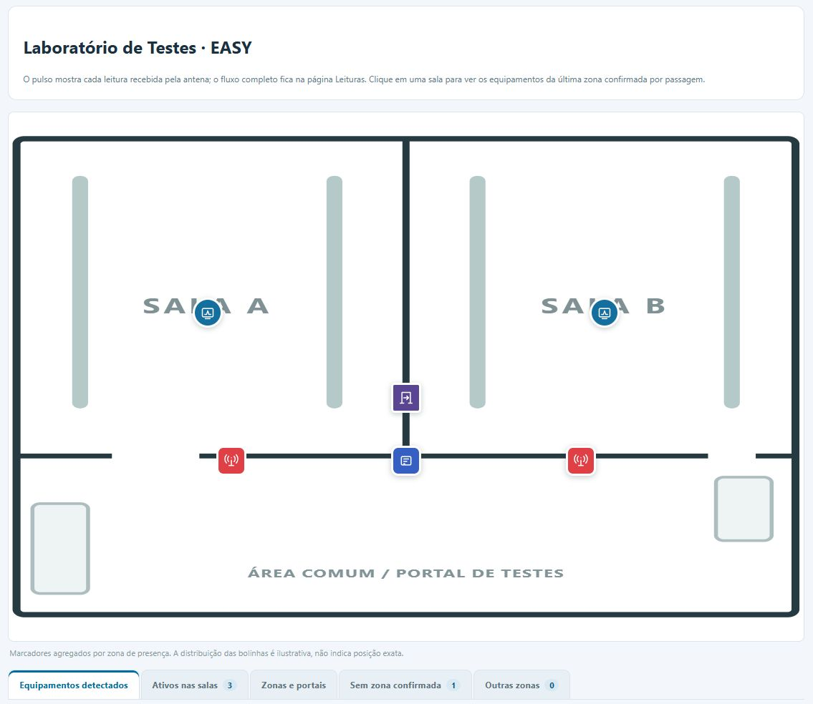
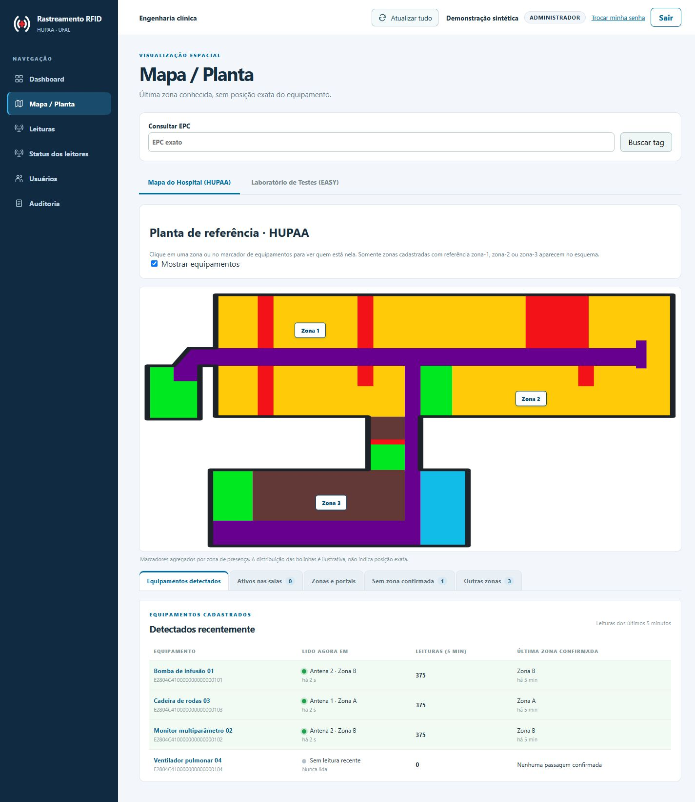
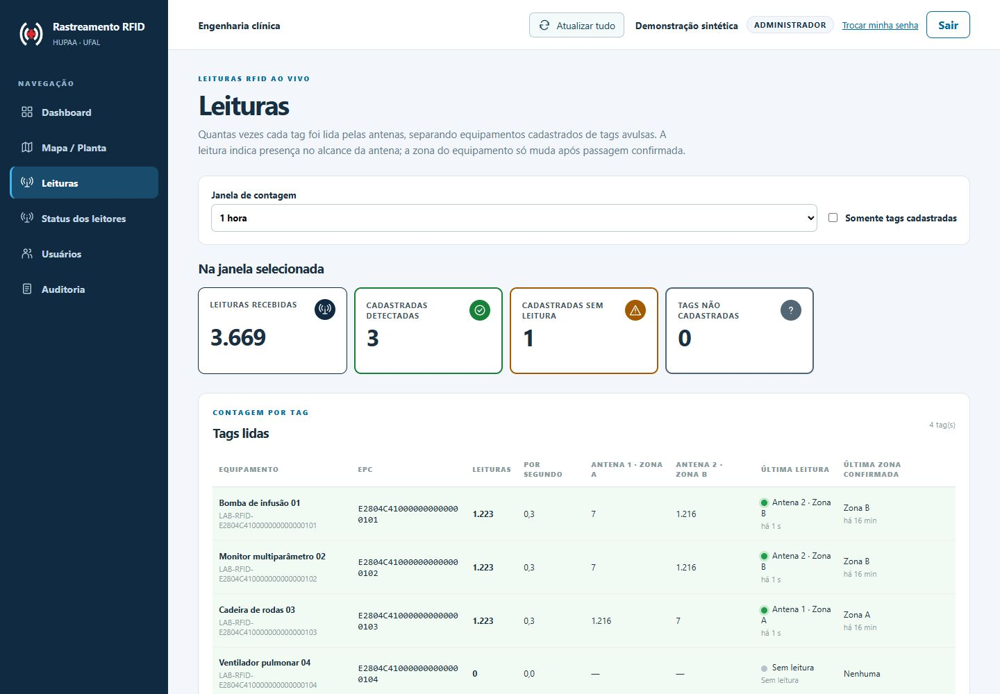
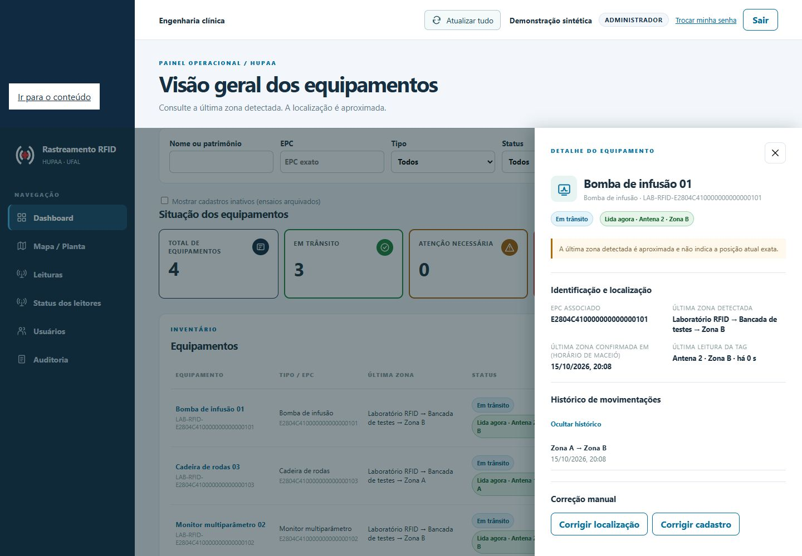
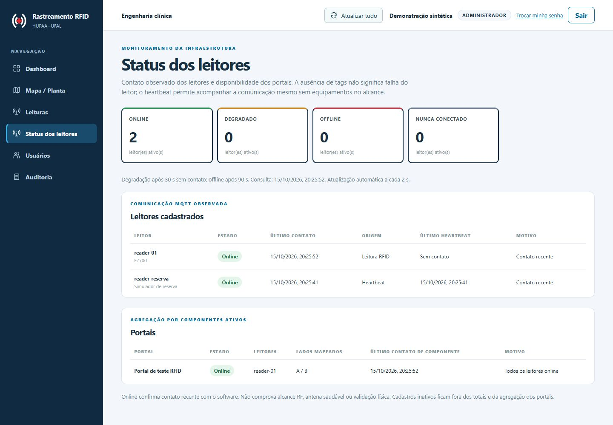

# Galeria — pipeline RFID com dados sintéticos

Capturas da aplicação em 15/10/2026, com viewport desktop de 1440 × 1000.
Foram capturados o topo, o inventário/rodapé e o esquema da planta. Nomes, EPCs e usuário são
fictícios; banco e broker pertencem a um projeto Docker Compose descartável.

## Caminho exercitado

Foi usado `tools.lab_launcher.synthetic.Publicador`, o mesmo publicador da janela
Flet, com payload do adapter EZ700. A janela Flet e o leitor físico não foram
abertos neste ensaio. As mensagens passaram pelo ingestor real; as telas consultam
a API e o PostgreSQL reais, sem respostas HTTP simuladas ou valores inseridos no HTML.

O cadastro recebeu quatro equipamentos e EPCs sintéticos. Para três deles foram
publicadas sete leituras por antena, a cada 0,2 s, com pausa de 0,4 s entre os
lados. Depois, novas leituras nas antenas de destino mantiveram a presença visível.
O quarto equipamento não recebeu leitura.

| Equipamento fictício | Sequência | Resultado confirmado |
|---|---|---|
| Bomba de infusão 01 | Antena A → Antena B | Direção A→B, histórico e última Zona B |
| Monitor multiparâmetro 02 | Antena A → Antena B | Direção A→B, histórico e última Zona B |
| Cadeira de rodas 03 | Antena B → Antena A | Direção B→A, histórico e última Zona A |
| Ventilador pulmonar 04 | Sem leituras | Sem passagem e sem zona confirmada |

Uma consulta SQL confirmou **três passagens com direção confirmada e três
movimentações**. O [registro sanitizado do ensaio](ingestion/galeria-pipeline-2026-10-15.json)
guarda os resultados. As leituras continuaram entre as capturas, por isso os
contadores e os horários relativos mudam entre as imagens.

## Dashboard

O inventário relaciona equipamentos, tags, última zona e presença recente. O
histórico global registra as três travessias. A ordenação permanece por grupo
operacional e nome, sem trocar posições conforme aumenta a contagem de leituras.

## Planta EASY

A planta apresenta um equipamento na Zona A e dois na Zona B. Na aplicação, a tabela de detectados
mostra a antena da leitura atual separada da última zona confirmada. Os marcadores
são agregados e ilustrativos; não representam coordenadas físicas dos ativos.

## Planta de referência do HUPAA

Uma captura complementar mostra a planta esquemática do segundo pavimento,
com as referências `zona-1`, `zona-2` e `zona-3` ligadas a três zonas provisórias
em uma base sintética isolada. Nenhum equipamento do ensaio EASY foi movido
artificialmente para o hospital. A planta não representa hardware instalado.

O [registro sanitizado desta captura](ingestion/mapa-hupaa-2026-10-15.json)
identifica o cenário. O [guia de implantação do piloto](../operations/implantacao-hupaa.md)
explica como cadastrar leitores e portas, associar antenas aos lados dos portais,
vincular EPCs aos equipamentos e relacionar a topologia com a planta.

## Leituras por antena

A janela de uma hora mostra as leituras de ambos os lados das travessias,
os EPCs cadastrados e a ausência de leituras do quarto equipamento. A contagem é
calculada a partir das leituras persistidas e não mede desempenho RF do hardware.

## Detalhe e histórico

O detalhe da bomba apresenta EPC, Zona B, antena da leitura recente e movimento
Zona A → Zona B. Nenhuma correção manual de localização foi usada para produzir
esse resultado: a movimentação nasceu da passagem inferida.

## Status dos leitores

O primeiro registro do ensaio distingue `reader-01` online por leituras de
`reader-reserva` nunca conectado. Depois, um heartbeat MQTT válido do contrato
do software colocou o leitor de reserva online **sem nenhuma leitura de tag**.
A captura mostra a origem de contato de cada um e o portal com os lados A/B.
O JSON do ensaio guarda o estado inicial e o resultado do heartbeat separado.

Os testes com relógio controlado cobrem interrupção, timeout, retorno e falha
parcial de portal com dois leitores. [Contrato e regras de monitoramento](../implementations/iss-024-status-leitores.md).

## Reproduzir uma demonstração semelhante

1. Siga o [README](../../README.md#configurar-os-arquivos-de-ambiente) para instalar
   dependências e configurar o perfil local.
2. Execute `python scripts/dev.py --teste 1` e crie o administrador após migrations.
3. Na janela Flet, cadastre quatro itens com os nomes desejados.
4. Arraste três itens entre as antenas A/B dentro da janela de passagem; deixe
   o quarto fora do alcance. Mantenha os itens nas antenas de destino para
   observar “Lida agora” e a estabilidade da ordenação.
5. Compare dashboard, mapa EASY, página de leituras e histórico do equipamento.

As contagens variam conforme o tempo de permanência. O alcance e RSSI do simulador
são ilustrativos. O ensaio comprova o fluxo lógico observado; a calibração de
antenas e a operação na rede hospitalar exigem validação física própria.
