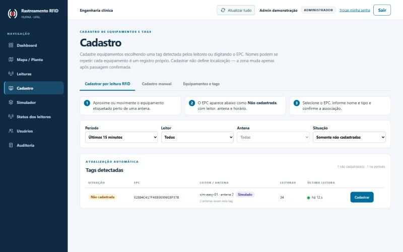
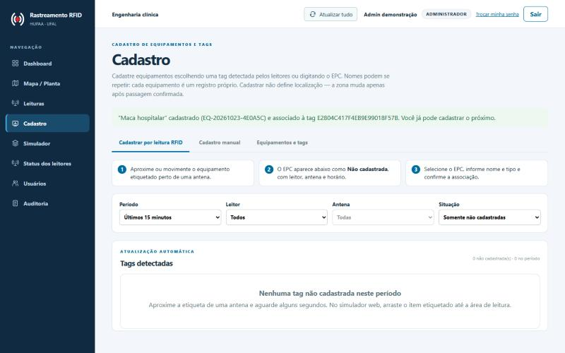

# Cadastro de equipamentos e tags pelo dashboard

## O problema

Nos ensaios, o cadastro inicial era feito no terminal: ao iniciar o launcher o
operador digitava EPC e nome de cada equipamento. Funcionou para o
laboratório, mas não serve ao hospital, onde a engenharia clínica cadastra
dezenas de macas e cadeiras sem acesso ao terminal e sem conhecer EPCs.

## Importância para o MVP

Sem cadastro, uma tag lida é só um EPC: a leitura é gravada, a passagem pode
até ser detectada, mas nenhum equipamento muda de zona. O cadastro é o elo
entre a etiqueta física e o ativo rastreado — e precisa ser simples, seguro
contra associações erradas e auditado.

## O que foi feito

**Backend (`api/service_cadastro.py`, `api/router_cadastro.py`)**

- `GET /api/cadastro/epcs-detectados`: consolida `leituras_brutas` por EPC,
  com leitor, porta, zona da antena, origem física/simulada (serial `SIM-`),
  primeira e última leitura, contagem por antena e indicador de leitura
  recente. Filtros por leitor, antena, período e situação (desconhecida /
  cadastrada). Inclui o estado de cada leitor (online, degradado, offline,
  nunca conectado) para avisar quando um leitor está indisponível.
- `POST /api/cadastro/equipamentos`: cria o equipamento e, se houver EPC,
  o vínculo **na mesma transação**; EPC já vinculado → 409 sem deixar
  equipamento órfão. Associar exige `confirmar_associacao=true`. Patrimônio
  opcional: se vazio, gera `EQ-AAAAMMDD-XXXXXX`.
- `GET /api/cadastro/equipamentos`: situação de etiquetagem (sem tag / com tag)
  e busca por nome, patrimônio ou EPC.
- `GET /api/cadastro/epcs/{epc}`: disponibilidade de um EPC.
- Associação posterior reutiliza `POST /equipamentos/{id}/tag` (ISS-010).

Investigação do ingestor: leituras de EPC desconhecido **já** eram
persistidas (sem FK para `tags`), desde que o leitor/porta existam. A
projeção de localização resolve o equipamento pelo vínculo vigente no
instante da leitura, então passagens anteriores ao cadastro nunca movem o
equipamento. Por isso a descoberta não exigiu mudança na ingestão nem na
inferência: é uma consulta sobre o que já é gravado. Leituras de leitores
não cadastrados continuam rejeitadas (`unknown_reader`) e não aparecem.

**Regras preservadas e novas**

- Nomes repetidos são permitidos (três "Maca hospitalar" são três
  registros); o patrimônio continua único; um EPC tem no máximo um vínculo
  ativo (índices parciais `uq_tag_ativa`/`uq_equipamento_tag_ativa`).
- Três situações distintas: equipamento sem tag; tag detectada sem cadastro;
  equipamento com tag. Equipamento sem EPC não gera leitura nem passagem.
- Permissões no backend: consulta com `equipamentos:consultar`; cadastro e
  associação com `equipamentos:alterar` (administrador). Auditoria
  `criar` + `vincular_epc` pelo registro central.

**Frontend (`frontend/src/pages/RegistrationPage.tsx`)** — página
**Cadastro** com três abas:

1. *Cadastrar por leitura RFID*: lista viva (2 s) das tags detectadas, filtros,
   aviso de leitores sem contato, seleção do EPC, formulário (nome, tipo,
   patrimônio, descrição), confirmação explícita e cadastro consecutivo.
2. *Cadastro manual*: EPC validado no cliente com a mesma regra da API e
   consulta de disponibilidade; EPC vazio cadastra sem tag.
3. *Equipamentos e tags*: equipamentos sem tag com ação "Associar tag"
   (digitar ou escolher entre as não cadastradas detectadas) e, só para
   administrador, **Fora de serviço / Reativar**. Fora de serviço é a baixa
   lógica já existente (`POST /equipamentos/{id}/inativar` e `/reativar`,
   permissão `equipamentos:alterar`): pede confirmação, nada é apagado, a tag
   continua vinculada, o equipamento sai do dashboard e da busca (aparece só
   com "Mostrar cadastros inativos") e a mudança entra na auditoria com o
   usuário. O filtro "Serviço" (em serviço, fora de serviço, todos) usa o
   novo parâmetro `estado` de `GET /api/cadastro/equipamentos`. Não há
   distinção entre manutenção temporária e baixa definitiva.

Criação rápida de tipo de equipamento no próprio formulário.

## Validação

- `tests/test_cadastro.py`: manual, nomes repetidos, EPC duplicado sem
  equipamento órfão, confirmação obrigatória, patrimônio duplicado, sem tag e
  associação posterior, descoberta (consolidação, filtros, recência, origem),
  cadastro por EPC detectado com auditoria e sem localização, operacional
  consulta mas não cadastra (403), fora de serviço e reativação com filtro
  `estado` e auditoria, operacional não tira de serviço (403).
- `frontend/src/test/Cadastro.test.tsx`: fluxos das três abas e permissões.
- Ensaio manual no navegador (23/10/2026, ambiente local, dados sintéticos):
  tag virtual detectada pelo simulador web, cadastrada pela aba de leitura;
  a passagem anterior ao cadastro não moveu nada; a passagem seguinte (B→A)
  atualizou a última zona para Zona A.

