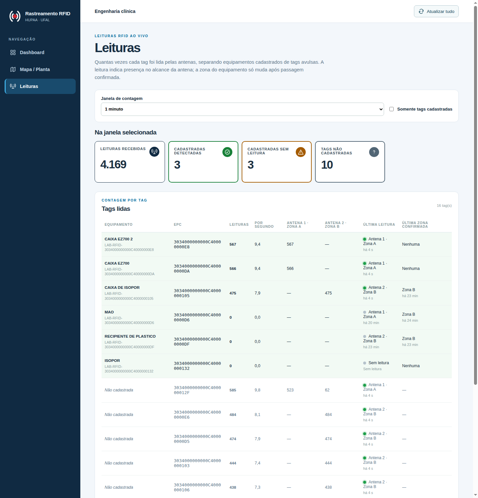
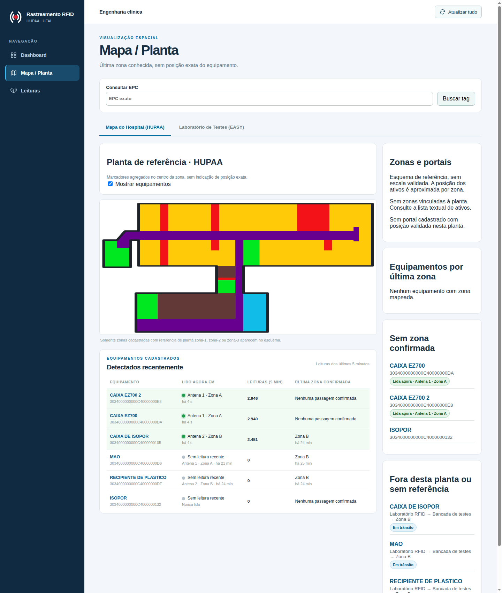
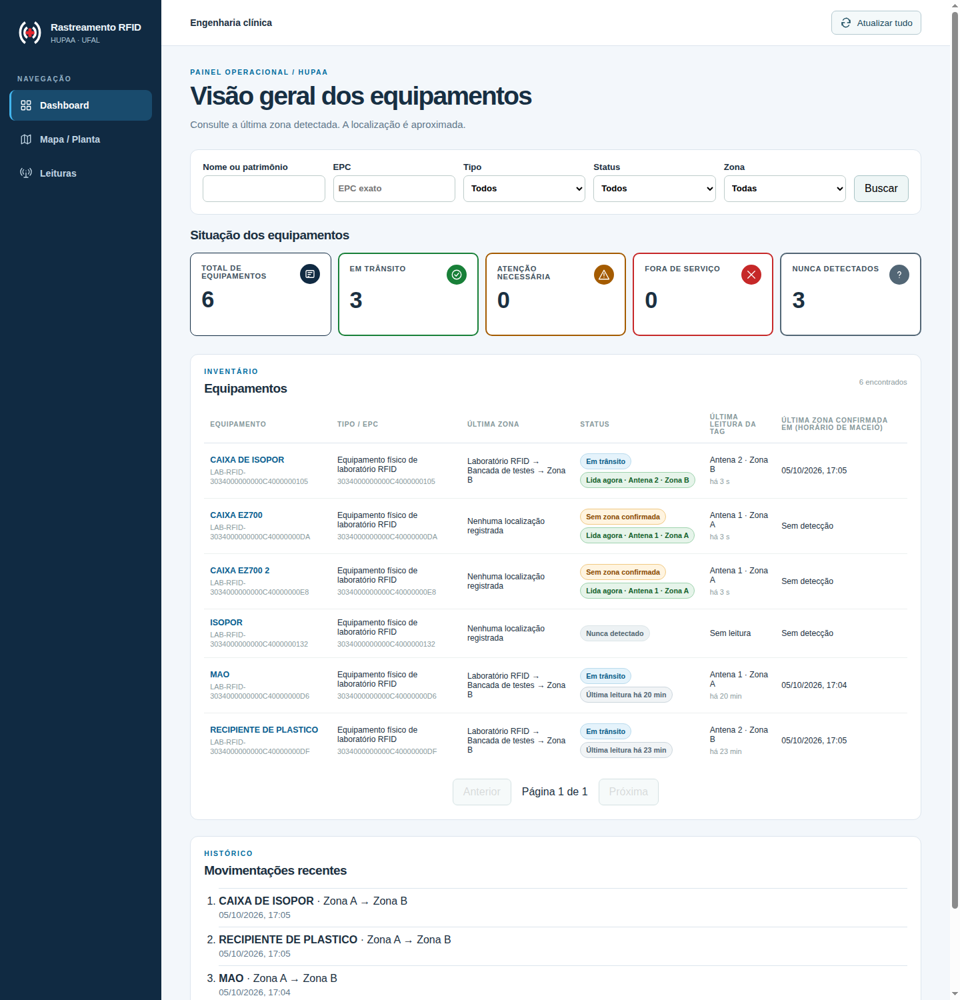

# Hotfix — página Leituras e presença por leitura bruta

## Problema e importância para o MVP

No ensaio físico de 05/10/2026, com o EZ700 publicando no Mosquitto local, a
equipe cadastrou as tags do laboratório (ex.: `3034000000000C40000000DA` como
**CAIXA EZ700**). As leituras chegavam ao frontend em tempo real pelo painel
"Leituras das antenas" do mapa EASY, mas o restante da interface parecia não
atualizar:

- **CAIXA EZ700**, parada na antena 1 e lida cerca de 10 vezes por segundo,
  aparecia como **Nunca detectado** e sem zona;
- **CAIXA DE ISOPOR**, parada na antena 2 e lida continuamente, mostrava como
  "última detecção" o horário da passagem confirmada (20 minutos antes).

A API respondia em menos de 0,2 s; a causa não era desempenho. Pelo modelo do
projeto (ISS-017), `ultima_zona` e `ultima_deteccao_em` só mudam com
**passagem confirmada** A → B ou B → A. Uma tag parada diante de uma antena não
atravessa o portal, então nunca ganha zona. No caso da CAIXA EZ700, a única
passagem registrada teve direção `ambiguous`. Faltava uma visão de **presença**:
quais tags cadastradas estão sendo lidas agora, por qual antena e quantas
vezes. Sem ela, não é possível distinguir no laboratório tags avulsas de
equipamentos reais.

## O que foi feito

A última zona continua sendo inferida somente por passagem confirmada. Antenas
do mesmo portal leem a mesma tag ao mesmo tempo (no ensaio, `…012F` foi lida
pelas duas), então usar a antena da última leitura como zona faria o
equipamento alternar de sala. A presença foi adicionada como uma camada
separada e rotulada como tal.

### API

- `GET /api/leituras/resumo?janela_segundos=60&somente_cadastradas=false`
  (janela de 5 s a 24 h): por EPC, o total de leituras na janela, as leituras
  por antena, a última leitura (leitor, porta, zona associada à antena) e o
  equipamento vinculado (nome e última zona confirmada). Tags cadastradas sem
  leitura na janela aparecem com zero e a última leitura histórica. Os
  indicadores informam leituras recebidas, cadastradas detectadas, cadastradas
  sem leitura e tags não cadastradas, com no máximo 200 tags não cadastradas
  listadas.
- `GET /api/ativos` passa a incluir `ultima_leitura` (`em`, `leitor`, `porta`,
  `zona`) da tag ativa. A consulta usa `LATERAL` com o índice
  `(epc, lido_em)`, uma busca por EPC da página.

### Frontend

- Novo item **Leituras** no menu, abaixo de Mapa / Planta (`#/leituras`):
  janela de contagem (30 s a 1 h), filtro "Somente tags cadastradas",
  indicadores e tabela por tag com leituras, leituras por segundo, contagem
  por antena, última leitura e última zona confirmada. As tags cadastradas
  aparecem primeiro e destacadas.
- Abaixo dos dois mapas (HUPAA e EASY): tabela **Detectados recentemente**
  com os equipamentos cadastrados, a antena e zona em que estão sendo lidos
  agora, as leituras dos últimos 5 minutos e a última zona confirmada. Clicar
  no equipamento abre o detalhe.
- Dashboard e detalhe: coluna/linha "Última leitura da tag" e selo "Lida
  agora · Antena N · Zona" (leitura nos últimos 30 s). Um equipamento sem
  passagem confirmada, mas com leituras, passa a mostrar **Sem zona
  confirmada** em vez de "Nunca detectado". O indicador e o filtro de mesmo
  nome refletem o que de fato contam: equipamentos sem zona confirmada.
- Todas as visões continuam com a atualização automática de 2 s da ISS-033.

## Validação

- Backend: `tests/test_resumo_leituras.py` (contagem por antena, cadastradas
  primeiro, tag cadastrada fora da janela, filtro, `ultima_leitura` sem
  alterar zona e validação HTTP), com o restante da suíte em PostgreSQL
  descartável.
- Frontend: testes da página Leituras (cadastradas × avulsas, colunas por
  antena, filtro) e da tabela abaixo dos mapas; `npm run build`.
- Leitor físico: com o EZ700 ligado, CAIXA EZ700 e CAIXA EZ700 2 apareceram
  como lidas agora na Antena 1 · Zona A, CAIXA DE ISOPOR na Antena 2 · Zona B,
  e as contagens subiram a cada atualização. A latência entre a leitura e a
  API ficou abaixo de 1 s. **RECIPIENTE DE PLASTICO** (`…0DF`) não foi lido
  desde 20:05 UTC e **ISOPOR** (`…132`) nunca foi lido; é preciso conferir a
  orientação da etiqueta ou a interferência do conteúdo, não o software.

## Capturas com o leitor físico (05/10/2026)

