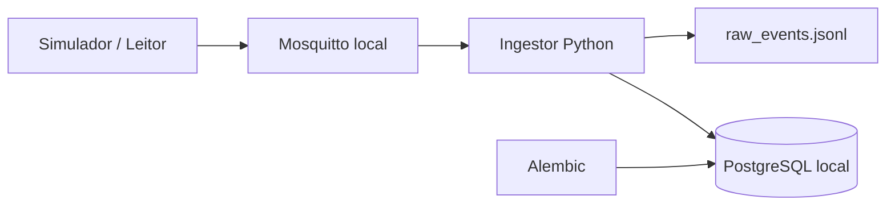
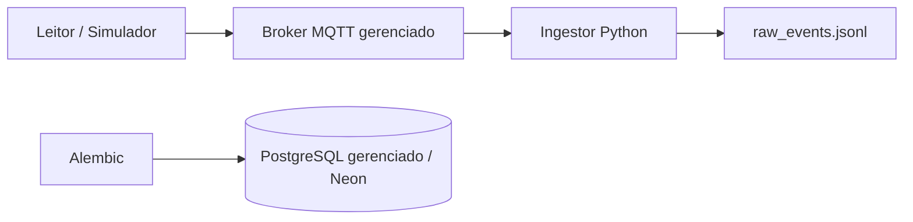

# ISS-003 — ambiente de desenvolvimento com Docker Compose

## 1. O que é a ISS-003

A ISS-003 padroniza a execução do MVP em desenvolvimento. Ela entrega uma imagem
para o ingestor Python atual e um arquivo `compose.yaml` com dois perfis explícitos:
`local`, totalmente offline, e `managed`, preparado para receber serviços externos.

Esta entrega não cria um backend web e não altera o destino funcional da ingestão:
os eventos MQTT continuam sendo preservados em JSONL.

## 2. Problema que ela resolve

Antes desta issue, o Compose iniciava apenas o Mosquitto. PostgreSQL, Alembic e o
ingestor dependiam de procedimentos separados, o que permitia diferenças entre os
ambientes da dupla e dificultava reconstruir o projeto a partir de um clone novo.

## 3. Objetivo

O objetivo é oferecer comandos repetíveis para:

- executar PostgreSQL, Mosquitto, migrations e ingestor sem Internet;
- trocar deliberadamente para PostgreSQL e MQTT gerenciados;
- aguardar infraestrutura saudável antes da aplicação;
- manter credenciais e dados gerados fora da imagem e do Git;
- apagar somente o estado Docker local, mediante confirmação explícita.

## 4. Relação com as issues próximas

| Issue | Relação com a ISS-003 |
|---|---|
| ISS-001 | Forneceu o contrato MQTT local/cloud que o Compose consome. |
| ISS-002b | Forneceu o contrato de PostgreSQL gerenciado, com `DATABASE_URL` direta para migrations e `APP_DATABASE_URL` pooled para a aplicação. |
| ISS-002c | Forneceu o fluxo Alembic final; a ISS-003 o consome sem duplicar configuração. |
| ISS-006 | Implementou persistência idempotente das leituras no PostgreSQL. |
| ISS-007 | Acrescentou recuperação automática e sessão persistente ao ambiente atual. |

## 5. O que foi implementado agora

- imagem Python não interativa, executada por usuário sem privilégios;
- PostgreSQL 16.15 local com volume persistente e `pg_isready`;
- Mosquitto local existente com healthcheck nativo;
- rede bridge explícita `rfid-dev`;
- migrations Alembic one-shot antes do ingestor;
- perfis Compose `local` e `managed` sem infraestrutura local desnecessária;
- exemplos de ambiente seguros, Make targets e reset protegido;
- testes estruturais e smoke test destrutivo em projeto Docker isolado.

## 6. O que permanece pendente

O perfil gerenciado foi revalidado estruturalmente após os merges da ISS-002b e
da ISS-002c, mas não foi conectado ao Neon porque não havia credenciais externas
disponíveis nesta execução. Essa pendência não impede o modo local e não autoriza
testes destrutivos no banco compartilhado.

## 7. Arquitetura do ambiente local



O ingestor e o simulador usam `mosquitto:1883` dentro da rede Docker. O host usa
`localhost` e a porta publicada. A migration usa `postgres:5432`; nunca usa
`localhost` dentro do contêiner.

Desde a ISS-006, o ingestor grava o evento canônico no PostgreSQL antes do ACK.
A ISS-007 adiciona recuperação automática quando broker ou banco ficam indisponíveis.

## 8. Arquitetura com serviços gerenciados



O perfil `managed` inicia somente `migrate-managed` e `ingestor-managed`. Ele não
cria PostgreSQL nem Mosquitto locais. `DATABASE_URL` vazia é recusada antes do
Alembic, sem imprimir seu conteúdo.

## 9. Serviços Docker

| Serviço | Perfil | Papel | Ciclo de vida |
|---|---|---|---|
| `postgres` | `local` | PostgreSQL de desenvolvimento | contínuo |
| `mosquitto` | `local` | broker MQTT anônimo em rede controlada | contínuo |
| `migrate-local` | `local` | executa `alembic upgrade head` no banco local | one-shot |
| `ingestor-local` | `local` | recebe MQTT local e grava JSONL | contínuo |
| `migrate-managed` | `managed` | aplica Alembic na `DATABASE_URL` externa | one-shot |
| `ingestor-managed` | `managed` | recebe MQTT gerenciado e grava JSONL | contínuo |

O `Dockerfile` existe somente para empacotar o ingestor e o Alembic atuais. Ele
fixa a base pequena `python:3.12.14-slim-bookworm`, usa os arquivos de dependências
do repositório e não inclui documentação, testes, `.env`, Git ou `data/` no
contexto final. PostgreSQL também fica fixado em `16.15-alpine`.

## 10. Volumes

`postgres_data` preserva o PostgreSQL local. `mosquitto_data` preserva sessões e
mensagens do Mosquitto entre reinicializações do contêiner. O
diretório `./data` é montado em `/app/data` nos ingestors; assim, o JSONL continua
visível no host e não entra na imagem. `data/*` já é ignorado, exceto `.gitkeep`.

O reset local remove `postgres_data`, mas não apaga JSONL: registros brutos podem
ser evidência experimental e exigem decisão explícita para remoção.

## 11. Rede interna

Todos os serviços do mesmo perfil usam a bridge `rfid-dev`. Os nomes `postgres` e
`mosquitto` são DNS internos do Compose. Portas publicadas existem para inspeção e
clientes no host; comunicação entre contêineres não passa por elas.

PostgreSQL é exposto em loopback por padrão. Mosquitto preserva `0.0.0.0` para o
fluxo anterior com leitores na LAN, mas pode ser restrito com
`MQTT_BIND_ADDRESS=127.0.0.1`. Acesso anônimo é apenas para desenvolvimento em
rede controlada e nunca representa uma configuração de produção.

## 12. Healthchecks e ordem

- PostgreSQL: `pg_isready` com usuário e banco locais;
- Mosquitto: `mosquitto_sub` consulta `$SYS/broker/version`;
- `migrate-local` depende de PostgreSQL saudável;
- `ingestor-local` depende de Mosquitto saudável e migration concluída com zero;
- `ingestor-managed` depende da migration gerenciada concluída com zero.

Não há `sleep` como mecanismo primário de prontidão.

## 13. Perfis e indicação do modo

O modo é sempre escolhido no comando:

```bash
docker compose --env-file .env.local --profile local config --services
docker compose --env-file .env.cloud --profile managed config --services
```

Os exemplos usam projetos distintos (`rfid-hospital-local` e
`rfid-hospital-managed`), reduzindo o risco de operar o ambiente errado.

## 14. Variáveis de ambiente

| Variável | Local | Managed | Observação |
|---|---|---|---|
| `COMPOSE_PROJECT_NAME` | `rfid-hospital-local` | `rfid-hospital-managed` | separa recursos Docker |
| `HOST_UID` / `HOST_GID` | UID/GID do usuário | UID/GID do usuário | mantém o contêiner sem privilégios e permite escrever no bind mount `data/` |
| `MQTT_MODE` | `local` | `cloud` | perfil managed força `cloud` |
| `MQTT_HOST` | `localhost` no host; `mosquitto` no contêiner | endpoint externo | sem esquema/credenciais |
| `MQTT_PORT` | `1883` | `8883` | cloud exige 8883 |
| `MQTT_TLS_ENABLED` | `false` | `true` | cloud exige TLS |
| `MQTT_USERNAME` / `MQTT_PASSWORD` | vazios | obrigatórios | nunca versionar valores reais |
| `MQTT_CA_CERT` | vazio | caminho interno opcional | vazio usa CAs do sistema |
| `MQTT_CLIENT_ID` | identificador local | obrigatório e único | não é senha |
| `MQTT_TOPIC` | filtro `easy/dev/...` | filtro permitido pela ACL | QoS 1 |
| `DATABASE_URL` | URL para comandos no host | URL externa completa | Alembic a consome diretamente |
| `APP_DATABASE_URL` | mesma instância local | URL pooled externa | reservada para a aplicação; não usada pelo ingestor atual |
| `POSTGRES_DB` / `USER` / `PASSWORD` | defaults somente dev | não usados | senha local não é produção |
| `POSTGRES_BIND_ADDRESS` / `PORT` | `127.0.0.1:5432` | não usados | acesso de ferramentas do host |
| `MQTT_BIND_ADDRESS` / `MQTT_LOCAL_PORT` | publicação do broker | não usados | restringir a loopback quando possível |
| `EVENTS_FILE` | `data/raw_events.jsonl` | igual | bind mount, ignorado pelo Git |

Senhas com caracteres reservados devem estar percent-encoded na URL. O Alembic
continua usando `db/url.py`: a URL não passa pelo `ConfigParser`, evitando o
vazamento conhecido de senhas percent-encoded em exceções.

## 15. Subir o ambiente local do zero

Pré-requisitos no Ubuntu 24.04: Docker Engine com Compose v2, GNU Make e permissão
para usar Docker.

Os exemplos usam UID/GID `1000:1000`. Em hosts com valores diferentes, ajuste
`HOST_UID=$(id -u)` e `HOST_GID=$(id -g)` no arquivo privado antes de iniciar.

```bash
cp .env.local.example .env.local
make local-up
make status-local
```

Sem Make:

```bash
docker compose --env-file .env.local --profile local up -d --build --wait
docker compose --env-file .env.local --profile local ps -a
```

O estado esperado é Postgres e Mosquitto saudáveis, `migrate-local` com saída 0 e
`ingestor-local` em execução.

## 16. Parar

```bash
make stop-local
make stop-managed
```

`down` sem `--volumes` preserva o banco local. Use o comando correspondente ao
perfil ativo.

## 17. Visualizar logs e estado

```bash
make status-local
make logs-local
# ou, no modo externo:
make status-managed
make logs-managed
```

Não use `set -x` com o perfil gerenciado, pois o ambiente contém credenciais.

## 18. Executar e verificar migrations

```bash
make migrate-local
make migration-current-local
```

No perfil gerenciado, somente com um banco de desenvolvimento autorizado:

```bash
make migrate-managed
make migration-current-managed
```

Esses comandos consomem diretamente o Alembic e o `db/url.py` finalizados pela
ISS-002c, inclusive URLs com percent-encoding; não existe configuração paralela
de migrations no Compose. Nunca execute downgrade no Neon compartilhado.

## 19. Executar o simulador

Com o perfil local ativo:

```bash
make simulator-local
```

O target usa um Client ID próprio e publica três mensagens no tópico
`easy/dev/hupaa/portal-01/reader-01/readings`. Também é possível executar o
simulador no host conforme `docs/mqtt-ingestion.md`.

## 20. Validar o pipeline atual

```bash
make tests
make smoke
tail -n 3 data/raw_events.jsonl
```

O smoke cria um projeto isolado, usa portas 18884/15432, confirma os dois
healthchecks, aplica Alembic, inspeciona uma tabela, publica um evento, valida o
JSONL, executa o reset local e confirma que o schema nasce novamente.

O que ele prova:

```text
PostgreSQL vazio -> Alembic -> schema atual
Mosquitto -> simulador -> ingestor -> JSONL
```

Ele prova MQTT -> JSONL/PostgreSQL. `make smoke-resilience` interrompe e restaura
broker e banco descartáveis para validar reconexão, redelivery e idempotência.

## 21. Reset local seguro

Este comando é destrutivo para PostgreSQL e estado de sessão Mosquitto **locais**:

```bash
CONFIRM_RESET_LOCAL=APAGAR make reset-local
```

O script aceita somente o projeto `rfid-hospital-local` (e nomes efêmeros do
smoke), chama `down --volumes` e não executa SQL, downgrade ou conexão por
`DATABASE_URL`. Portanto, ele não consegue apagar dados no Neon. JSONLs não são
apagados automaticamente.

## 22. Fora do escopo

- criar backend, API, dashboard ou regras de passagem;
- alterar o provisionamento ou as credenciais do Neon definidos pela ISS-002b;
- substituir as convenções e o fluxo de migrations definidos pela ISS-002c;
- validar protocolo, payload ou TLS do Identix EZ700 sem o equipamento físico;
- tornar o Mosquitto anônimo adequado à Internet/produção;
- configurar o notebook como hotspot.

## 23. Evidências e resultados observados

Validação executada em 13/09/2026 com Docker Desktop/engine Linux:

| Comando/checagem | Resultado observado |
|---|---|
| `docker build --tag rfid-hospital-mvp:iss003-build-check .` | imagem construída com sucesso |
| `docker compose ... --profile local config --quiet` | sucesso |
| `docker compose ... --profile managed config --quiet` | sucesso estrutural; sem conexão externa |
| `python -m unittest discover -s tests -v` | 32 testes, OK; 4 pulados por serem opt-in/dependerem de executáveis externos |
| suíte final com `RUN_MQTT_INTEGRATION=1` e OpenSSL no `PATH` | 32/32 testes, OK, sem skips |
| perfil local com `up -d --build --wait` | Postgres e Mosquitto saudáveis; migration saiu 0; ingestor ativo |
| `alembic current` no contêiner | `44ef89b10f17 (head)` |
| inspeção do banco | 17 tabelas públicas: 16 do modelo e `alembic_version` |
| simulador -> ingestor -> JSONL | 1/1 evento válido no tópico esperado; teste de integração adicional 42/42 |
| `tests/infrastructure/compose-smoke-test.sh` | passou os dois ciclos, incluindo reset e recriação do schema |
| reset protegido | volume local removido; inspeção retornou `no such volume` |

A validação original não tinha GNU Make; os comandos Compose equivalentes e o
script via Git Bash foram executados. O registro histórico foi mantido acima e
complementado pela revalidação no sistema-alvo.

Revalidação executada em 14/09/2026 no Ubuntu 24.04 após ISS-002b e ISS-002c:

| Comando/checagem | Resultado observado |
|---|---|
| `docker compose ... config --quiet` nos perfis local e managed | sucesso estrutural nos dois perfis |
| `docker compose ... --profile local build` | imagem construída com sucesso |
| `make tests` com a `.venv` no `PATH` | 32 testes, OK; 1 integração MQTT opt-in pulada |
| `python -m pytest -q` | 35 aprovados, 1 pulado e 18 subtestes aprovados |
| migration managed com `DATABASE_URL` vazia | recusada com status 2 sem imprimir URL |
| perfil local com `make local-up` | Postgres e Mosquitto saudáveis; migration saiu 0; ingestor ativo |
| `make simulator-local` | 3/3 eventos válidos persistidos no JSONL esperado |
| primeira execução do smoke | revelou falta de permissão no bind mount Linux; corrigida com `HOST_UID`/`HOST_GID` |
| `make smoke` após a correção | passou os dois ciclos, incluindo reset e recriação do schema |
| reset protegido | contêineres, rede e volume PostgreSQL locais removidos |

## 24. Pendências para revalidação

- [x] Integrar e verificar com o fluxo final de migrations da ISS-002c.
- [ ] Testar o perfil gerenciado com um banco/branch de desenvolvimento Neon da ISS-002b.
- [ ] Confirmar migrations no Neon sem tocar dados principais ou de produção.
- [x] Reexecutar o perfil local após os merges das dependências.
- [x] Reexecutar estruturalmente o perfil gerenciado após os merges das dependências.
- [x] Repetir `make smoke` em Ubuntu 24.04 com OpenSSL disponível.

Somente os critérios que exigem credenciais e conectividade externa com o Neon
permanecem pendentes; o ambiente local não depende deles.

## 25. Troubleshooting

**Nenhum serviço aparece:** informe `--profile local` ou `--profile managed`.

**Porta 5432 ou 1883 ocupada:** altere `POSTGRES_PORT` ou `MQTT_LOCAL_PORT` no
arquivo privado. Clientes no host devem usar a nova porta; contêineres continuam
em 5432/1883 internamente.

**Ingestor local rejeita o host:** dentro do Compose use o DNS `mosquitto`; fora
dele use `localhost` ou IP privado. Hosts públicos no modo local são recusados.

**Migration managed para imediatamente:** preencha `DATABASE_URL` em `.env.cloud`.
A mensagem de ausência é deliberada e não mostra o valor da URL.

**Postgres não fica saudável:** veja `make logs-local`, confira espaço em disco e
se as variáveis `POSTGRES_*` permanecem coerentes. Mudá-las não altera um volume
já inicializado; faça backup e use o reset local somente se puder perder os dados.

**Mosquitto não fica saudável:** confira o bind mount de
`mosquitto/mosquitto.dev.conf` e se a imagem contém `mosquitto_sub`.

**JSONL não recebe mensagens:** confira se o tópico publicado está dentro do
filtro do ingestor, se os Client IDs são distintos e se o simulador recebeu PUBACK.

**Credencial apareceu em saída:** interrompa, revogue/rotacione a credencial e não
publique o log. O Compose e o Alembic não precisam imprimir URLs para diagnóstico.
