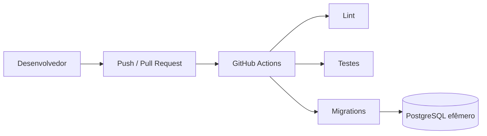

# ISS-004 — Integração contínua

## O que é

Integração contínua (CI) é a execução automática de verificações do repositório pelo
GitHub. Neste projeto, o workflow `.github/workflows/ci.yml` é acionado em pushes para
`main` e em Pull Requests direcionados a `main`.

## Problema

Sem CI, uma alteração de um integrante pode quebrar código que já funcionava para o
outro. O problema pode aparecer tarde, quando as mudanças já estão misturadas.

## Objetivo

Executar automaticamente verificações de qualidade, testes e criação do schema sempre
que código chegar à branch principal ou for proposto por Pull Request.

## Fluxo



Os três jobs são independentes e executam em paralelo. Assim, uma falha informa
diretamente se o problema está em `Lint`, `Testes` ou `Migrations`.

## O que cada etapa verifica

- **Lint:** usa Ruff para detectar erros básicos de Python, imports não usados ou
  indefinidos e problemas de organização dos imports. A formatação de imports é uma
  etapa separada e visível dentro do job; o formatador global não foi imposto neste
  baseline para evitar uma alteração massiva sem relação funcional com a issue.
- **Testes:** executa pytest com os testes unitários e inicia o Mosquitto local para
  habilitar a integração MQTT existente. Não acessa leitor físico, HUPAA ou HiveMQ.
- **Migrations:** o job de `ci.yml` reutiliza `.github/workflows/migrations.yml`,
  pertencente à ISS-002c. Em PostgreSQL vazio, aplica `upgrade head` duas vezes,
  executa `downgrade base`, reaplica `upgrade head`, confere exatamente as 17
  tabelas esperadas e roda os testes. O workflow reutilizável não possui gatilho
  próprio, portanto cada PR ou push produz uma única execução dessa validação.

O cache usado por `actions/setup-python` considera `requirements/base.txt` e
`requirements/dev.txt`; somente pacotes do pip são armazenados, nunca variáveis ou
segredos de ambiente.

## PostgreSQL efêmero

O job `Migrations` cria um serviço PostgreSQL 16 exclusivo para aquela execução. O
banco usa credenciais sintéticas declaradas no workflow, tem health check com
`pg_isready` e é descartado junto com o runner.

Esse banco **não é o Neon**, não é compartilhado e não usa credenciais de produção ou
desenvolvimento. A URL é fornecida somente ao job de migrations e não é impressa pelos
comandos do workflow.

## Como executar localmente

Prepare o ambiente, em Ubuntu 24.04:

```bash
python3 -m venv .venv
source .venv/bin/activate
python -m pip install -r requirements/dev.txt
```

Lint e formatação de imports, equivalentes às etapas do job `Lint`:

```bash
python -m ruff check --config config/ruff.toml --select E4,E7,E9,F .
python -m ruff check --config config/ruff.toml --select I .
```

Testes unitários, sem serviço externo:

```bash
python -m pytest -q
```

Para reproduzir também a integração viável no CI com o Compose já existente:

```bash
docker compose -f deploy/compose.yaml up -d mosquitto
RUN_MQTT_INTEGRATION=1 TEST_MQTT_PORT=1883 python -m pytest -q
docker compose -f deploy/compose.yaml --profile local down --volumes --remove-orphans
```

O ambiente PostgreSQL padronizado da ISS-003 já está disponível. Para validar schema,
healthchecks, integração MQTT e reset exclusivamente local, use:

```bash
make -f scripts/Makefile smoke
```

O smoke cria um projeto e um volume descartáveis, aplica a migration atual, remove o
volume e recria o schema vazio. A sequência exaustiva do CI permanece definida somente
em `.github/workflows/migrations.yml`; não mantenha uma segunda implementação manual.
Nunca execute o `downgrade base` de validação contra o Neon compartilhado.

## Como interpretar uma falha

- `Lint` vermelho: erro básico de código Python ou imports fora do baseline.
- `Testes` vermelho: comportamento incorreto, regressão ou falha da integração local.
- `Migrations` vermelho: o schema atual não pôde ser recriado em PostgreSQL vazio.

Abra o job vermelho e localize a primeira etapa que falhou. Os nomes das etapas
correspondem aos comandos documentados acima.

## Relação com ISS-002c

A ISS-002c está integrada à `main` e continua dona da validação de migrations. A
ISS-004 apenas chama seu workflow reutilizável. O `alembic/env.py` final e o
`db/url.py` continuam enviando `DATABASE_URL` diretamente ao SQLAlchemy/Alembic,
sem passar URLs com percent-encoding pelo `ConfigParser`. Nenhuma lógica de migration
foi copiada para `ci.yml`.

## Relação com ISS-003

A ISS-003 padroniza o ambiente local com Docker. A ISS-004 valida automaticamente o
repositório no GitHub. Elas se complementam: o ambiente local facilita a reprodução,
enquanto a CI evita que a validação dependa de uma execução manual.

A ISS-003 já está integrada à `main`. O job `Testes` usa o serviço Mosquitto definido
no Compose final. O workflow reutilizável de migrations mantém um PostgreSQL efêmero
do GitHub Actions para isolar a validação e não inicia a pilha local completa; isso não
altera o Compose nem cria uma segunda implementação dos comandos Alembic.

## Validação realizada

Em 13/09/2026, na branch `feat/iss-004-ci-lint-tests`:

- `python -m ruff check --config config/ruff.toml --select E4,E7,E9,F .`: aprovado.
- `python -m ruff check --config config/ruff.toml --select I .`: aprovado.
- `python -m pytest -q`: 30 aprovados e 4 ignorados legitimamente (integração MQTT
  opt-in e OpenSSL ausente no host Windows).
- suíte com Mosquitto e `RUN_MQTT_INTEGRATION=1`: 31 aprovados e 3 ignorados
  legitimamente (OpenSSL ausente no host Windows).
- `alembic -c config/alembic.ini upgrade head`: aprovado em PostgreSQL 16 vazio.
- `alembic -c config/alembic.ini current`: `44ef89b10f17 (head)`.
- inspeção do banco: 17 tabelas no schema `public`, contando `alembic_version`.
- primeira execução do GitHub Actions no PR #39: `Lint` aprovado em 21 s, `Testes`
  aprovado em 29 s e `Migrations` aprovado em 42 s.

Falha controlada: foi criado temporariamente `controlled_failure_iss004.py` com
`import os` não utilizado. Ruff reportou `F401` e encerrou com código 1. O arquivo foi
removido, e as duas verificações de qualidade voltaram a passar. A falha não faz parte
do histórico final.

### Revalidação após ISS-002b, ISS-002c e ISS-003

Executada em 14/09/2026 no Ubuntu 24.04:

- `python -m ruff check --config config/ruff.toml --select E4,E7,E9,F .`: aprovado.
- `python -m ruff check --config config/ruff.toml --select I .`: aprovado.
- `python -m pytest -q`: 36 aprovados, 1 pulado e 18 subtestes aprovados.
- suíte com Mosquitto e `RUN_MQTT_INTEGRATION=1`: 37 aprovados e 18 subtestes.
- configuração Compose local e managed: aprovada estruturalmente.
- `make -f scripts/Makefile smoke`: aprovado nos dois ciclos, incluindo reset e recriação do schema.
- `actionlint` nos dois workflows: aprovado sem avisos.
- ciclo em PostgreSQL local descartável: `upgrade head`, segundo `upgrade head`,
  `downgrade base` e novo `upgrade head`, todos aprovados.
- estado final: `44ef89b10f17 (head)` e 17 tabelas públicas.
- contêineres, redes e volumes descartáveis removidos ao final.

## Regra de merge

Uma branch só deve ser integrada quando `Lint`, `Testes` e a chamada reutilizável de
`Migrations` estiverem verdes na execução correspondente do GitHub Actions.
