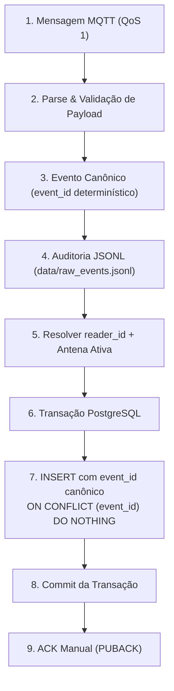

# ISS-006 — persistência idempotente de leituras brutas

## O que esta issue resolve e por que importa

**ISS-006 — Persistir leituras brutas no PostgreSQL com event_id idempotente**
é a Issue #8. Ela permite guardar cada mensagem RFID válida como uma leitura
consultável no banco, sem criar outra leitura quando a rede entrega novamente
a mesma mensagem.

Antes, o MVP recebia, normalizava e escrevia mensagens em um arquivo JSONL:

```text
MQTT → normalização → JSONL
```

Esse arquivo conserva a evidência da coleta, mas ainda faltava uma tabela de
leituras ligada às antenas cadastradas. Depois desta issue:

```text
MQTT → normalização → JSONL + PostgreSQL
```

O arquivo continua registrando cada entrega. O banco passa a guardar as leituras
com origem rastreável e proteção contra repetição. Isso prepara a base para as
futuras análises de passagens e rastreabilidade de equipamentos do MVP, sem
implementar essas funcionalidades agora.

MQTT QoS 1 significa entrega **pelo menos uma vez**: uma confirmação perdida pode
fazer a mesma mensagem chegar novamente. Por exemplo, três entregas do mesmo
evento devem produzir três envelopes de auditoria, mas apenas uma linha no banco.
Essa propriedade é chamada **idempotência**. Duas mensagens novas do mesmo EPC,
mesmo muito próximas no tempo, continuam sendo duas leituras quando têm IDs
diferentes. Agrupar leituras próximas por tempo seria **debounce**, da ISS-014.

ACK é a confirmação enviada pelo receptor ao broker de que tratou a mensagem.
O ACK manual deixa essa confirmação para depois do resultado do banco ou de uma
rejeição permanente auditada. Assim, uma falha de banco não é apresentada ao
broker como processamento concluído.

## Objetivo e fluxo detalhado

A ISS-006 acrescenta persistência no PostgreSQL ao ingestor existente, integrando o contrato canônico da ISS-005 à infraestrutura de hardware da ISS-012.



```text
MQTT message
    ↓
parse / normalize
    ↓
canonical event
    ↓
JSONL audit
    ↓
resolve reader + active antenna
    ↓
PostgreSQL transaction
    ↓
INSERT using canonical event_id
    ↓
commit
    ↓
ACK
```

O tópico exclusivo permanece `easy/<environment>/<site_id>/<portal_id>/<reader_id>/readings`.
Adapters e contrato canônico permanecem os da [ISS-005](iss-005-rfid-normalization.md).
`JsonlEventStore` preserva o envelope completo de cada entrega, inclusive mensagens inválidas
e duplicadas. `RawReadingRepository` usa SQLAlchemy 2.x e uma transação atômica por evento,
sem conhecer os detalhes do transporte MQTT. Não existe cadastro automático de topologia.

## Contrato e schema

A migration **`da436f7c75b3`** sucede **`6b3e5f7a91c4`** (head da ISS-012),
integrando-se ao grafo linear de migrations após a stack ISS-008..012
(`44ef89b10f17` → `7c1d4e9a2b83` → `992c5c770214` → `af6d99290414` → `019782a38ff7` → `6b3e5f7a91c4` → `da436f7c75b3`).
Essa linearização garante exatamente uma head no Alembic sem necessidade de merge
migrations artificiais.

A ISS-012 é a **fonte da verdade para o modelo de hardware** (leitores, antenas,
portais e ciclo de vida). A ISS-006 não define nem altera o schema de `leitores`
ou `antenas`, limitando-se a consumir suas informações para persistência e
resolução topológica.

| Campo | Decisão |
|---|---|
| `leituras_brutas.event_id` | `VARCHAR(71)`, NOT NULL, UNIQUE; ID canônico preservado literalmente |
| `leituras_brutas.rssi` | Nullable; unidade desconhecida não significa intensidade zero |
| `leituras_brutas.dados_origem` | JSONB nullable para linhas anteriores; novos eventos guardam metadata canônica, topic, adapter, qos e retain |
| `leitores.reader_id` | VARCHAR, NOT NULL, UNIQUE (definido pela ISS-012); identidade lógica MQTT independente de `identificador_serial` |
| `lido_em` | Timestamp da leitura, vindo de canonical_event.timestamp |
| `recebido_em` | Timestamp de recepção do servidor, vindo de received_at_utc |

Os dois timestamps são enviados como datetimes com fuso UTC. Um timestamp de
origem ausente/inválido nunca é substituído pelo horário de recepção. Na duplicata,
nenhuma coluna é atualizada: permanece a recepção associada à primeira inserção.

RSSI sem unidade comprovada é gravado como NULL. Valor bruto e unidade ficam em
`dados_origem.metadata.rssi_original` e `rssi_unit`. Não há divisão por 100, nova
escala ou interpretação do relógio do EZ700 físico.

A conversão de UUID para texto em `leituras_brutas.event_id` usa explicitamente
`USING event_id::text`, preservando UUIDs legados como texto, sem inventar hashes.
O downgrade usa `event_id::uuid`: **IDs sha256:* não podem ser convertidos semanticamente em UUID**.
Dados incompatíveis precisam ser migrados/removidos deliberadamente antes do
rollback; RSSI NULL também impede restaurar NOT NULL. O downgrade não apaga dados
para contornar essas restrições. O ciclo no banco vazio do CI é reversível.

Os índices existentes `(epc, lido_em)` e `(antena_id, lido_em)` são preservados.
A busca por leitor usa `reader_id` UNIQUE e a associação com antena ativa, mantendo o caminho de consulta por leitor e período.

## Resolução de leitor e antena ativa

O repositório procura `Leitor.reader_id == canonical.reader_id` e a antena desse
leitor cujo `porta_numero == canonical.antenna` E que esteja ATIVA (`Antena.ativo.is_(True)`).
O `Antena.id` encontrado alimenta `leituras_brutas.antena_id`. Serial, fabricante
e modelo não participam da busca.

Com o modelo da ISS-012, a unicidade de porta do leitor é garantida por índice
único parcial (`uq_antena_ativa_por_porta_leitor WHERE ativo`). Isso permite que
uma porta física seja reutilizada quando uma antena é inativada e substituída por
uma nova antena ativa (ex.: Leitor X porta 1 com Antena A inativa e Antena B ativa).
As antenas inativas históricas são preservadas no banco e continuam referenciadas
pelo histórico de leituras e passagens. A consulta de ingestão filtra expressamente
`Antena.ativo.is_(True)`, evitando erros do tipo `MultipleResultsFound` em portas
reconfiguradas.

Leitor desconhecido retorna `rejected / unknown_reader`; porta inexistente ou
sem antena ativa no leitor conhecido retorna `rejected / unknown_antenna`. Nenhum
desses casos grava leitura bruta. Não foi adicionado filtro de `Leitor.ativo`
nesta issue, pois a política de rejeição de leitor inativo é regra de domínio a
ser definida separadamente.

## Idempotência de mensagem, sem debounce

A fonte de verdade é o `event_id` da ISS-005: `sha256:` e 64 hexadecimais
minúsculos. Não há segundo fingerprint nem geração de UUID na persistência.

O insert usa `ON CONFLICT (event_id) DO NOTHING RETURNING id`. Resultado com ID
significa `inserted`; sem ID significa `duplicate`. Ambos são sucesso após o
commit. Não existe SELECT prévio por event_id, evitando a corrida entre consulta
e inserção. O repositório também retorna explicitamente `rejected` com motivo.

Duas leituras do mesmo EPC com IDs diferentes permanecem no banco. O contrato
existente identifica bytes/contexto: mensagens legítimas de bytes idênticos no
mesmo contexto também compartilham ID. Debounce temporal é a ISS-014.

## ACK manual e auditoria

O receptor Paho habilita `manual_ack_set(True)` antes de conectar. Para QoS 1:

| Resultado | Auditoria | ACK |
|---|---|---|
| Inserção confirmada | Envelope JSONL e log de resultado | Uma vez |
| Duplicata | Novo envelope JSONL e log duplicate | Uma vez |
| Parsing/normalização inválidos | Envelope com parse_error/validation_errors e canonical_event nulo | Uma vez, sem consultar o banco |
| Leitor/antena desconhecidos | Envelope original e registro JSONL complementar de rejeição | Uma vez |
| Falha PostgreSQL temporária, inclusive no commit | Envelope original permanece; recuperação com backoff | Não |
| Falha PostgreSQL permanente/configuração | Envelope original permanece; receptor falha para intervenção | Não |
| Falha de escrita JSONL, inclusive no registro complementar | Receptor falha | Não |

O registro complementar usa `event_type: rfid_persistence`, `status`, `reason`,
`event_id` e `received_at_utc`, sem repetir payload. Consumidores do JSONL que
contam mensagens devem selecionar os envelopes com `payload_original`; registros
complementares não são novas entregas MQTT. Os logs de resultados não incluem
payload, SQL, parâmetros, URLs ou exceções originais do banco.

A auditoria antecede a transação PostgreSQL. Não há transação distribuída entre
arquivo e banco. Se o processo cair depois do commit e antes do ACK, uma reentrega
do mesmo evento será duplicata. JSONL continua append-only e pode conter várias
entregas da mesma mensagem. Flush não equivale a garantia de durabilidade com fsync.

Desde a ISS-007, falha temporária de banco pausa o consumo: o receptor desconecta
sem ACK, testa a volta do PostgreSQL com backoff e então reconecta ao MQTT para a
reentrega. Erro permanente de autenticação/configuração e falha no envio do ACK
continuam fatais. A sessão MQTT 3.1.1 é persistente e o `event_id` torna segura a
repetição lógica; os limites estão no [guia da ISS-007](iss-007-ingestor-resilience.md).

## Configuração e operação

- Aplicação e verificador: `APP_DATABASE_URL`. Ausência/URL inválida produz erro
  de configuração seguro; não há fallback para DATABASE_URL.
- Alembic: `DATABASE_URL`, mantendo a separação de roles direct/pooled do Neon.
- Compose local fornece o endereço interno do PostgreSQL ao ingestor. No modo
  managed, APP_DATABASE_URL vem do ambiente. Nenhuma credencial é versionada.
- Antes de coletar, aplicar migrations e cadastrar explicitamente leitor lógico
  e antena na topologia real. Um banco vazio rejeita leitores desconhecidos.
- O notebook continua apenas broker/receptor, sem hotspot.

O role de aplicação precisa dos privilégios DML e de sequences documentados no
[guia Neon](iss-002b-neon-setup.md). O repositório não cria tabelas, schemas ou fixtures.

## Principais arquivos implementados

| Arquivo | Responsabilidade |
|---|---|
| `db/models.py` e migration `da436f7c75b3` | Alinham o banco ao contrato canônico |
| `db/runtime.py` | Cria a conexão da aplicação usando APP_DATABASE_URL |
| `rfid_ingestion/repository.py` | Resolve topologia e insere atomicamente, retornando inserted/duplicate/rejected |
| `rfid_ingestion/mqtt_client.py` | Coordena JSONL, persistência e ACK manual |
| `rfid_ingestion/__main__.py` e `verification.py` | Ligam o mesmo repositório ao receptor e ao verificador |
| `compose.yaml` | Fornece configuração de banco e normalização ao ingestor |
| `tests/test_repository.py`, `test_migrations.py`, `test_mqtt_persistence.py` e `test_integration.py` | Verificam banco real, concorrência, rejeições, timestamps e ACK |
| Workflows existentes e scripts smoke | Executam as validações em serviços descartáveis |

## Reprodução local — Ubuntu 24.04

Com Python 3.12, Docker Compose e OpenSSL disponíveis:

```bash
python -m pip install -r requirements-dev.txt
python -m ruff check --select E4,E7,E9,F .
python -m ruff check --select I .
python -m pytest -q
bash tests/reader-connectivity/mqtt/smoke-test.sh
bash tests/infrastructure/compose-smoke-test.sh
```

Sem TEST_DATABASE_URL, os testes PostgreSQL são explicitamente pulados. Sem
RUN_MQTT_INTEGRATION=1, os testes Mosquitto são pulados. O primeiro smoke cria
PostgreSQL/Mosquitto próprios, fornece as variáveis e roda toda a suíte. O segundo
valida build, migrations, uma leitura canônica no banco e reset/recriação do
volume descartável. Ambos limpam exclusivamente seus projetos de teste.

Para serviços descartáveis já iniciados, configurar TEST_DATABASE_URL sem exibi-la:

```bash
RUN_MQTT_INTEGRATION=1 TEST_MQTT_PORT=1883 python -m pytest -q
python -m pytest -q tests/test_repository.py tests/test_migrations.py tests/test_mqtt_persistence.py
```

Cada teste PostgreSQL cria um schema isolado, aplica Alembic e remove apenas esse
schema. O banco de teste exige permissão para CREATE SCHEMA. Nunca apontar
TEST_DATABASE_URL para Neon compartilhado. Fixtures de topologia existem apenas
nos testes; `tests/fixtures/topology.sql` destina-se ao banco vazio do smoke.

O CI preserva os jobs **Lint**, **Testes** e **Migrations**. O job Testes ganhou
PostgreSQL descartável junto ao Mosquitto. Migrations continua aplicando duas vezes,
revertendo até base, reaplicando e conferindo 17 tabelas. Para repetir manualmente,
com DATABASE_URL apontando exclusivamente ao banco descartável:

```bash
python -m alembic upgrade head
python -m alembic upgrade head
python -m alembic downgrade base
python -m alembic upgrade head
python -m alembic check
```

## Retenção e limites de escopo

**Política de retenção = TBD com HUPAA.** Não há expurgo automático nem prazo
hospitalar inventado. Volume em bytes exige medir a representação real de linhas
e índices; não foram estimados bytes por linha. O [ADR MQTT](../decisions/0002-managed-mqtt.md)
pode orientar cenários de contagem de publicações, sem equivalência automática
com armazenamento PostgreSQL.

Permanecem fora da ISS-006: ISS-014
(debounce), ISS-015 (passagens/direção), atualização de zonas, histórico de
movimentações, CRUD e cadastro automático. A investigação física EZ700
MQTTS/timestamps da **#42** permanece separada e não foi resolvida aqui.

## Evidências desta entrega

Validação local em 15/09/2026, Windows com Python 3.12.14, OpenSSL do Git e
Docker Desktop com contêineres Linux PostgreSQL 16.15 e Mosquitto 2.1.2:

| Verificação | Resultado observado |
|---|---|
| Ruff E4,E7,E9,F e imports I | Ambos passaram; avisos locais de acesso ao cache não impediram as verificações |
| pytest completo, PostgreSQL/Mosquitto/TLS habilitados | **83 passed, 47 subtests passed**, nenhum skip, 8,51 s |
| Smoke MQTT via Bash, serviços descartáveis | **83 passed, 47 subtests passed**, 9,37 s; saída PASSOU |
| Smoke Compose completo via Bash | PASSOU: schema head, leitura no banco, reset do volume e reaplicação |
| Ciclo Alembic vazio/repetição/downgrade/re-upgrade | Passou; `alembic check`: nenhuma operação nova |
| Testes focados de repositório/migration/ACK | **29 passed**, 5,50 s |

Os testes incluem oito tentativas concorrentes do mesmo event_id (uma inserção,
sete duplicatas), leituras consecutivas, resolução de topologia, timestamps
distintos, RSSI nulo, ACK, rejeições e falha no commit sem falso sucesso.
Temporários exclusivos foram usados para contornar permissões locais do pytest.
Uma repetição intermediária encontrou Docker parado (67 testes passaram e
16 tiveram erro de conexão). Após reiniciar somente os serviços descartáveis,
a suíte final passou integralmente e o ciclo Alembic foi repetido com sucesso;
o schema final contém 17 tabelas. `git diff --check` passou.

**NOT RUN:** Neon descartável/compartilhado, HiveMQ e EZ700 físico; nenhuma
credencial externa foi usada. A suíte completa não foi executada diretamente
no Ubuntu/WSL local; os smoke scripts foram executados via Bash no Windows.
O CI permanece configurado para Ubuntu 24.04 e Python 3.12.
