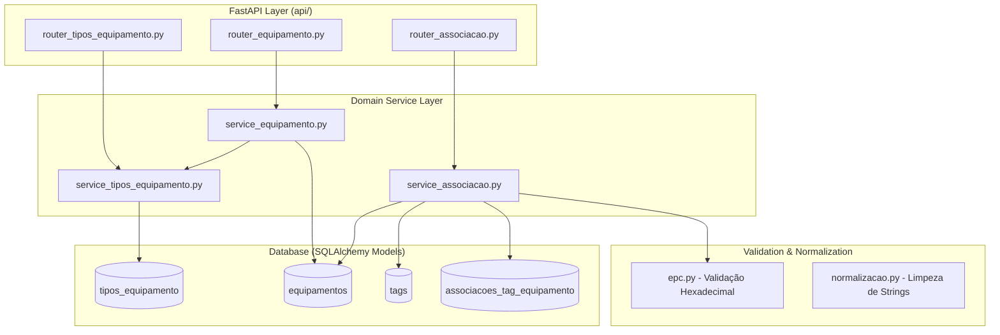
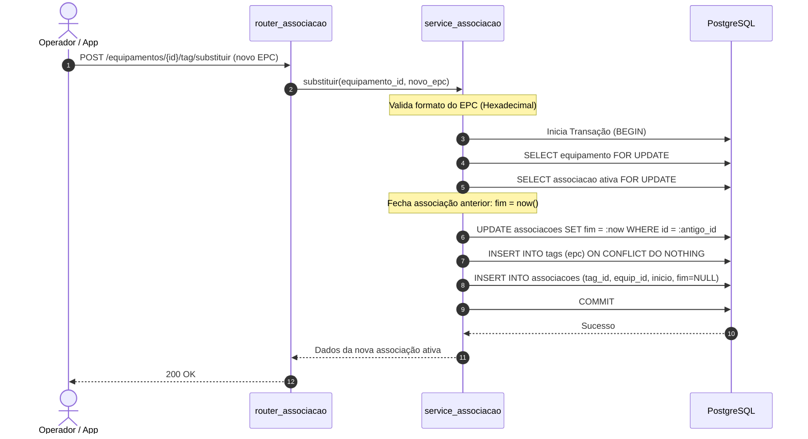

# ISS-008, ISS-009 e ISS-010 — Gestão de Ativos, Tipos e Vínculo de Tags (EPC)

Este documento descreve a implementação do módulo de domínio de ativos hospitalares do **RFID Hospital MVP**, abrangendo as issues:
- **ISS-009 (PR #45):** CRUD de Tipos de Equipamentos
- **ISS-008 (PR #46):** CRUD de Equipamentos com Identificador Interno Normalizado
- **ISS-010 (PR #48):** Associação Segura e Temporal de EPCs a Equipamentos

---

## 1. Objetivo e Problema Resolvido

### Problema
Para que leituras RFID de antenas e portais tenham significado assistencial no hospital (HUPAA/UFAL), cada tag EPC lida deve estar associada a um bem hospitalar concreto (ex.: Bomba de Infusão nº patrimonial `PAT-0412`). Antes dessas issues:
1. O repositório continha apenas modelos relacionais em `db/models.py`, sem endpoints para cadastro ou manipulação de equipamentos e tags.
2. Não havia garantia em tempo de execução de que uma mesma tag RFID não pudesse ser cadastrada em dois equipamentos simultaneamente.
3. Não havia mecanismo temporal para troca de tag (ex.: tag danificada substituída sem perder o histórico de rastreamento do equipamento).

### Objetivo
Entregar uma API REST robusta via FastAPI e serviços com SQLAlchemy para:
- Cadastrar e gerenciar tipos de equipamentos hospitalares.
- Cadastrar e gerenciar equipamentos com busca por identificador interno normalizado.
- Associar, desassociar e substituir tags EPC com histórico temporal (`[inicio, fim)`) e concorrência segura garantida por transação e índices únicos parciais no banco de dados.

---

## 2. Situação Anterior vs. Implementação Atual

| Aspecto | Antes (ISS-007) | Agora (ISS-008..010) |
|---|---|---|
| Camada HTTP | Apenas ingestão em background via script MQTT | Servidor FastAPI (`api/main.py`) com routers desacoplados |
| Tipos de Equipamentos | Tabela existente sem endpoints | CRUD completo (`/tipos-equipamento`), paginação, seed piloto |
| Equipamentos | Tabela existente sem endpoints | CRUD completo (`/equipamentos`), validação de tipo ativo, busca por patrimônio normalizado |
| Associação Tag-Equipamento | Modelo relacional isolado | Endpoints de vínculo e substituição atômica com validação hexadecimal de EPC |
| Concorrência de Tags | Apenas validação teórica | `SELECT ... FOR UPDATE` e `uq_tag_ativa` (`WHERE fim IS NULL`) no Postgres |

---

## 3. Arquitetura e Componentes Principais



### Arquivos Principais:
- `api/main.py`: Ponto de montagem dos routers FastAPI e tratamento global de exceções.
- `api/router_tipos_equipamento.py` & `api/service_tipos_equipamento.py`: Endpoints e regras de negócio para categorias (bomba de infusão, cadeira de rodas, monitor, etc.).
- `api/router_equipamento.py` & `api/service_equipamento.py`: Endpoints e regras para equipamentos.
- `api/router_associacao.py` & `api/service_associacao.py`: Operações de vínculo tag-ativo.
- `api/epc.py`: Validação de EPCs RFID UHF (hexadecimal de 24 a 64 caracteres, sem caracteres especiais).
- `api/normalizacao.py`: Sanitização e normalização de textos e identificadores.

---

## 4. Fluxo de Associação e Troca de Tag

A troca de tag de um equipamento é uma operação crítica para a rastreabilidade hospitalar:



### Semântica Temporal:
O intervalo de validade de cada vínculo é meio-aberto: `[inicio, fim)`.
- Se uma leitura ocorreu no instante `T`:
```sql
SELECT equipamento_id FROM associacoes_tag_equipamento
WHERE tag_id = :tag_id
  AND inicio <= :t
  AND (fim IS NULL OR fim > :t);
```
Isso garante que uma leitura antiga feita antes da troca da tag continue atribuída ao equipamento que estava portando a tag no momento da passagem, mesmo após a tag ter sido reatribuída.

---

## 5. Decisões Importantes de Design

1. **Identificador Interno Normalizado:** Para evitar que `PAT 001`, `pat-001` e `PAT-001` fossem cadastrados como bens distintos, a coluna `identificador_interno_normalizado` armazena o texto em maiúsculas e sem pontuação/espaços, com constraint `UNIQUE`.
2. **Impossibilidade de Tag Ativa Duplicada:** Garantida por dois índices únicos parciais no banco de dados:
   ```sql
   CREATE UNIQUE INDEX uq_tag_ativa ON associacoes_tag_equipamento (tag_id) WHERE fim IS NULL;
   CREATE UNIQUE INDEX uq_equipamento_tag_ativa ON associacoes_tag_equipamento (equipamento_id) WHERE fim IS NULL;
   ```
3. **Inativação Lógica vs. Exclusão:** Equipamentos com histórico de leituras nunca são deletados (`DELETE`); são marcados como `status = 'inativo'`, preservando a integridade referencial.
4. **Seed Piloto:** Scripts dedicados (`api/seed_tipos_equipamento.py`) populam os tipos hospitalares padrão do HUPAA para agilizar testes e homologação local.

---

## 6. Validação Realizada

- **Testes Unitários e de API:**
  - `tests/test_api_tipos_equipamento.py` e `tests/test_service_tipos_equipamento.py`: Cobertura de criação, listagem paginada, unicidade e inativação.
  - `tests/test_api_equipamento.py` e `tests/test_service_equipamento.py`: Cobertura de integridade com `tipo_id`, identificador normalizado e ciclo de vida.
  - `tests/test_epc.py`: Validação de strings hexadecimais válidas e rejeição de entradas malformadas.
  - `tests/test_service_associacao.py` e `tests/test_concorrencia_associacao.py`: Validação de concorrência com múltiplas threads tentando associar a mesma tag simultaneamente.

---

## 7. Limitações e Próximos Passos

- Não há interface web (frontend) nesta fase; o consumo é via API REST ou Swagger (`/docs`).
- O cadastro de tag avulsa sem equipamento não é exposto diretamente na API; a tag é criada sob demanda na associação.
