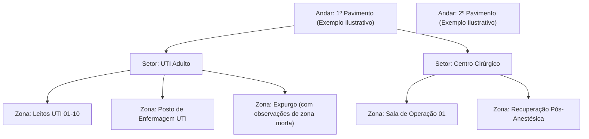
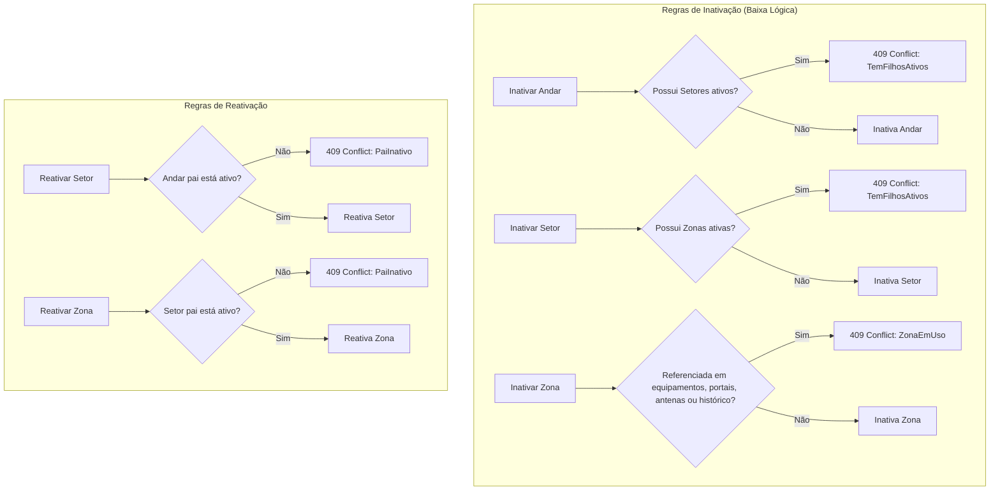

# ISS-011 — Hierarquia de Localização Hospitalar (Andares, Setores e Zonas)

Este documento detalha a implementação do subsistema de localização física do **RFID Hospital MVP**, referente à **ISS-011 (PR #49)**.

---

## 1. Objetivo e Problema Resolvido

### Problema
Para rastrear ativos hospitalares por zonas de presença, o sistema necessita de uma representação hierárquica e coerente do espaço físico. Antes desta issue:
1. As tabelas `andares`, `setores` e `zonas` existiam no banco de dados, mas não havia endpoints nem serviços para gerenciá-las.
2. Não havia garantias lógicas para impedir inconsistências estruturais (por exemplo, inativar um andar enquanto seus setores e zonas permaneciam cadastrados como ativos).
3. Não havia mecanismo estruturado para consultar a árvore física completa do ambiente.

### Objetivo
Disponibilizar uma API REST completa em FastAPI para gerenciamento do espaço físico hospitalar com:
- Hierarquia estrita de 3 níveis: **Andar $\rightarrow$ Setor $\rightarrow$ Zona**.
- *Guards* de integridade referencial e ciclo de vida (bloqueio de inativação com filhos ativos e bloqueio de reativação com pai inativo).
- Proteção contra desativação de zonas referenciadas no sistema (equipamentos, portais, antenas ou histórico).
- Consulta da árvore hierárquica aninhada em chamadas otimizadas (`/localizacoes/arvore` e `/andares/{andar_id}/arvore`).
- Script de *seed* piloto com estrutura configurável para testes de carga e validação.

---

## 2. Estrutura Hierárquica e Relacionamentos

A hierarquia física persistida inicia em **Andar**, contendo **Setores**, que por sua vez contêm **Zonas**:

> [!NOTE]
> O diagrama acima e os valores default de `api/seed_localizacao_piloto.py` constituem um **exemplo ilustrativo e configurável para testes**, e não uma taxonomia física homologada do HUPAA. Os dados reais de pavimentos serão definidos e inseridos durante a implantação física no hospital.

### Regras de Domínio:
1. **Unicidade de Nomenclatura por Escopo:**
   - O nome do andar é único globalmente (`UniqueConstraint("nome_normalizado")`).
   - O nome do setor é único dentro de seu respectivo andar: `UNIQUE (andar_id, nome)`.
   - O nome da zona é único dentro de seu respectivo setor: `UNIQUE (setor_id, nome)`.
2. **Zona Morta não é uma Entidade:**
   - Áreas com sombra de radiofrequência ou sem cobertura de antenas não são modeladas como entidades à parte. A caracterização de zona morta é documentada textualmente no campo opcional `zonas.observacoes`.

---

## 3. Integridade e Regras de Ciclo de Vida (Guards)

Para garantir que o mapa hospitalar permaneça consistente:

### Detalhamento da Inativação de Zona:
A inativação de uma zona (`POST /zonas/{zona_id}/inativar`) é bloqueada se ela for referenciada por **qualquer** entidade do sistema, independentemente de estarem ativas ou inativas:
- `Equipamento.ultima_zona_id`: Ativo atualmente associado a esta zona;
- `Portal.zona_a_id` ou `Portal.zona_b_id`: Qualquer portal existente ligando a esta zona (ativos ou inativos);
- `Antena.zona_associada_id`: Qualquer antena cadastrada cuja cobertura aponte para esta zona;
- `HistoricoMovimentacao.zona_origem_id` ou `zona_destino_id`: Registros históricos de movimentação de ativos.

Se qualquer uma dessas referências existir, o serviço levanta `ZonaEmUso` e a API retorna HTTP `409 Conflict`.

---

## 4. Principais Arquivos e Endpoints

### Arquivos:
- `api/router_localizacao.py`: Tradução HTTP, parâmetros de rota e mapeamento de exceções.
- `api/service_localizacao.py`: Lógica de domínio, validação dos *guards* e transações SQLAlchemy.
- `api/schemas_localizacao.py`: Contratos Pydantic de entrada, saída, paginação e árvore aninhada (`AndarArvore`).
- `api/seed_localizacao_piloto.py`: Carga idempotente e configurável de estrutura piloto para testes de andares, setores e zonas (placeholders sobrescrevíveis via CLI).

### Rotas HTTP Implementadas:
- **Consultas em Árvore:**
  - `GET /localizacoes/arvore`: Retorna a árvore completa (Andares $\rightarrow$ Setores $\rightarrow$ Zonas) em uma estrutura aninhada.
  - `GET /andares/{andar_id}/arvore`: Retorna a árvore aninhada de um andar específico.
- **Andares:**
  - `POST /andares`, `GET /andares`, `GET /andares/{andar_id}`, `PATCH /andares/{andar_id}`, `POST /andares/{andar_id}/inativar`, `POST /andares/{andar_id}/reativar`.
- **Setores:**
  - `POST /setores`, `GET /setores`, `GET /setores/{setor_id}`, `PATCH /setores/{setor_id}`, `POST /setores/{setor_id}/inativar`, `POST /setores/{setor_id}/reativar`.
- **Zonas:**
  - `POST /zonas`, `GET /zonas`, `GET /zonas/{zona_id}`, `PATCH /zonas/{zona_id}`, `POST /zonas/{zona_id}/inativar`, `POST /zonas/{zona_id}/reativar`.

---

## 5. Validação Realizada

- **Testes de API e Domínio:**
  - `tests/test_api_localizacao.py` (567 linhas): Validação de todas as respostas HTTP, paginação, códigos 404, 409 e 422.
  - `tests/test_service_localizacao.py` (841 linhas): Cobertura profunda das invariantes de banco, inativação em cascata bloqueada, reativação controlada e integridade da árvore.
  - `tests/test_seed_localizacao_piloto.py`: Validação de idempotência da carga inicial piloto.
