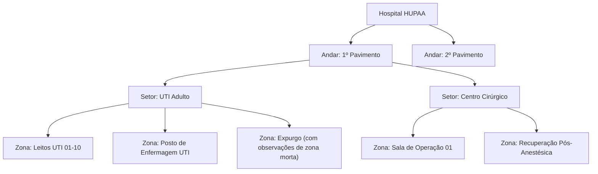
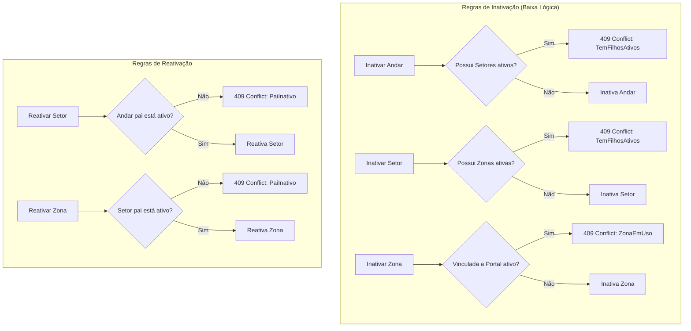

# ISS-011 — Hierarquia de Localização Hospitalar (Andares, Setores e Zonas)

Este documento detalha a implementação do subsistema de localização física do **RFID Hospital MVP**, referente à **ISS-011 (PR #49)**.

---

## 1. Objetivo e Problema Resolvido

### Problema
Para inferir a posição de ativos hospitalares no HUPAA/UFAL, o sistema necessita de uma representação hierárquica e coerente do espaço físico. Antes desta issue:
1. As tabelas `andares`, `setores` e `zonas` existiam no banco de dados, mas não havia endpoints nem serviços para gerenciá-las.
2. Não havia garantias lógicas para impedir inconsistências estruturais (por exemplo, inativar um andar enquanto seus setores e zonas permaneciam cadastrados como ativos).
3. Não havia mecanismo estruturado para consultar a árvore física completa de um prédio hospitalar.

### Objetivo
Disponibilizar uma API REST completa em FastAPI para gerenciamento do espaço hospitalar com:
- Hierarquia estrita de 3 níveis: **Andar $\rightarrow$ Setor $\rightarrow$ Zona**.
- *Guards* de integridade referencial e ciclo de vida (bloqueio de inativação com filhos ativos e bloqueio de reativação com pai inativo).
- Proteção contra desativação de zonas vinculadas a portais de leitura.
- Consulta da árvore hierárquica aninhada em uma única chamada otimizada.
- Script de *seed* piloto com a estrutura física real de pavimentos do HUPAA.

---

## 2. Estrutura Hierárquica e Relacionamentos

### Regras de Domínio:
1. **Unicidade de Nomenclatura por Escopo:**
   - O nome do andar é único no hospital.
   - O nome do setor é único dentro de seu respectivo andar: `UNIQUE (andar_id, nome)`.
   - O nome da zona é único dentro de seu respectivo setor: `UNIQUE (setor_id, nome)`.
2. **Zona Morta não é uma Entidade:**
   - Áreas com sombra de radiofrequência ou sem cobertura de antenas não são modeladas como entidades à parte. A caracterização de zona morta é documentada textualmente no campo `zonas.observacoes`.

---

## 3. Integridade e Regras de Ciclo de Vida (Guards)

Para garantir que o mapa hospitalar permaneça consistente:

---

## 4. Principais Arquivos e Endpoints

### Arquivos:
- `api/router_localizacao.py`: Tradução HTTP, parâmetros de rota e mapeamento de exceções.
- `api/service_localizacao.py`: Lógica de domínio, validação dos *guards* e transações SQLAlchemy.
- `api/schemas_localizacao.py`: Contratos Pydantic de entrada, saída, paginação e árvore aninhada (`AndarArvore`).
- `api/seed_localizacao_piloto.py`: Carga idempotente de andares, setores e zonas de exemplo do HUPAA.

### Principais Rotas HTTP:
- `GET /andares/arvore`: Retorna a árvore completa (Andar $\rightarrow$ Setores $\rightarrow$ Zonas) em uma resposta JSON aninhada.
- `POST /andares`, `GET /andares`, `PUT /andares/{id}`, `POST /andares/{id}/inativar`, `POST /andares/{id}/reativar`.
- `POST /setores`, `GET /setores`, `PUT /setores/{id}`, `POST /setores/{id}/inativar`, `POST /setores/{id}/reativar`.
- `POST /zonas`, `GET /zonas`, `PUT /zonas/{id}`, `POST /zonas/{id}/inativar`, `POST /zonas/{id}/reativar`.

---

## 5. Validação Realizada

- **Testes de API e Domínio:**
  - `tests/test_api_localizacao.py` (567 linhas): Validação de todas as respostas HTTP, paginação, códigos 404, 409 e 422.
  - `tests/test_service_localizacao.py` (841 linhas): Cobertura profunda das invariantes de banco, inativação em cascata bloqueada, reativação controlada e integridade da árvore.
  - `tests/test_seed_localizacao_piloto.py`: Validação de idempotência da carga inicial piloto.
