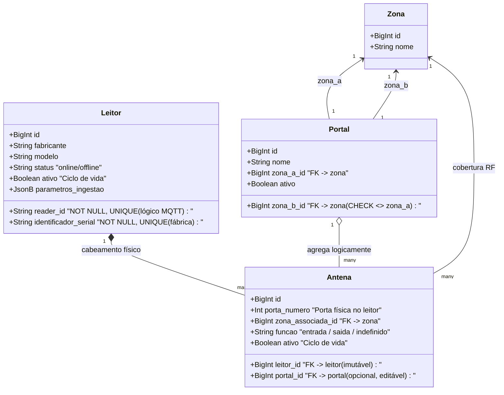

# ISS-012 — Topologia de Hardware (Leitores, Antenas e Portais)

Este documento descreve a implementação do módulo de topologia de hardware do **Rastreamento RFID HUPAA**, referente à **ISS-012 (PR #50)** e às migrations `019782a38ff7` e `6b3e5f7a91c4`.

---

## 1. Objetivo e Problema Resolvido

### Problema
Para que o serviço de ingestão MQTT persista leituras brutas de forma confiável e para que os futuros algoritmos de passagem funcionem, o sistema precisa conhecer a infraestrutura física de leitura:
1. **Identidade do Leitor no MQTT:** O identificador físico de fábrica (serial) nem sempre coincide com o identificador lógico atribuído na rede MQTT (`reader_id` no tópico).
2. **Arranjo de Antenas e Portais:** Na modelagem inicial simplificada, assumia-se que um portal pertencia diretamente a um leitor. Como decisão arquitetural, o modelo passa a permitir que um portal agregue antenas conectadas a leitores diferentes (por exemplo, antenas em lados opostos de uma passagem alimentadas por equipamentos distintos).
3. **Reconfiguração de Portas sem Perda Histórica:** Se uma antena física falhar na porta 1 de um leitor e for substituída, a antena antiga não pode ser excluída do banco de dados, pois milhares de leituras históricas apontam para ela. No entanto, o banco não podia permitir duas antenas ativas na mesma porta física simultaneamente.
4. **Proteção contra Vazamento de Segredos:** Parâmetros de ingestão não devem armazenar credenciais ou tokens no banco de dados.

### Objetivo
- Fornecer CRUD completo via FastAPI para Leitores, Antenas e Portais.
- Desacoplar `reader_id` (origem lógica no MQTT) de `identificador_serial` (número de série físico).
- Desacoplar Leitores de Portais: a relação de agregação passa a ser de **Antenas com Portais** (`antenas.portal_id`).
- Implementar integridade de porta ativa via **índice único parcial no PostgreSQL**.
- Garantir *allowlist* estrita para parâmetros de ingestão e blindagem contra eco de segredos em logs/erros 422.

---

## 2. Diagrama de Relacionamento de Hardware



---

## 3. Invariantes Críticas de Engenharia

### 3.1 Unicidade Parcial de Porta Ativa por Leitor
No PostgreSQL, a restrição de porta física é assegurada pelo índice único parcial:

```sql
CREATE UNIQUE INDEX uq_antena_ativa_por_porta_leitor
ON antenas (leitor_id, porta_numero)
WHERE ativo IS TRUE;
```

**Comportamento:**
- Uma porta (ex.: Leitor 1, Porta 1) pode ter apenas **uma** antena com `ativo = true`.
- Ao inativar uma antena (`ativo = false`), a porta é imediatamente liberada para que uma nova antena ativa seja cadastrada.
- O histórico de leituras brutas (`leituras_brutas.antena_id`) continua apontando com integridade referencial para a antena antiga inativada.
- A ingestão de leituras (ISS-006) resolve a antena aplicando expressamente o filtro `Antena.ativo.is_(True)`.

### 3.2 Desacoplamento Leitor-Portal
- A coluna `leitores.portal_id` foi **eliminada** do schema na migration `019782a38ff7`.
- Um leitor pode ter antenas em portais diferentes (ex.: Porta 1 no Portal A, Porta 2 no Portal B).
- Como capacidade arquitetural do modelo, um portal pode agregar antenas conectadas a leitores físicos distintos.

### 3.3 Allowlist e Blindagem em Parâmetros de Ingestão
- A coluna `leitores.parametros_ingestao` aceita apenas uma *allowlist* fechada de chaves não-secretas:
  `protocolo`, `adapter`, `formato_timestamp`, `topico`, `qos`.
- Qualquer tentativa de enviar campos sensíveis (como `senha`, `password`, `token`, `secret`) é rejeitada com HTTP 422.
- Em `api/main.py`, um handler de exceção customizado para `RequestValidationError` sanitiza a resposta para **não ecoar** o valor enviado na resposta HTTP nem nos logs.

---

## 4. Principais Arquivos e Endpoints

### Arquivos Implementados:
- `alembic/versions/019782a38ff7_iss012_leitores_antenas_portais.py`: Migration estrutural de leitores, antenas e portais.
- `alembic/versions/6b3e5f7a91c4_iss012_porta_ativa_e_timestamps.py`: Adição do índice parcial `uq_antena_ativa_por_porta_leitor` e colunas `created_at`/`updated_at`.
- `api/router_hardware.py`: Rotas REST para leitores, antenas e portais.
- `api/service_hardware.py`: Regras de negócio, guards e persistência de hardware.
- `api/schemas_hardware.py`: Schemas Pydantic com validação de formato e allowlist de parâmetros.

### Principais Rotas HTTP:
- **Leitores:** `POST /leitores`, `GET /leitores`, `GET /leitores/{leitor_id}`, `PATCH /leitores/{leitor_id}`, `POST /leitores/{leitor_id}/inativar`, `POST /leitores/{leitor_id}/reativar`.
- **Antenas:** `POST /antenas`, `GET /antenas`, `GET /antenas/{antena_id}`, `PATCH /antenas/{antena_id}`, `POST /antenas/{antena_id}/inativar`, `POST /antenas/{antena_id}/reativar`.
- **Portais:** `POST /portais`, `GET /portais`, `GET /portais/{portal_id}`, `PATCH /portais/{portal_id}`, `POST /portais/{portal_id}/inativar`, `POST /portais/{portal_id}/reativar`.

---

## 5. Validação Realizada

- **Testes de API e Schemas:**
  - `tests/test_schemas_hardware.py` (301 linhas): Validação da allowlist de parâmetros, rejeição de credenciais e campos obrigatórios.
  - `tests/test_api_hardware.py` (784 linhas): Cobertura completa de rotas, códigos de erro (404, 409, 422) e respostas.
  - `tests/test_service_hardware.py` (902 linhas): Testes exaustivos de concorrência, troca de antena na mesma porta, bloqueio de reativação conflitante e ciclo de vida.
  - `tests/test_migration_iss012.py` (339 linhas): Verificação de integridade das migrations `019782a38ff7` e `6b3e5f7a91c4`, roundtrip de upgrade/downgrade e comportamento de aborto em dados inconsistentes.
