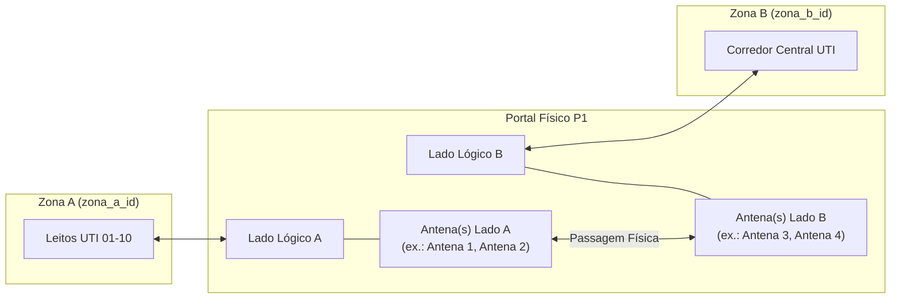
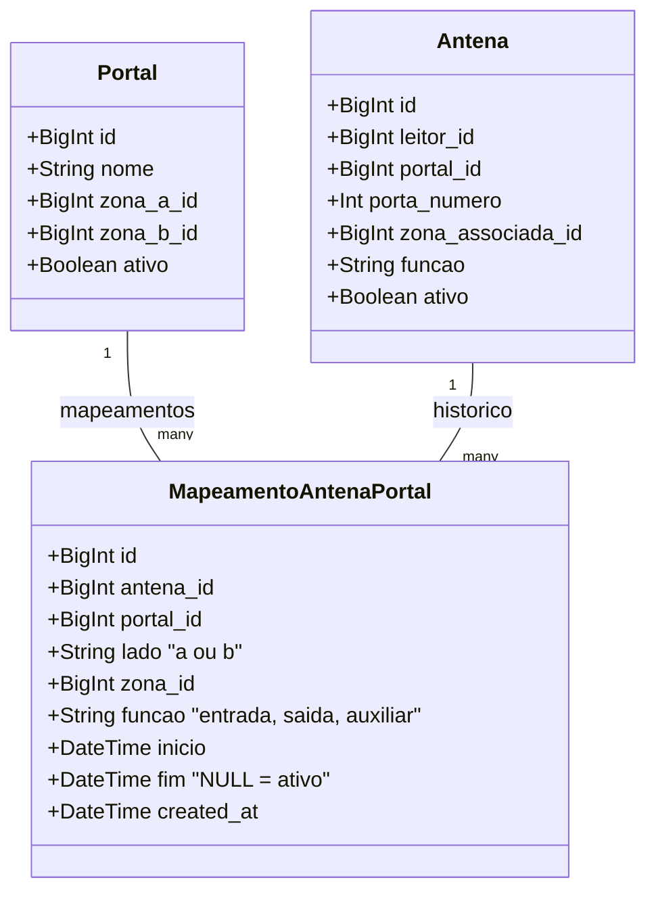

# ISS-013 — Topologia Lógica de Portais (Lados, Zonas e Funções das Antenas)

Este documento detalha a implementação do módulo de **Topologia Lógica de Portais**, referente à **ISS-013 (Issue #15)** e à migration `68e5a26c2e17`.

---

## 1. Escopo e Objetivo da Issue

### Problema
A rastreabilidade hospitalar por RFID passivo depende de interpretar passagens físicas entre ambientes delimitados. Na ISS-012, foi estabelecida a topologia física de inventário de hardware:
> *"Quais equipamentos físicos existem e como estão conectados?"*  
> (ex.: Leitor 1 possui a Porta 1 conectada à Antena X, que está instalada no vão do Portal P1).

No entanto, essa informação física por si só **não é suficiente** para determinar a direção de movimento de um equipamento:
- Não se sabia para qual lado da passagem a Antena X apontava.
- Não se sabia qual zona hospitalar estava de fato associada àquele lado.
- Não se definia a função operacional da antena (`entrada`, `saida`, `auxiliar`).
- Se essa parametrização fosse feita através de colunas mutáveis na tabela `antenas`, qualquer reorganização física posterior sobrescreveria a configuração antiga, destruindo a capacidade de auditar ou reinterpretar leituras brutas e passagens passadas.

### Objetivo da ISS-013
Responder:
> *"Qual o significado lógico e operacional de cada antena dentro do portal em uma linha do tempo?"*

A ISS-013 fornece:
1. **Configuração direcional inequívoca:** Associação explícita entre antena, portal, lado lógico (A ou B), zona adjacente e função operacional.
2. **Preservação histórica versionada (`[inicio, fim)`):** Alterações de configuração geram novas versões no tempo sem apagar a configuração histórica necessária para interpretar eventos anteriores.
3. **Consulta consolidada da topologia:** Endpoint otimizado (`GET /portais/{portal_id}/topologia`) fornecendo em uma única chamada todos os dados que o motor de inferência (ISS-015) necessita para correlacionar leituras MQTT com sentidos de movimentação.

---

## 2. Por que a ISS-013 é Vital para o MVP?

Sem a topologia lógica:
1. O motor de inferência (ISS-015) seria incapaz de traduzir duas detecções consecutivas (Antena 1 seguida de Antena 2) em um vetor de movimentação espacial ($A \rightarrow B$).
2. A troca de layout físico no hospital (como mudar a antena de entrada de posição ou inverter o sentido de um corredor) provocaria anacronismo e inconsistência retroativa em todo o histórico de movimentações anteriores.
3. Múltiplas antenas cobrindo um portal largo não teriam como ser agrupadas sob o mesmo lado de leitura.

---

## 3. Diferença entre Topologia de Hardware (ISS-012) e Topologia Lógica (ISS-013)

| Dimensão | Topologia de Hardware (ISS-012) | Topologia Lógica de Portais (ISS-013) |
|---|---|---|
| **Pergunta central** | "O que existe fisicamente e onde está cabeado?" | "O que cada antena significa na interpretação do fluxo?" |
| **Entidades principais** | `leitores`, `antenas`, `portais` | `mapeamentos_antena_portal` |
| **Natureza do dado** | Estado atual do inventário de hardware | Configuração temporal versionada `[inicio, fim)` |
| **Comportamento em alteração** | Mutação do cadastro atual (`UPDATE`) | Fechamento temporal (`fim = now()`) e abertura de nova linha |
| **Consumidores** | Ingestão MQTT (resolução leitor/porta $\rightarrow$ antena) | Motor de inferência de passagens e direções (ISS-015) |

---

## 4. Arquitetura Lógica e Semântica de Lados e Zonas

Um portal opera como a fronteira de controle de passagem entre duas zonas hospitalares distintas (`zona_a_id` e `zona_b_id`):



### Semântica Direcional $A \rightarrow B$ e $B \rightarrow A$:
- **Passagem $A \rightarrow B$:** Detecção sequencial iniciando em antena do **Lado A** e finalizando em antena do **Lado B** representa transição física de **Zona A $\rightarrow$ Zona B**.
- **Passagem $B \rightarrow A$:** Detecção sequencial iniciando em antena do **Lado B** e finalizando em antena do **Lado A** representa transição física de **Zona B $\rightarrow$ Zona A**.

> [!IMPORTANT]
> A ISS-013 **não implementa a inferência de passagens**, nem debounce de rádio, nem atualização automática de localização de ativos. A ISS-013 fornece unicamente o modelo de dados, os serviços e a API de consulta necessários para que a **ISS-015** execute esse algoritmo.

---

## 5. Modelo de Dados e Versionamento Temporal

A tabela `mapeamentos_antena_portal` utiliza a semântica temporal de intervalo semiaberto `[inicio, fim)`:



### Invariantes do Banco de Dados:
1. **Lado Lógico:** `CheckConstraint("lado IN ('a', 'b')", name="ck_mapeamento_lado_valido")`.
2. **Função Operacional:** `CheckConstraint("funcao IN ('entrada', 'saida', 'auxiliar')", name="ck_mapeamento_funcao_valida")`.
3. **Período Válido:** `CheckConstraint("fim IS NULL OR fim >= inicio", name="ck_mapeamento_periodo_valido")`.
4. **Unicidade de Mapeamento Ativo:**  
   Índice único parcial no PostgreSQL:
   ```sql
   CREATE UNIQUE INDEX uq_mapeamento_antena_ativo
   ON mapeamentos_antena_portal (antena_id)
   WHERE fim IS NULL;
   ```
   Garante que uma antena física pode estar associada a no máximo **um** mapeamento lógico ativo simultâneo.
5. **Múltiplas Antenas por Lado:** Não há constraint de unicidade em `(portal_id, lado)`, permitindo suporte nativo a portais largos com arranjos de múltiplas antenas no mesmo lado.

---

## 6. Regras de Domínio e Guards de Integridade

A camada de serviço (`api/service_topologia_portal.py`) e os guards em hardware implementam as seguintes proteções:

1. **Validação de Existência e Ciclo de Vida:** A antena e o portal precisam existir e estar com `ativo = true` para receber um novo mapeamento ativo.
2. **Vínculo Físico Prévio:** A antena deve estar associada ao portal na configuração física (`antena.portal_id == portal.id`).
3. **Coerência Estrita de Lado e Zona:**
   - Se `lado == 'a'`, a zona obrigatoriamente deve ser igual a `portal.zona_a_id`.
   - Se `lado == 'b'`, a zona obrigatoriamente deve ser igual a `portal.zona_b_id`.
   - A `antena.zona_associada_id` do hardware deve coincidir com a zona do lado correspondente.
4. **Substituição Temporal Atômica (`atualizar_mapeamento`):**
   - Ao alterar lado ou função de um mapeamento ativo:
     - `antigo.fim = now()`
     - `novo.inicio = now()`, `novo.fim = NULL`
   - Ambas as operações ocorrem na mesma transação atômica. O registro antigo torna-se imutável e permanece consultável.
5. **Guard no Portal (`atualizar_portal`):**
   - Se o portal possuir mapeamentos lógicos ativos (`fim IS NULL`), qualquer tentativa de alterar `zona_a_id` ou `zona_b_id` é **bloqueada** (`PortalComMapeamentosAtivos`, HTTP 409). O operador deve encerrar os mapeamentos antes de alterar as zonas físicas do portal.
6. **Guard na Antena (`atualizar_antena`):**
   - Se a antena possuir mapeamento lógico ativo, tentativas de alterar ou remover seu `portal_id` ou alterar sua `zona_associada_id` são **bloqueadas** (`AntenaComMapeamentoAtivo`, HTTP 409).
7. **Guard na Zona (`inativar_zona`):**
   - A verificação de uso da zona impede a inativação de qualquer zona que possua registros em `mapeamentos_antena_portal` (`ZonaEmUso`, HTTP 409).

---

## 7. Principais Arquivos e Rotas da API

### Arquivos Adicionados / Modificados:
- `db/models.py`: Declaração do modelo `MapeamentoAntenaPortal` e relacionamentos em `Portal` e `Antena`.
- `alembic/versions/68e5a26c2e17_iss_013_topologia_logica_versionada_de_.py`: Migration com criação de tabela, índices e backfill seguro.
- `api/service_topologia_portal.py`: Regras de negócio, ciclo de vida temporal e DTOs de topologia.
- `api/schemas_topologia_portal.py`: Schemas Pydantic de requisição e resposta.
- `api/router_topologia_portal.py`: Endpoints REST dedicados à topologia lógica.
- `api/service_hardware.py` e `api/router_hardware.py`: Guards de integridade em portais e antenas e mapeamento HTTP 409.
- `api/main.py`: Registro do roteador `router_topologia_portal`.

### Rotas HTTP Disponibilizadas:
| Método | Rota | Descrição |
|---|---|---|
| `POST` | `/portais/{portal_id}/mapeamentos` | Cria um mapeamento lógico ativo para uma antena no portal |
| `GET` | `/portais/{portal_id}/mapeamentos` | Lista mapeamentos do portal (ativos por padrão; `?incluir_historico=true`) |
| `GET` | `/portais/{portal_id}/topologia` | Consulta consolidada de topologia para o motor de inferência (ISS-015) |
| `GET` | `/mapeamentos-antena/{id}` | Detalha um mapeamento lógico específico |
| `PATCH` | `/mapeamentos-antena/{id}` | Atualização temporal (encerra versão anterior e abre nova) |
| `POST` | `/mapeamentos-antena/{id}/inativar` | Encerra um mapeamento lógico preservando o histórico |
| `GET` | `/antenas/{antena_id}/mapeamentos` | Consulta histórico completo de mapeamentos de uma antena |

---

## 8. Formato da Resposta de Topologia (`/portais/{portal_id}/topologia`)

O motor de inferência da ISS-015 precisa resolver leituras MQTT recebidas no formato `(reader_id, porta_numero)` diretamente para o lado e zona do portal, sem realizar queries adicionais no banco. O endpoint responde no formato consolidado:

```json
{
  "portal_id": 1,
  "nome": "Portal P1 - Entrada UTI",
  "ativo": true,
  "zona_a": {
    "id": 10,
    "nome": "Leitos UTI 01-10"
  },
  "zona_b": {
    "id": 20,
    "nome": "Corredor Central"
  },
  "antenas": [
    {
      "mapeamento_id": 1,
      "antena_id": 101,
      "reader_id": "reader-01",
      "porta_numero": 1,
      "lado": "a",
      "zona_id": 10,
      "funcao": "entrada",
      "inicio": "2026-09-21T20:00:00Z"
    },
    {
      "mapeamento_id": 2,
      "antena_id": 102,
      "reader_id": "reader-01",
      "porta_numero": 2,
      "lado": "b",
      "zona_id": 20,
      "funcao": "saida",
      "inicio": "2026-09-21T20:00:00Z"
    }
  ]
}
```

---

## 9. Validação e Testes Realizados

- **Testes de Serviço (`tests/test_service_topologia_portal.py`):**
  - Validação de portal bidirecional e semântica $A \rightarrow B$ / $B \rightarrow A$.
  - Rejeição de terceira zona não pertencente ao portal.
  - Rejeição de divergência entre lado e zona.
  - Suporte a múltiplas antenas no mesmo lado.
  - Bloqueio de duplicidade de mapeamento ativo para a mesma antena.
  - Testes de versionamento temporal e imutabilidade de registros históricos.
  - Testes dos guards de mutação de zonas de portal e antenas ativas.
- **Testes de API (`tests/test_api_topologia_portal.py`):**
  - Cobertura de todos os endpoints HTTP, códigos de status (200, 201, 404, 409, 422).
  - Formato estrito da rota de topologia consolidada.
- **Testes de Migration (`tests/test_migration_iss013.py`):**
  - Roundtrip upgrade / downgrade / re-upgrade em banco descartável.
  - Backfill seguro de antenas ativas pré-existentes.
  - Salvaguardas *fail-fast* contra zonas inconsistentes ou funções indefinidas.

---

## 10. Limitações Conhecidas e Próximos Passos

1. **Inferência Não Implementada:** A ISS-013 estabelece o significado das antenas, mas **não** gera registros na tabela `passagens` nem atualiza `equipamentos.ultima_zona_id`.
2. **Debounce de RF:** Antenas podem gerar múltiplos eventos para a mesma tag em milissegundos. A supressão desse ruído pertence à **ISS-014**.
3. **Próximas Dependências:**
   - **ISS-014:** Debounce temporal de leituras consecutivas.
   - **ISS-015:** Motor de inferência de passagens e direções ($A \rightarrow B$ e $B \rightarrow A$).
   - **ISS-016:** Atualização dinâmica da localização dos equipamentos.
