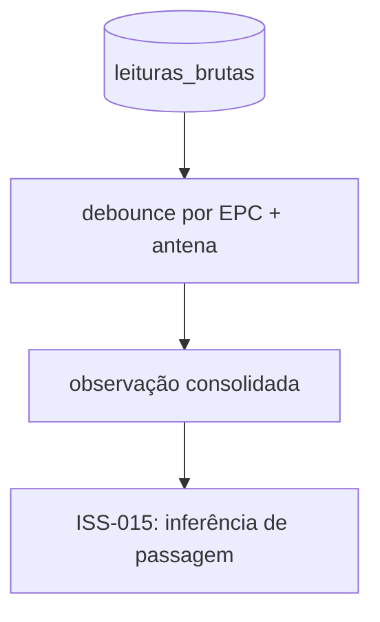

# ISS-014 — Debounce temporal de leituras RFID

## 1. O que a issue resolve

A ISS-014 (GitHub Issue #16) introduz a primeira etapa do Épico E4: transformar
rajadas de leituras brutas da mesma tag e da mesma antena em uma observação
lógica consolidada. Ela não detecta passagem, não calcula direção, não altera a
localização de equipamentos e não grava histórico de movimentações.

Leitores RFID UHF passivos podem reportar a mesma tag muitas vezes enquanto ela
permanece no campo de uma antena. Essas mensagens são evidências válidas e
continuam existindo individualmente em `leituras_brutas`; o debounce cria apenas
uma visão temporal em memória para o próximo estágio de inferência.



## 2. Idempotência não é debounce

A ISS-006 protege a persistência contra reentrega MQTT: o mesmo `event_id` usa
`ON CONFLICT DO NOTHING` e produz `duplicate`. A ISS-014 trata outra situação:
mensagens legítimas, com `event_id`s diferentes, podem descrever a mesma rajada
física.

O receptor chama o debounce somente quando `PersistenceResult.status` é
`inserted`. Uma duplicata continua recebendo ACK depois do resultado confirmado
do banco, mas não incrementa a contagem da observação. Assim:

- o banco conserva todas as leituras legítimas;
- a retransmissão do mesmo evento não vira nova evidência física;
- o `event_id` não é usado como chave temporal de agrupamento.

## 3. Chave e semântica temporal

A chave é **`(EPC, antena_id)`**, depois de o repositório resolver a origem
física `(reader_id, porta_numero)` para a antena ativa. Leituras do mesmo EPC em
antenas diferentes nunca são fundidas.

O algoritmo usa `lido_em`, representado pelo timestamp canônico UTC da leitura,
e não `recebido_em`. Após ordenar por event time, duas leituras consecutivas
pertencem à mesma observação quando:

```text
gap <= RFID_DEBOUNCE_WINDOW_MS
```

O limite é inclusivo. Com janela de 100 ms, gaps de exatamente 100 ms ainda
pertencem à mesma rajada; 101 ms inicia outra observação. A regra é encadeada:
leituras em 0, 90 e 180 ms formam uma observação, embora a amplitude total seja
180 ms, pois cada gap consecutivo é de 90 ms.

Empates de timestamp são ordenados por `event_id`, o que torna determinísticas
as referências de primeira e última leitura.

## 4. Eventos fora de ordem

Cada chave mantém um buffer simples e o maior event time já observado. O
watermark é:

```text
max_seen_at - RFID_OUT_OF_ORDER_TOLERANCE_MS
```

Eventos no watermark ou depois dele ainda são aceitos, inseridos no buffer em
ordem temporal e reagrupados. Uma nova leitura da mesma chave pode finalizar
grupos anteriores quando `fim_da_observacao + janela < watermark`; a desigualdade
estrita preserva o comportamento inclusivo no limite da janela.

Para uma chave que ficou silenciosa, `DebounceProcessor.advance_time()` usa um
segundo critério: o instante monotônico da última **chegada aceita** àquela
chave. Se o silêncio ultrapassar estritamente `janela + tolerância`, os grupos
pendentes são finalizados. O receptor chama essa operação a cada iteração do
loop MQTT, inclusive quando não chega nenhuma mensagem (cadência nominal de
até 200 ms enquanto conectado). Não é necessária uma nova leitura da mesma
antena. No limite exato de `janela + tolerância`, o grupo ainda aguarda.

Esses dois relógios têm funções distintas: `observed_at`/`lido_em` determina
quais leituras se agrupam e a ordem das referências; o relógio monotônico mede
apenas o tempo de silêncio operacional desde a recepção. `recebido_em` não entra
na chave nem no cálculo dos gaps. A tolerância é também o período de espera por
possíveis chegadas fora de ordem; uma chegada posterior à finalização segue a
regra de evento tardio abaixo.

Uma leitura anterior ao watermark, ou que cair no intervalo de uma observação já
finalizada, é classificada como tardia. Ela continua em `leituras_brutas`, gera o
log estruturado `rfid_debounce_late_event`, incrementa `late_events` e não reabre
silenciosamente o resultado finalizado. Coleções cuja extensão cabe dentro da
tolerância produzem o mesmo resultado para qualquer ordem razoável de chegada.

`DebounceProcessor.flush()` finaliza explicitamente tudo que ainda estiver no
buffer durante encerramento controlado e testes. A emissão operacional normal
usa `advance_time()` no loop MQTT. O polling não cria thread ou timer adicional.

## 5. Estrutura da observação

`ConsolidatedObservation` contém:

- `epc` e `antenna_id`;
- `first_seen_at` e `last_seen_at` em UTC;
- `reading_count`;
- `first_reading_id` e `last_reading_id`;
- `first_event_id` e `last_event_id` para rastreabilidade;
- `rssi_min`, `rssi_max` e `rssi_mean`.

Valores RSSI nulos são ignorados no cálculo. Se todos forem nulos, as três
estatísticas também são nulas. O componente não converte escala e não inventa
unidade: no perfil EZ700 cuja unidade ainda não foi validada fisicamente, o RSSI
canônico permanece nulo conforme a ISS-005.

## 6. Configuração

| Variável | Default inicial | Validação |
|---|---:|---|
| `RFID_DEBOUNCE_WINDOW_MS` | `250` | inteiro positivo |
| `RFID_OUT_OF_ORDER_TOLERANCE_MS` | `1000` | inteiro não negativo |

Esses defaults são parâmetros conservadores de software para o MVP, não valores
validados no HUPAA. Devem ser calibrados com dados reais de campo depois da
validação física. Os exemplos local, cloud e Compose expõem as duas variáveis.

## 7. Integração e observabilidade

O fluxo permanece:

```text
MQTT -> normalização -> event_id -> auditoria JSONL
     -> resolução de antena -> INSERT/commit PostgreSQL
     -> debounce somente se inserted -> ACK MQTT
```

O ACK continua condicionado ao commit PostgreSQL; falhas de banco não chegam ao
debounce e não recebem ACK. O `PersistenceResult` passou a carregar `antenna_id`
junto com `reading_id`, reaproveitando a resolução já feita na mesma transação e
evitando uma segunda consulta.

Uma falha interna isolada do debounce é registrada como `rfid_debounce_failed`
sem conteúdo da exceção e não desfaz o commit nem bloqueia o ACK: a evidência já
está segura em `leituras_brutas` e pode ser reconstruída, enquanto reter o ACK
causaria apenas uma reentrega que a idempotência classificaria como duplicata.

`MqttReceiver` recebe o `DebounceProcessor` por injeção e oferece um
`observation_handler`. O loop MQTT finaliza rajadas silenciosas em runtime e
entrega as observações a esse callback. A ISS-015 poderá conectar seu detector
de passagens ao callback sem acoplar a regra temporal ao MQTT. Nesta issue o
resultado é disponibilizado como objeto e logado, sem escrita em `passagens`.

Os logs estruturados informam leitura aceita/incorporada, duplicata ignorada,
evento tardio, observação finalizada e flush. `DebounceCounters` expõe:

- `readings_received`;
- `readings_incorporated`;
- `observations_finalized`;
- `late_events`.

Cada log de observação inclui `reading_count` e referências às leituras. Um poll
que emite observações também registra `rfid_debounce_automatic_finalization` com
contagem e totais acumulados, sem payload MQTT completo nem credenciais.

## 8. Testes realizados

`tests/test_debounce.py` cobre rajada simples, leituras espaçadas, limite exato,
separação por antena e EPC, reordenação dentro da tolerância, evento tardio,
RSSI nulo e agregado, referências temporais, flush e validações do componente.
`tests/test_config.py` cobre defaults, overrides e valores inválidos.

`tests/test_debounce_integration.py` percorre o pipeline com PostgreSQL real:
três leituras distintas da mesma tag/antena permanecem em `leituras_brutas` e
viram uma observação com `reading_count=3`; a mesma tag em outra antena produz
outra observação; a reentrega do mesmo `event_id` recebe ACK, não cria linha e
não aumenta a contagem.

Os testes adicionais simulam o relógio monotônico sem `sleep`: três leituras em
A são emitidas após silêncio, seguidas de duas em B, com
`observation_handler == [A, B]` durante o loop MQTT e sem `flush()`. Também
cobrem reordenação dentro da tolerância, limite do silêncio, contadores e evento
tardio após finalização automática.

Validação local inicial em 22/09/2026, antes da correção de finalização
automática: suíte completa com **247 passed, 486 skipped, 56 subtests**. A CI do
PR original executou **733 passed e 56 subtests**, além de lint e migrations.

Após a correção, também em 22/09/2026: Ruff `E4,E7,E9,F,I` passou; núcleo
`tests/test_debounce.py`: **18 passed**; integração
`tests/test_debounce_integration.py`: **4 passed, 1 skipped**; suíte completa:
**252 passed, 486 skipped, 56 subtests**. A execução completa com PostgreSQL
descartável é verificada pela CI do PR #55.

O skip da integração PostgreSQL real no ambiente local ocorreu porque o Docker Desktop
local não disponibilizou o daemon e o serviço do sistema não pôde ser iniciado
com a permissão da sessão. Os testes puros e a integração MQTT/repositório
injetado passaram; o teste PostgreSQL permanece versionado para execução no CI,
que fornece `TEST_DATABASE_URL` descartável. Os demais skips da suíte completa
são os testes opt-in de infraestrutura já existentes (PostgreSQL, Mosquitto e
integrações externas) sem suas variáveis/serviços locais.

## 9. Limitações e relação com a ISS-015

- O estado do debounce é local ao processo e não tem checkpoint durável. Uma
  reinicialização descarta buffers pendentes; `leituras_brutas` permanece íntegra
  para replay/reconstrução futura.
- Eventos além da tolerância ficam apenas como evidência bruta e sinalização de
  atraso; não são anexados retroativamente a observações finalizadas.
- Os parâmetros ainda precisam de calibração física no HUPAA.
- Não foi criada tabela de observações consolidadas nem migration.
- A ISS-015 consumirá `ConsolidatedObservation` em runtime para detectar
  passagens entre antenas com apoio da topologia lógica da ISS-013. A inferência
  de direção pertence à ISS-016, a última zona à ISS-017 e o histórico à ISS-018.
