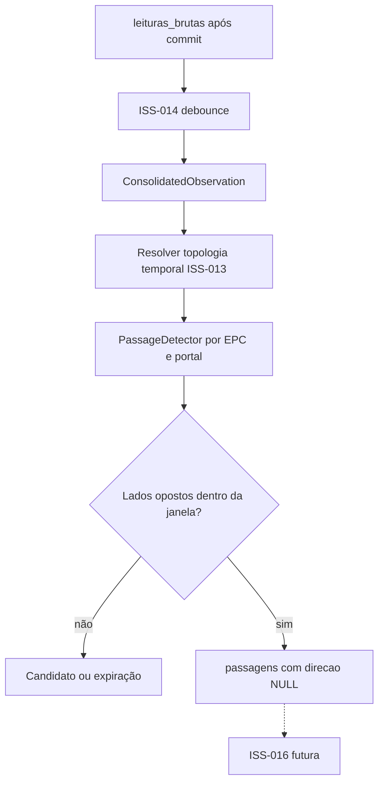

# ISS-015 — Detecção de passagem por sequência de antenas

## Problema e importância para o MVP

A ISS-014 reúne leituras repetidas da mesma antena em uma `ConsolidatedObservation`. Isso ainda não prova que uma tag atravessou um portal. A ISS-015 correlaciona duas observações da mesma tag, em lados lógicos opostos do mesmo portal, com proximidade temporal. A saída é uma linha em `passagens` que conserva as evidências. Direção, localização e histórico pertencem às issues seguintes.

## Regra e estados

O estado é independente por `(EPC, portal_id)`. `IDLE` recebe uma observação válida e vira `PENDING`. Outra observação do mesmo lado, inclusive de outra antena, substitui o candidato pela evidência mais recente e não gera passagem. Lados opostos A→B ou B→A geram uma proposta de passagem quando o intervalo é menor ou igual a `RFID_PASSAGE_MAX_INTERVAL_MS` (padrão inicial: 3000 ms). Uma sequência incompleta expira. O detector somente entra em `CONFIRMED` quando a gravação idempotente da passagem termina; falha de banco mantém a proposta para tentativa no próximo polling. O ACK da leitura bruta continua independente desse resultado.

As evidências são ordenadas por `(first_seen_at, antenna_id, first_event_id)`, inclusive quando as observações chegam fora de ordem ou têm timestamps iguais. O intervalo é `max(0, segunda.first_seen_at - primeira.last_seen_at)`. Exatamente no limite há relação; acima do limite o candidato expira e a nova observação inicia outro. `detectada_em` é o maior `last_seen_at` das duas observações. Todo esse julgamento usa tempo RFID, sem `datetime.now()`.

Após confirmação, observações do mesmo `(EPC, portal_id)` com distância de até a janela em relação ao fim da atividade confirmada são suprimidas. Cada observação residual estende o fim da atividade. Uma nova passagem só pode começar após lacuna **maior** que a janela. Assim, A1, A2, B1, B2, A3 e B3 residuais formam um único grupo físico. Um retorno real extremamente rápido dentro dessa janela pode ser suprimido no MVP. O relógio monotônico limpa estados silenciosos sem decidir a relação entre eventos. A limpeza espera a janela de passagem mais o tempo máximo de finalização da ISS-014 (`debounce window + out-of-order tolerance`), para não descartar A enquanto B ainda é consolidado.

## Topologia temporal

`PassageRepository.resolve` consulta `mapeamentos_antena_portal` históricos para a antena, não apenas a configuração ativa atual. Exige **um único** mapeamento cobrindo toda a observação: `inicio <= first_seen_at` e `fim IS NULL OR fim > last_seen_at`. O intervalo de configuração é `[inicio, fim)`. Um timestamp exatamente em `inicio` pertence ao novo mapeamento; exatamente em `fim` não pertence ao encerrado. Observações que atravessam reconfiguração, sem mapeamento ou com sobreposição ambígua não entram no detector. O serviço incrementa `topology_unresolved` e registra `rfid_passage_topology_unresolved`. As leituras brutas continuam intactas. Antenas de leitores físicos distintos podem integrar o mesmo portal; várias antenas do mesmo lado não criam passagem entre si.

## Persistência e observabilidade

`passagens.antena_origem_id` e `antena_destino_id` representam **primeira e segunda evidências ordenadas**, sem significar ainda zona de origem ou destino. A primeira observação fornece `last_reading_id`, e a segunda fornece `first_reading_id`: são as leituras brutas mais próximas da transição. `direcao` permanece `NULL`. A migration `4b751b0e9015` cria índice único no par `(leitura_origem_id, leitura_destino_id)`; `INSERT ... ON CONFLICT DO NOTHING` garante idempotência concorrente e em replay. Não há tabela nova nem escrita em equipamentos ou histórico.

O detector conta observações, candidatos iniciados/expirados, repetições do mesmo lado, passagens confirmadas/duplicadas e atividade suprimida. O serviço conta topologia não resolvida e falha de persistência. Logs identificam início, expiração, mesmo lado, confirmação, duplicata, topologia não resolvida e falha de gravação, sem payload MQTT ou detalhes privados do SQL.

## Testes e limites

`tests/test_passage.py` testa a máquina de estados sem banco ou `sleep`, incluindo limite exato, expiração, desempate, chegada fora de ordem, tags e portais simultâneos, atividade residual e retry. `tests/test_passage_integration.py` testa topologia temporal, persistência e pipeline MQTT → leitura bruta → debounce → observação → passagem quando há PostgreSQL descartável em `TEST_DATABASE_URL`. A migration participa da validação Alembic da CI. Se o processo for reiniciado, o estado em memória se perde; as leituras brutas preservadas permitem reconstrução/replay operacional posterior, sem fila durável nova nesta issue.

**PENDENTE DE VALIDAÇÃO FÍSICA:** o valor de 3000 ms é configuração inicial de software. Precisa de calibração controlada no HUPAA com leitores Identix EZ700 reais. Nenhum resultado físico é presumido aqui. A ISS-016 receberá a passagem persistida e interpretará posteriormente A→B, B→A ou ambiguidade sem que esta implementação antecipe direção semântica.
