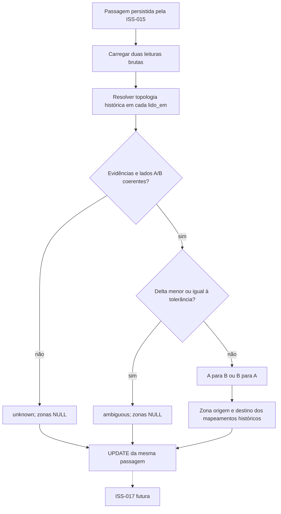

# ISS-016 — Inferência temporal da direção da passagem

## Problema e importância para o MVP

A ISS-014 consolida leituras repetidas por EPC e antena. A ISS-015 detecta a
travessia de um portal e grava duas leituras de evidência em `passagens`, mas
deixa `direcao=NULL`. A ISS-016 interpreta essas evidências para determinar o
sentido lógico e as zonas da passagem. Isso entrega à futura ISS-017 uma
passagem com destino confiável quando a classificação for `confirmed`.

## Semântica da direção

O lado A e o lado B são definições lógicas do portal na ISS-013. A função
operacional do mapeamento (`entrada`, `saida` ou `auxiliar`) não define o
sentido físico. Uma sequência temporal A→B produz `direcao=a_para_b`,
`zona_origem_id=zona A` e `zona_destino_id=zona B`. B→A produz
`direcao=b_para_a`, origem na zona B e destino na zona A. O algoritmo não usa
`reader_id`, porta física nem RSSI para decidir direção. Várias antenas por
lado e antenas de leitores distintos usam a mesma regra de mapeamento.

As colunas `antena_origem_id` e `leitura_origem_id` da ISS-015 significam
primeira evidência temporal; as colunas `...destino_id` significam segunda
evidência temporal. A ISS-016 usa `LeituraBruta.lido_em` dessas duas leituras,
não o desempate técnico por ID de antena da ISS-015, nem o instante de
recepção MQTT. O resultado imutável `DirectionInferenceResult` conserva IDs,
antenas, instantes, lados, zonas, regra e status para inspeção da decisão.

## Topologia histórica e ambiguidade

Cada leitura é associada a exatamente um `MapeamentoAntenaPortal` cuja janela
contém seu instante: `inicio <= lido_em AND (fim IS NULL OR fim > lido_em)`.
Assim, `[inicio, fim)` inclui o início e exclui o fim. A configuração atual
do portal não substitui a configuração histórica. O serviço verifica que
ambas as evidências pertencem ao portal da passagem, que lados A/B e zonas
históricas são coerentes em ambos os instantes e que os lados são opostos.
Ausência, sobreposição, outro portal, mesmo lado, leitura incompatível ou
mudança de zonas durante a travessia gera `unknown`, sem zonas de origem e
destino persistidas.

`RFID_DIRECTION_AMBIGUITY_MS` aceita inteiro não negativo e vale **100 ms**
por padrão. Com `delta = segunda.lido_em - primeira.lido_em`, a fronteira é
inclusiva: `delta <= tolerância` gera `ambiguous`. Timestamps iguais, 50 ms
e exatamente 100 ms ficam ambíguos no default; acima de 100 ms, uma
topologia consistente permite `confirmed`. `ambiguous` significa evidências
válidas mas ordem física incerta. `unknown` significa evidências ou topologia
insuficientes/inconsistentes. Ambos gravam `direcao=indeterminada` e zonas
`NULL`; uma passagem física da ISS-015 continua registrada.

## Persistência, idempotência e recuperação

A migration `9d0116a01600` adiciona `zona_origem_id` e `zona_destino_id`
como FKs anuláveis para `zonas`, além de `direcao_status` e `direcao_regra`.
O CHECK de `direcao` passa a admitir somente `a_para_b`, `b_para_a` e
`indeterminada`, além de `NULL` antes da classificação. Outro CHECK exige
zonas distintas e presentes para `confirmed`; `ambiguous`/`unknown` não
podem ter zonas. A regra persistida é `temporal_side_order_v1`,
`temporal_proximity_v1`, `topology_unresolved`, `evidence_unresolved`,
`same_side` ou `evidence_order_invalid`.

O upgrade preserva passagens da ISS-015 com `direcao=NULL`. Se houver
`entrada`/`saida` antigos não nulos, falha com mensagem explícita para
revisão manual, pois não existe tradução inequívoca para A/B. O downgrade
é possível enquanto não houver A/B confirmado; nesse caso, exige revisão
manual antes de retornar ao contrato antigo para não apagar uma decisão
semântica. Os testes de migration cobrem schema vazio e passagem pendente
pré-existente.

Após o commit da passagem, o `PassageInferenceService` chama o serviço de
direção. No startup e a cada 5 segundos durante o loop operacional, ele
busca até 100 passagens sem `direcao_status` e tenta processá-las. Assim,
uma queda entre INSERT da ISS-015 e UPDATE da ISS-016 deixa uma pendência
durável recuperável no PostgreSQL. O UPDATE usa `WHERE direcao_status IS
NULL`: retries e concorrência não duplicam linhas nem rebaixam uma decisão
já consolidada. Logs JSON registram status, IDs, zonas e regra; contadores
em memória registram processadas, confirmadas, ambíguas, desconhecidas e
retries. Não há payload MQTT bruto ou credencial nesses eventos.

## Testes, limites e contrato futuro

`tests/test_direction.py` cobre a regra pura, fronteira temporal, topologias
inválidas, múltiplas antenas, ausência de dependência do leitor/RSSI e retry.
`tests/test_direction_integration.py` cobre topologia histórica no
PostgreSQL, limites `[inicio, fim)`, persistência, constraints e o fluxo
MQTT → leitura bruta → debounce → passagem → direção, incluindo o cenário
de 50 ms. `tests/test_migrations.py` cobre upgrade/downgrade/re-upgrade.

Validação de 22/09/2026 no PR #57: Ruff `E4,E7,E9,F,I` passou. Localmente,
`tests/test_direction.py` terminou com **24 passed**; a suíte completa,
com diretório temporário acessível, terminou com **289 passed, 507 skipped e
63 subtests passed**. Os skips locais decorrem da ausência de
`TEST_DATABASE_URL` e dos serviços de integração. Na CI, o job **Testes**
com PostgreSQL e Mosquitto descartáveis terminou com **796 passed,
0 skipped e 63 subtests passed**. O job **Migrations** realizou upgrade,
downgrade e reupgrade em banco vazio, verificou o schema e terminou com
**794 passed, 2 skipped e 63 subtests passed**; os dois skips são os
cenários MQTT de `tests/test_integration.py`, pois esse job não inicia o
broker. Os mesmos cenários passaram no job Testes.

A ISS-017 poderá consumir somente passagens com
`direcao_status == "confirmed"` e `zona_destino_id IS NOT NULL` para atualizar
a última zona. **Esta issue não altera** `equipamentos.ultima_zona_id`,
`ultima_deteccao_em`, `ultima_passagem_id` nem insere em
`historico_movimentacoes`; ISS-017 e ISS-018 permanecem pendentes.

O default de 100 ms, a estabilidade da ordem entre campos sobrepostos e a
confiabilidade dos timestamps do Identix EZ700 ainda precisam de ensaios
controlados. **PENDENTE DE VALIDAÇÃO FÍSICA NO HUPAA.** Os testes sintéticos
avaliam algoritmo, topologia e persistência; não constituem validação física.
