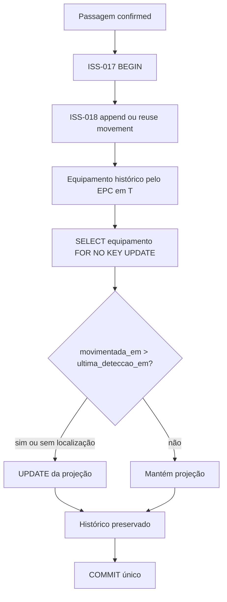

# ISS-017 — Última localização conhecida do equipamento

## Objetivo e importância

A Issue #19 (RF-012, RF-017, RF-018) fecha o fluxo lógico da Sprint 2: MQTT →
`leituras_brutas` → debounce (ISS-014) → passagem (ISS-015) → direção (ISS-016)
→ histórico (ISS-018) e última zona (ISS-017). A zona é aproximada: representa
a última passagem confiável, não posicionamento contínuo.

## Projeção e fonte auditável

`equipamentos.ultima_zona_id`, `ultima_deteccao_em`, `ultima_passagem_id` e
`ultima_movimentacao_id` formam uma projeção para consulta rápida. A fonte
auditável permanece `historico_movimentacoes`. A migration `a017b1c2d3e4`
adiciona apenas a FK `ultima_movimentacao_id` nullable, sem backfill, preservando
equipamentos e históricos existentes; downgrade remove somente essa coluna.
O vínculo permite obter `origem_registro`, `registrado_em`, justificativa, EPC,
portal e evidências. `registrado_em` é o tempo de processamento da localização;
`equipamentos.updated_at` não o substitui, pois também muda com edição cadastral.

## Fluxo automático e transação

`DirectionInferenceService` chama o serviço de localização após persistir uma
direção `confirmed`. O callback pode falhar sem desfazer a leitura bruta, a
passagem ou a direção já commitadas. A reconciliação no startup e no polling
do ingestor recupera a pendência. Não há fila externa nem thread nova.

`process_passage(passage_id)` abre uma única transação com `engine.begin()`,
reutiliza `append_automatic_movement(connection, passage_id)` da ISS-018,
carrega a movimentação persistida, bloqueia o equipamento via `FOR NO KEY UPDATE`,
compara event time e atualiza os quatro campos quando o movimento vence.
O append da ISS-018 não faz commit interno. Uma exceção durante o UPDATE ou
antes do commit desfaz histórico e projeção juntos. A FK ao movimento é criada
após a tabela de histórico, inclusive em schema vazio; os relacionamentos ORM
indicam a FK para resolver a circularidade sem cascata de exclusão.

## Ordem temporal, concorrência e idempotência

`historico_movimentacoes.movimentada_em` deriva de `passagens.detectada_em`
para registros automáticos. É o **event time** usado na decisão, nunca `now()`,
`registrado_em` ou ordem de processamento. Sem localização anterior ou com T
maior, o movimento atualiza a projeção. Um T menor é `stale`: a linha histórica
é preservada, mas a zona não regride. Com T igual e mesmo movimento, o retry é
`duplicate`; com movimento diferente, é `same_timestamp_conflict` e a projeção
não escolhe um ID como ordem física. A consulta histórica ainda mostra ambos.

O lock `SELECT ... FOR NO KEY UPDATE` serializa a decisão por equipamento.
Ele é compatível com os locks `KEY SHARE` das FKs de dois INSERTs de histórico
simultâneos, evitando deadlock por promoção de lock. Dois
workers que processam T=10:00 e T=10:05 chegam sempre à zona de 10:05,
independentemente da ordem do lock. O índice único parcial da ISS-018 mantém
uma movimentação automática por passagem; o serviço também aceita histórico
já existente e reconcilia a projeção ausente. Reprocessar a mesma passagem
não duplica histórico nem altera a zona. A busca de pendências inclui passagem
`confirmed` sem histórico e histórico automático com T maior que a projeção ou
projeção ausente, em lotes limitados; cursor por ID evita que EPCs sem vínculo
bloqueiem todo o lote. Depois da reconciliação, uma passagem resolvida deixa de
ser retornada. O relógio monotônico só agenda o polling.

## EPC, direção e correção manual

A ISS-018 resolve `Tag.epc` e `AssociacaoTagEquipamento` no intervalo histórico
`[inicio, fim)` do instante T. A troca posterior da tag não muda o equipamento
da passagem antiga. EPC desconhecido ou associação ambígua retornam status
explícito, sem criar equipamento, movimento automático ou localização. Uma
passagem `ambiguous`, `unknown` ou estruturalmente inválida tampouco projeta
zona; suas leituras e passagem permanecem preservadas. Equipamento hoje inativo
não é descartado quando a associação histórica válida aponta para ele.

`apply_manual_location_correction(...)` é serviço **interno** para futuro
chamador autorizado. Ele bloqueia o equipamento antes de derivar zona de
origem e `registro_anterior_id`, rejeita T anterior ou igual ao da projeção,
chama `append_manual_correction` e atualiza a projeção na mesma transação. O
novo registro conserva justificativa, aponta para o anterior e tem
`passagem_id=NULL`; o anterior permanece intacto. Nenhum endpoint público
de escrita foi criado. Identidade, RBAC, autorização e interface administrativa
pertencem à ISS-025/ISS-027/ISS-028.

## Observabilidade, testes e limites

Resultados imutáveis e logs informam status, equipamento, passagem, movimento,
zonas e tempos; contadores locais cobrem processados, atualizados, atrasados,
duplicatas, conflitos, EPCs irresolúveis e retries. Não há payload MQTT bruto,
credenciais nem SQL completo nos logs da localização. Testes unitários cobrem
ordem temporal; integração PostgreSQL cobre retry, evento atrasado, conflito,
EPC sem vínculo, associação histórica, concorrência, rollback, recuperação,
correção manual e migration; o teste ponta a ponta usa MQTT sintético até
histórico e equipamento. Consulte o resultado exato dos testes no PR da Issue
#19; testes que exigem `TEST_DATABASE_URL` local são pulados sem esse banco.

**PENDENTE DE VALIDAÇÃO FÍSICA NO HUPAA.** Debounce, janela de passagem,
tolerância de direção, comportamento das antenas, sequência física de leituras
e estabilidade dos timestamps do Identix EZ700 ainda exigem ensaio em campo.
Nenhum parâmetro de inferência foi alterado nesta issue.
