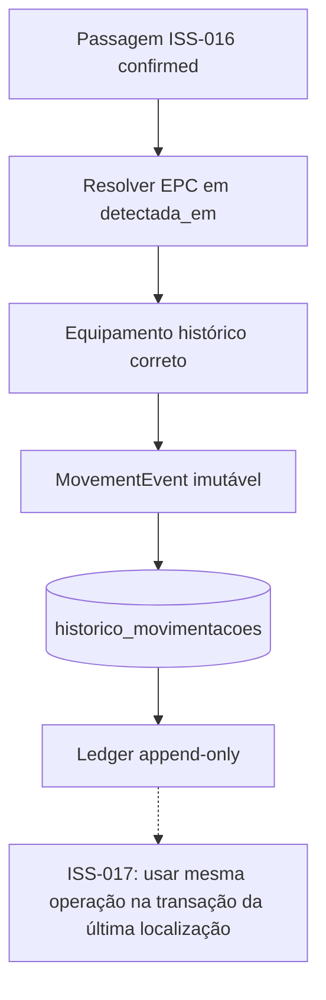

# ISS-018 — Histórico imutável de movimentações

> Estado atual: a ISS-017 já integra este ledger ao pipeline e à projeção da
> última zona em uma transação. As referências a integração futura abaixo
> descrevem a fronteira original da entrega ISS-018.

## Objetivo e importância

A Issue #20 (RF-013, RNF-006, RNF-015) prepara o ledger de movimentações para auditoria do MVP. Uma passagem confirmada pela ISS-016 pode ser convertida em registro com equipamento, EPC, portal, zonas, leituras e horários. A ISS-017 ainda deverá integrar essa operação à atualização da última localização, na **mesma transação**. Por isso, esta entrega não liga o ledger automaticamente ao ingestor ou ao serviço de direção e não altera `equipamentos.ultima_zona_id`, `ultima_deteccao_em` ou `ultima_passagem_id`.

## Estrutura e tempos

O registro inclui `equipamento_id`, `epc`, `zona_origem_id`, `zona_destino_id`, `portal_id`, `passagem_id`, `leitura_origem_id`, `leitura_destino_id`, `origem_registro`, `movimentada_em` e `registrado_em`. O **event time** `movimentada_em` vem de `passagens.detectada_em`, definido pela ISS-015 como o maior `last_seen_at` das observações. O **processing time** `registrado_em` é preenchido pelo banco ao inserir o histórico. As FKs ligam a passagem e as leituras sem copiar RSSI ou payload. `justificativa` e `registro_anterior_id` suportam correções. Campos novos são anuláveis no schema para preservar linhas legadas, que não têm event time confiável recuperável; uma `CHECK NOT VALID` protege novas inserções.

## Registro automático e resolução temporal

`append_automatic_movement(connection, passage_id)` carrega a passagem persistida e exige `direcao_status=confirmed`, direção A→B ou B→A, zonas distintas e presentes, duas leituras e portal. Não aceita origem, destino ou passagem informados livremente por cliente HTTP. A associação é resolvida por `Tag.epc` e `associacoes_tag_equipamento` no instante `passagem.detectada_em`: `inicio <= T AND (fim IS NULL OR fim > T)`. Assim, uma passagem antiga conserva o equipamento antigo depois da troca de tag. Ausência de EPC/vínculo ou mais de uma associação temporal retorna estado explícito sem inserir histórico. Logs registram o motivo e IDs úteis, sem payload MQTT ou SQL completo.

O índice único parcial `uq_historico_passagem_automatica` impede duas movimentações automáticas para a mesma passagem. `INSERT ... ON CONFLICT DO NOTHING` e a leitura do ID existente tornam retry e disputa entre workers idempotentes. A proteção principal é do PostgreSQL, inclusive quando duas transações concorrentes tentam inserir ao mesmo tempo. `MovementWriteResult` informa `recorded`, `duplicate`, `invalid_passage`, `unresolved_epc`, `ambiguous_association` ou `passage_missing`.

## Correção e imutabilidade

`append_manual_correction(connection, ...)` exige equipamento, destino, instante com fuso e justificativa não vazia. Pode referenciar um registro anterior do mesmo equipamento; nesse caso, a origem é seu destino anterior e a justificativa fica no novo registro. O anterior permanece intacto. Uma correção não atualiza a projeção de última localização; a ISS-017 deverá incluir ambos os comandos em uma transação. O serviço só faz `INSERT`; a API expõe apenas `GET`, sem `PATCH` ou `DELETE` do histórico. A imutabilidade é a política do fluxo normal e da API; administradores com acesso SQL direto continuam responsáveis por controlar privilégios de banco.

## Consulta, índice e retenção

`GET /equipamentos/{equipamento_id}/movimentacoes` devolve `items`, `page`, `size`, `total` e `pages`, com `page >= 1` e `1 <= size <= 100`. Equipamento inexistente retorna 404; página sem itens retorna lista vazia. A ordem é `movimentada_em DESC NULLS LAST, id DESC`; o ID desempata instantes iguais. `inicio` e `fim` opcionais têm fuso horário e filtram o event time no intervalo semiaberto `[inicio, fim)`, exigindo `inicio < fim` quando ambos são dados. O índice `(equipamento_id, movimentada_em, id)` atende ao acesso por equipamento e período. O índice antigo em `(equipamento_id, registrado_em)` foi preservado.

**Retenção indefinida no MVP; decisão de retenção pendente para produção.** Não há expurgo automático.

## Transação futura, testes e limites

O chamador fornece uma `sqlalchemy.engine.Connection` já dentro de `BEGIN`. Nenhum método de escrita faz `commit()`; um `ROLLBACK` externo remove a inserção. A ISS-017 poderá resolver a passagem, verificar sua recência, atualizar os três campos de última localização e chamar `append_automatic_movement` antes de um único `COMMIT`. Essa integração ainda não foi implementada. Como o pipeline não chama o serviço nesta issue, uma passagem confirmada não gera histórico automaticamente hoje.

`tests/test_movement.py` cobre seleção de passagem, associação irresolúvel, ambiguidade, retry e justificativa. `tests/test_movement_integration.py` cobre troca histórica de tag, fronteiras `[inicio, fim)`, referências, idempotência concorrente, rollback, correção append-only, consulta, API e ausência de atualização do equipamento. `tests/test_migrations.py` cobre upgrade, downgrade, reupgrade e preservação de linha legada. Testes PostgreSQL exigem `TEST_DATABASE_URL` local descartável; sem ela são explicitamente pulados. A migration pode falhar se já houver duplicatas automáticas legadas para a mesma passagem, caso que exige revisão humana sem apagar histórico.

**Validação física pendente no HUPAA.** A associação de EPC ao equipamento e a ordem dos timestamps do Identix EZ700 ainda exigem ensaios com leitores reais. Estes testes validam o contrato lógico e transacional, não a inferência física.
