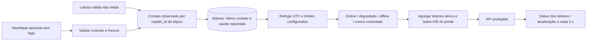

# Monitoramento de leitores e portais

## Problema e importância para o MVP

A ausência de leituras pode significar ausência de tags, silêncio da fonte ou
falha de comunicação. Sem monitoramento, uma localização antiga pode parecer
atual mesmo com o leitor indisponível. A ISS-024, acompanhada na
[solicitação de implementação #26](https://github.com/OtavioBrandao/rastreamento-rfid-hupaa/issues/26),
introduz estado operacional separado do ciclo de vida do cadastro.

## Funcionamento



O ingestor grava o contato **antes do PUBACK**. Falhas transitórias do banco
suspendem confirmação e usam a recuperação MQTT existente. Leituras brutas e
contato são commits separados e idempotentes: se o segundo falhar, a reentrega
não duplica a leitura. Heartbeats não criam tags, leituras, passagens ou zonas.
Um leitor ativo conhecido pode comprovar contato mesmo quando sua porta ainda
não está cadastrada; isso não torna a topologia válida para inferência.

`ultimo_contato_em` é monotônico por leitor: recepção UTC nas leituras e o menor
entre envio e recepção nos heartbeats, para mensagens enfileiradas não
parecerem contato novo;
`origem_ultimo_contato` distingue leitura de heartbeat. `ultimo_heartbeat_em`
guarda o instante informado no último heartbeat aceito. `saude_reportada`
preserva degradação explícita até um heartbeat online posterior. Ler tags não
apaga uma falha reportada. Mensagens de leitor desconhecido ou inativo não
renovam contato. O cadastro permanece disponível para consulta.

| Estado | Regra padrão |
|---|---|
| Nunca conectado | Nenhum contato válido observado desde a implantação do monitor |
| Online | Idade do contato < 30 s, sem degradação explícita |
| Degradado | 30 s ≤ idade < 90 s, ou heartbeat reportou degradação |
| Offline | Idade ≥ 90 s, inclusive se antes estava degradado |

O worker reavalia silêncio a cada segundo e registra apenas transições após
commit, em logs `reader_status_changed`, com PK, estados, motivo fixo e contador
`transitions_total` por processo. A API calcula novamente o estado no momento
da consulta; não depende de o ingestor continuar funcionando. `leitores.status`
é a última projeção persistida e pode atrasar quando o ingestor estiver parado.
Os endpoints de status são a referência para conectividade atual. Não há
exportador Prometheus nem histórico permanente de transições nesta versão.

## Portal com mais de um componente

Participam leitores ativos com antenas ativas vinculadas ao portal. Os lados
A/B vêm dos mapeamentos vigentes no instante da consulta:

1. Sem leitores ativos, ou todos nunca observados: nunca conectado.
2. Todos offline/nunca conectados e pelo menos um contato anterior: offline.
3. Todos online, com lados A e B mapeados: online.
4. Demais combinações: degradado; o motivo distingue topologia incompleta e falha parcial.

O último contato do portal é o **mais recente de qualquer componente**; esse
horário sozinho não comprova que todos estão online. A tabela identifica cada
componente. Cadastros inativos são identificados e não entram nos totais.

## Configuração

Defina valores iguais no ambiente da API e do ingestor:

```dotenv
RFID_READER_DEGRADED_SECONDS=30
RFID_READER_OFFLINE_SECONDS=90
# Vazio desabilita a assinatura adicional; leituras continuam atualizando contato.
MQTT_HEARTBEAT_TOPIC=easy/dev/hupaa/+/+/heartbeat
```

Exige `0 < degradado < offline`, com valores finitos. O Compose repassa esses
campos. O broker precisa autorizar a assinatura de heartbeat e permitir que
cada publicador escreva somente no tópico do próprio leitor. TLS e credenciais
seguem o perfil existente. Uma falha de ACL da assinatura impede prontidão;
por isso o heartbeat vem desabilitado nos exemplos. Depois de mudar o perfil,
reinicie API e ingestor para ambos carregarem os mesmos limites.

O contrato opcional é do **software**, sem presumir suporte nativo no EZ700:

```text
easy/dev/hupaa/portal-01/reader-01/heartbeat
```

```json
{"status":"online","sent_at":"2026-10-15T12:00:00Z"}
```

`status` aceita `online` ou `degradado`. O JSON exige exatamente esses dois
campos, até 1024 bytes, timestamp com fuso, idade < timeout e futuro ≤ 5 s.
Use QoS 1 e `retain=false`. Payloads retidos, inválidos, antigos, duplicados
ou fora do escopo não renovam heartbeat. Conteúdo inválido nunca é repetido
na auditoria. O heartbeat exige relógio sincronizado na fonte. A identidade
vem do tópico e a proteção contra personificação depende da ACL do broker.

Publicador para ensaio sem nenhuma tag no alcance:

```bash
python -m tools.reader_heartbeat --env-file config/environments/.env.cloud.reader-01 --reader-id reader-01 --interval 10
```

Use um perfil local equivalente para Mosquitto. Esse publicador representa o
estado escolhido pelo operador; não mede hardware nem deve ser executado
como se comprovasse saúde de um leitor físico. O simulador visual continua
comprovando contato por suas leituras; heartbeat independente exige uma fonte
compatível ou o publicador acima.

## API, migração e validação

`GET /leitores/status` retorna leitores e portais com um único instante UTC;
`GET /portais/status` retorna o agregado. Ambos exigem sessão e
`hardware:consultar` (perfis operacional e administrador). Não expõem
endereço de rede, parâmetros livres, usuário, senha, token ou payload.

```bash
python -m alembic -c config/alembic.ini upgrade head
python -m pytest tests/test_reader_status.py tests/test_migrations.py tests/test_rbac_matriz.py -q
```

A migration acrescenta três campos sem apagar histórico. Heartbeat legado é
preservado como contato; leituras antigas não são promovidas artificialmente
a contato atual. Banco de testes deve ser PostgreSQL local descartável.

Os testes usam relógio controlado para fronteiras de timeout, retorno de dois
leitores, silêncio sem tags, replay, degradação reportada, agregação parcial,
ACL/RBAC, ausência de segredos e PUBACK após persistência. A matriz de acesso
é exercitada também para as novas rotas. A validação física de heartbeat,
antenas, alcance RF e rede institucional permanece um ensaio separado.
