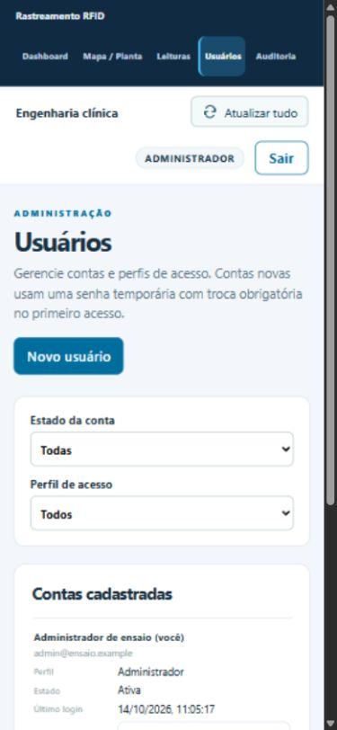
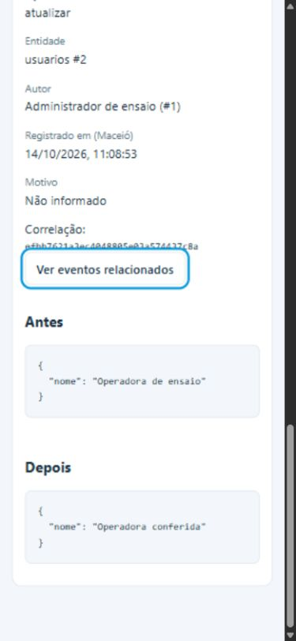

# ISS-026 / ISS-028 — Frontend de usuários e auditoria

## O que são as issues e por que importam para o MVP

A ISS-026 (issue #28, PR #72) disponibiliza contas, autenticação e administração
de usuários. A ISS-028 (issue #30, PR #75) registra alterações e eventos de
segurança em uma trilha imutável. As duas APIs já existiam, mas a administração
de contas e a consulta da trilha dependiam de chamadas HTTP manuais.

Para a equipe do HUPAA, estas telas permitem gerenciar quem pode operar o MVP
e conferir quem alterou um cadastro, inclusive correções manuais da ISS-025.
O frontend de login e troca obrigatória de senha da ISS-027 e o painel de
correção da ISS-025 já estavam implementados e foram preservados.

## O que foi implementado

### Usuários (`#/usuarios`)

- Navegação e página disponíveis pela permissão `usuarios:administrar` recebida
  da sessão, sem copiar a matriz de perfis da API.
- Lista paginada em 20 contas, com filtros de estado e perfil no servidor;
  mostra troca pendente, bloqueio e último login em `America/Maceio`.
- Criação com nome, e-mail, perfil e senha temporária; edição de nome/perfil,
  sem reenviar campos inalterados nem editar e-mail.
- Desativação, reativação e redefinição de senha com confirmação explícita na
  própria tela. A API continua responsável por revogar sessões e impedir que
  o último administrador ativo seja removido.
- Desativar e redefinir a senha da própria conta ficam desabilitados.
  Ao editar o próprio nome ou perfil, `/auth/me` é recarregado para atualizar
  o cabeçalho e as permissões imediatamente.
- A senha temporária existe somente no formulário e na requisição; é apagada
  após resposta de sucesso ou erro, e o formulário é desmontado ao cancelar.

### Auditoria (`#/auditoria`)

- Navegação e página exigem `auditoria:consultar`.
- Consulta paginada em 50 registros com todos os filtros da API: entidade,
  ID da entidade, ação, origem, autor, correlação e período.
- Datas digitadas são interpretadas como horário de Maceió (UTC-03:00),
  convertidas para ISO UTC com fuso. Início inclusivo e fim exclusivo; um
  intervalo invertido é recusado antes de consultar.
- Detalhe obtido por ID com autor, motivo, correlação e dados antes/depois.
  Os dados são exibidos como texto escapado pelo React, inclusive conteúdo
  parecido com HTML.
- O botão de eventos relacionados filtra pela correlação e reinicia a
  paginação, permitindo inspecionar operações com mais de um registro.
- Não há ações de edição ou exclusão da trilha.

### Integração

- As telas usam a atualização automática existente e o botão global de
  atualização. Os rascunhos de formulários não são substituídos pelo polling.
- O Vite encaminha `/usuarios` e `/auditorias` para a mesma API que `/auth`.
  Todas as chamadas usam `credentials: 'same-origin'`; a sessão continua
  somente no cookie HttpOnly.
- URLs administrativas abertas sem permissão mostram acesso restrito e não
  carregam essas APIs. Um 401 retorna ao login e um 403 oculta dados anteriores.
  Erros HTTP não reproduzem o corpo enviado, evitando exibir senhas em um 422.
- A navegação e o cabeçalho acomodam as cinco páginas em telas pequenas;
  tabelas e comparação antes/depois apresentam layout adaptado ao celular.

### Troca voluntária da própria senha (`#/senha`)

O cabeçalho oferece “Trocar minha senha” a qualquer usuário autenticado. A tela existente foi reutilizada com rótulo de senha atual e cancelamento; a troca obrigatória continua sem cancelamento. Após sucesso, a sessão é recarregada e o usuário retorna ao dashboard. Dois testes adicionais verificam sucesso, cancelamento e a obrigação de trocar a senha temporária.

## Dependências e execução

Este complemento partiu do head `66d442a` do PR #77. Em 15/10/2026, depois
da integração dos PRs #72, #73, #75 e #77, foi sincronizado com a `main`
`efac17b`, resolvendo os conflitos da antiga pilha. O PR #81 passa a ter
`main` como base. Não modifica o backend nem cria migrations.

Use as instruções de execução do README para API e frontend. O banco precisa
estar na migration `b025a1b2c3d4` e deve existir um administrador criado pelo
comando `python -m api.criar_admin`. Os exemplos locais de configuração não
precisam expor credenciais no repositório.

## Validação em 14/10/2026

- **Frontend:** 58 testes passaram, incluindo 14 novos testes de administração
  e auditoria, com criação, edição parcial, confirmação/cancelamento,
  redefinição, recusas, paginação, mudança do próprio perfil, 401/403, filtros
  temporais e renderização segura dos valores.
- `npm run build` passou (TypeScript e Vite).
- **Pilha de backend:** 1.303 testes e 93 subtestes passaram em PostgreSQL 16
  descartável, com 5 skips de integrações opcionais MQTT/OpenSSL. Inclui os
  testes de autenticação, RBAC, auditoria, correções, concorrência e migrations.
- Ruff (`E4,E7,E9,F,I`) passou e `alembic check` não encontrou diferenças.
- **Smoke HTTP real**, via Vite + uvicorn e banco descartável: login, criar,
  editar, desativar, reativar, redefinir senha, filtrar auditoria e consultar
  detalhe. A trilha contém as ações esperadas e não contém a senha de ensaio.
  O cliente httpx precisou ajustar somente seu cookie jar para usar o cookie
  Secure no localhost HTTP; o Chromium aceitou o cookie sem esse ajuste.
- **Navegador:** login da conta sintética, lista de usuários, filtros da
  auditoria e detalhe antes/depois; navegação por teclado e layout mobile de
  390 px, além da verificação de largura do conteúdo em desktop de 1.440 px.

Evidências com dados sintéticos:

## Validação da integração em 15/10/2026

Os nove arquivos em conflito foram conciliados com a `main` `efac17b`.
O resultado preserva o backend integrado e acrescenta somente o complemento
de frontend e sua documentação. Não houve alteração de migrations.

- `npm test`: 58 testes passaram.
- `npm run build`: TypeScript e Vite aprovados.
- Ruff (`E4,E7,E9,F,I`): aprovado.
- `alembic upgrade head` e `alembic check`: aprovados em PostgreSQL 16
  descartável local, sem diferenças de schema.
- `git diff --check`: aprovado, sem marcadores de conflito restantes.

## Limites

A consulta não exporta dados nem define política de retenção. A paginação
continua seguindo o contrato da API: novos registros podem deslocar itens
entre páginas durante a atualização. A validação descrita é de software,
em ambiente local e sintético; não homologa hardware EZ700 nem rede hospitalar.
