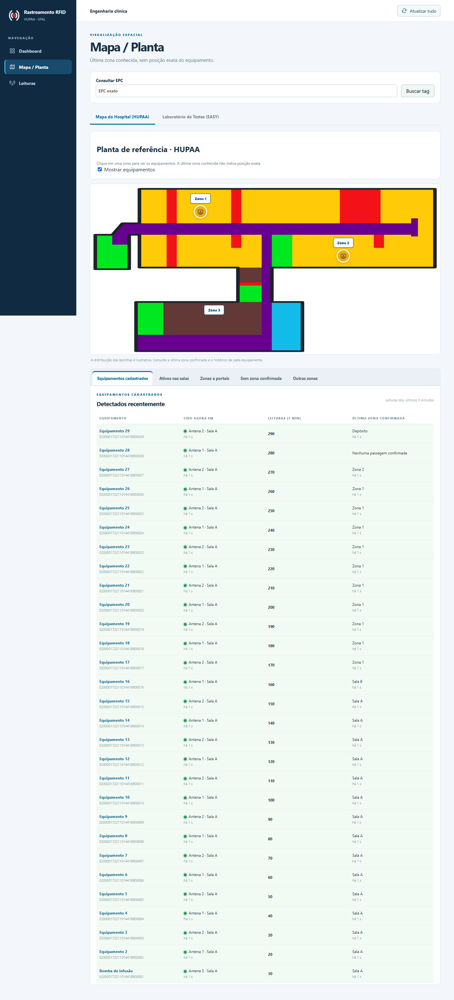
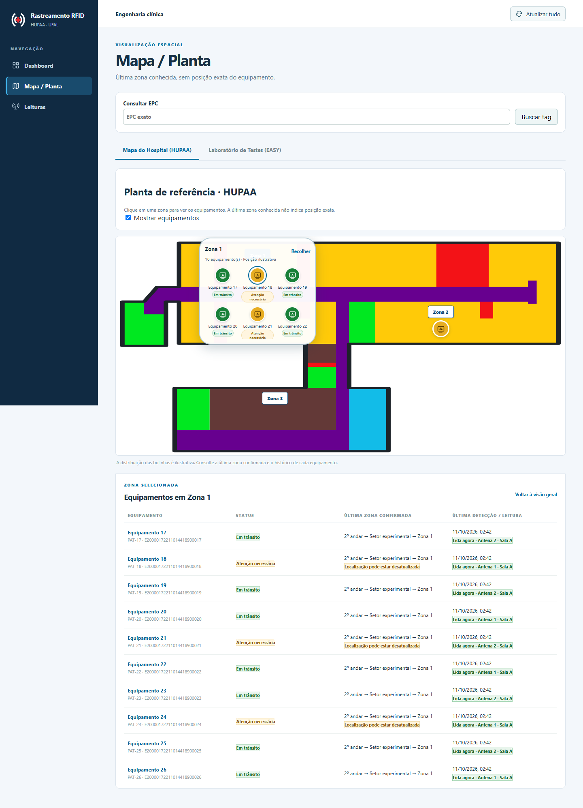
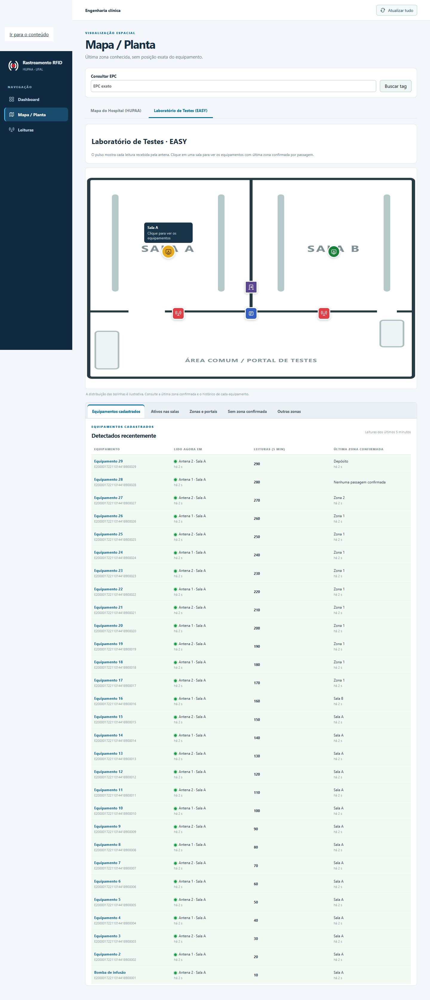
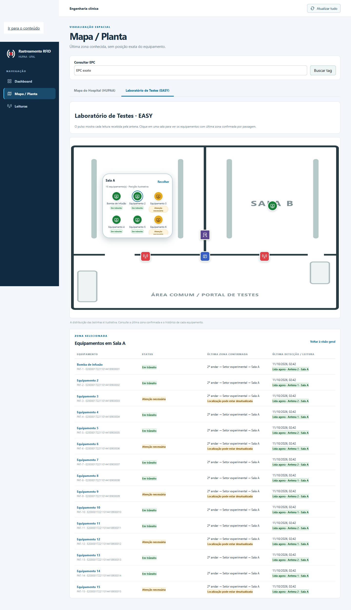
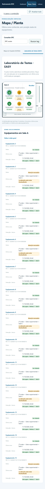

# Mapas HUPAA/EASY — abas e inspeção dos equipamentos por zona

## Solicitação e importância para o MVP

A visão geral dos mapas repetia o painel de leituras das antenas, já disponível
na página **Leituras**, e distribuía várias listas numa coluna à direita. Isso
reduzia a largura da planta e das tabelas e dificultava consultar os equipamentos
de uma sala. A solicitação é exclusivamente de interface: reunir as consultas
abaixo do mapa e permitir abrir uma zona para identificar seus equipamentos.

## O que foi feito

- Removida a coluna lateral nos mapas do HUPAA e do laboratório EASY. Planta e
  tabelas passam a ocupar toda a largura disponível.
- Criadas cinco abas abaixo da planta: **Equipamentos cadastrados** (a tabela
  Detectados recentemente), **Ativos nas salas**, **Zonas e portais**, **Sem zona
  confirmada** e **Outras zonas**. As abas têm navegação por setas, Home e End,
  identificação acessível e apenas um painel visível por vez.
- O ícone agregado de uma sala/zona mostra **Clique para ver os equipamentos**
  ao passar o mouse ou receber foco. Ao clicar, abre um agrupamento de bolinhas
  identificadas por nome e status. Em trânsito aparece em verde e atenção
  necessária em amarelo; os demais status preservam suas cores semânticas.
  Cada bolinha abre o painel de detalhes existente, incluindo o histórico.
- A seleção também substitui as abas por uma tabela dos equipamentos da zona.
  **Recolher**, **Voltar à visão geral** ou Escape no agrupamento/tabela fecham
  a inspeção e restauram a aba anterior. A seleção textual em Zonas e portais
  permite abrir inclusive zonas vazias. As zonas do HUPAA também podem ser
  selecionadas pelo rótulo da planta.
- Preservados os vínculos por ID e referência da zona. Falhas de topologia
  removem a seleção não verificável e mantêm os ativos consultáveis nas abas.
  Equipamentos sem zona confirmada não recebem bolinha na planta.
- Removido o log duplicado **Leituras das antenas**. A página Leituras continua
  disponível; no EASY, a consulta com cursor a cada segundo permanece para
  alimentar o pulso das antenas, com aviso e recuperação em caso de falha.
- Mantida a atualização automática de ativos/topologia, resumo, detalhes e
  histórico a cada dois segundos, além do botão global. A tabela Detectados
  recentemente continua montada e atualizando quando está oculta por outra aba
  ou por uma zona aberta. O filtro EPC também restringe seus equipamentos.

`MapWorkspace` compartilha a seleção e os marcadores entre os dois mapas;
`MapEquipmentTabs` reúne as consultas e a tabela da zona selecionada. Não houve
alteração no backend, endpoints, regras de inferência, banco ou protocolo MQTT.

## Semântica e limites

A distribuição das bolinhas é ilustrativa e estável durante as atualizações;
não representa coordenadas medidas dos equipamentos. O pertencimento continua
sendo a **última zona confirmada**, nunca a zona da antena da última leitura.
O status Em trânsito mantém a classificação já fornecida pela API. Um
equipamento recém-lido sem passagem confirmada continua consultável nas abas
Equipamentos cadastrados e Sem zona confirmada.

O agrupamento tem rolagem para permitir inspecionar salas com muitos itens,
enquanto a tabela apresenta todos os equipamentos da zona. Em celular, as
tabelas se reorganizam em linhas com rótulos e as abas podem ocupar mais de
uma linha. As consultas continuam periódicas, conforme a ISS-033.

## Validação — 11/10/2026

- `npm --prefix frontend test`: **27 testes aprovados**, incluindo seleção e
  retorno nos dois mapas, detalhes/histórico, grupos de ativos, teclado, EPC,
  atualização de bolinhas/tabela com a sala aberta, saída de um equipamento
  para outra zona, preservação durante falha de ativos e recuperação após
  falha de topologia. A regressão mantém o pulso das antenas e a página Leituras.
- `npm --prefix frontend run build`: TypeScript e build Vite aprovados.
- Navegador Chromium/Playwright com respostas sintéticas locais: fluxo nos dois
  mapas, 15 equipamentos numa sala, cores calculadas verde/amarelo, detalhe e
  histórico, mudança de sala durante a inspeção, zonas vazias, seleção textual,
  ocultação de equipamentos e filtro EPC. Nenhum erro JavaScript ou
  transbordamento horizontal nas larguras 320, 390, 768, 1024 e 1440 px. Em
  390 × 844, o agrupamento permaneceu dentro dos limites da planta.
- `git diff --check`: aprovado.

As capturas abaixo usam equipamentos fictícios e respostas interceptadas no
navegador; não são evidência de ensaio físico com EZ700 nem de integração MQTT.

## Limpeza das branches solicitada

Foram removidas **27 branches remotas e 24 locais** cujos commits eram
ancestrais de `origin/main`. As exclusões remotas foram atômicas e verificaram
os SHAs esperados; branches com PR aberto e as três branches em uso por
worktrees foram preservadas. Também foram mantidas as branches com commits
não integrados, incluindo `hotfix/lab-cadastro-tags-fisicas`, que recebeu um
commit após o merge do PR #78. A branch desta entrega foi criada de `origin/main`.
