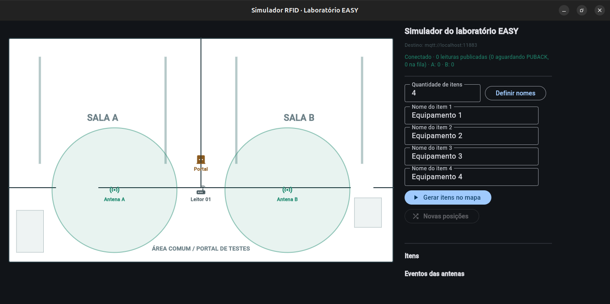

# Simulador visual do laboratório

> **Substituído em 23/10/2026** pelo [simulador web unificado](simulador-web.md)
> (EASY e HUPAA no navegador). `tools/lab_simulator` e o Flet foram removidos
> depois de validada a equivalência; este registro fica como histórico.

## O que é

As opções sintéticas do launcher (1: local; 4: broker e banco externos)
publicavam roteiros fixos: uma tag de A para B com 100 mensagens ou dois roteiros
de duas tags com fases predefinidas. Esses roteiros foram substituídos por um
simulador visual em Flet (`python -m tools.lab_simulator`), que reproduz a planta
do laboratório EASY e deixa o operador mover os itens com o mouse.

## Importância para o MVP

- **Demonstração:** a pessoa arrasta um equipamento entre as salas A e B e vê,
  no mesmo momento, o pulso da antena no simulador e no mapa EASY do dashboard,
  a página Leituras e, depois da passagem, a última zona confirmada.
- **Teste do caminho externo sem o leitor:** antes de levar o EZ700, a opção 4
  exercita HiveMQ → ingestor → banco externo → API → frontend com os mesmos
  tópico, payload e contador do leitor. Uma falha nesse teste aponta para a
  infraestrutura, não para o hardware.
- **Cenários livres:** permanência na antena, vai e vem, desistência no meio do
  portal e vários itens ao mesmo tempo são feitos com o mouse, sem novos roteiros
  no código.

## O que foi feito

- `tools/lab_simulator/modelo.py`: regras sem interface. Coordenadas 0–100 iguais
  a `frontend/src/config/mapaConfig.ts` (antena A em (28, 66), antena B em
  (72, 66), portal em (50, 54)). Alcance circular de raio 16, corrigido pela
  proporção da planta para coincidir com o círculo desenhado; RSSI linear de
  -5700 a -6700; uma leitura a cada 0,2 s por item e antena no alcance. Os
  alcances não se sobrepõem. Itens recebem EPCs aleatórios de 96 bits com
  prefixo `E2804C41` e surgem em posições sorteadas, fora do alcance e
  afastadas entre si.
- `tools/lab_simulator/app.py`: janela com a planta, os círculos de alcance que
  pulsam a cada leitura, itens arrastáveis (`GestureDetector`), painel para
  quantidade e nomes, estado da conexão e eventos de entrada e saída do alcance.
- `tools/lab_launcher/synthetic.py`: o publicador virou a classe `Publicador`,
  com a mesma validação de tópico contra a assinatura do ingestor, o mesmo
  payload compacto (`epc`, `rssi`, `antenna`, `timestamp`) e o mesmo contador de
  sete dígitos. A publicação QoS 1 não bloqueia a cada PUBACK; ainda falha se
  uma mensagem ficar 10 s sem confirmação ou se a conexão cair. Uma thread
  dedicada consome a fila, então a janela não trava com broker lento.
- Cadastro: ao gerar os itens, o simulador vincula cada EPC a um equipamento do
  tipo sintético com o nome escolhido (`semear_equipamentos`), para que passagem
  e última zona apareçam com o nome no dashboard.
- Launcher: as opções 1 e 4 abrem o simulador depois do ingestor saudável e o
  encerram com `Ctrl+C`. No modo externo continua exigindo a credencial de
  publicação separada (`config/environments/.env.cloud.reader-01`). Foram removidos `--scenario`,
  `--count`, `--messages`, `--interval`, `--epc`, `--passage/--single` e a
  conferência automática no banco (`verify.py`), que só faziam sentido para
  roteiros fixos.
- Dependência: `requirements/lab.txt` (`flet[desktop]==1.0.3`), fora de
  `requirements/base.txt` para não entrar na imagem do ingestor. Sem o Flet, o
  launcher interrompe antes de subir serviços e indica o comando de instalação.

## Validação

- Testes em `tests/test_lab_simulator.py`: contrato do payload aceito pelo
  adapter EZ700, tópico, falta de PUBACK por desconexão e por tempo, alcance e
  RSSI, período de leitura, EPCs únicos, posições fora do alcance e cadastro
  nomeado reexecutável. A suíte completa passa.
- Ensaio ponta a ponta isolado (Mosquitto e PostgreSQL descartáveis, ingestor no
  host): um item movido de A para B pelas mesmas classes do simulador gerou 10
  leituras em cada antena e uma passagem `a_para_b` confirmada para a Zona B; o
  item parado não gerou leituras.
- A janela foi aberta e capturada no Ubuntu 24.04 (XWayland). O arraste com o
  mouse deve ser conferido no primeiro uso do laboratório.

## Limites

- Alcance, RSSI e período são ilustrativos; não substituem a calibração física
  no HUPAA.
- Com os parâmetros atuais, a passagem exige sair de uma antena e entrar na
  outra em até 3 s.
- Na primeira execução o Flet baixa o cliente desktop; é preciso acesso à
  internet nesse momento.
