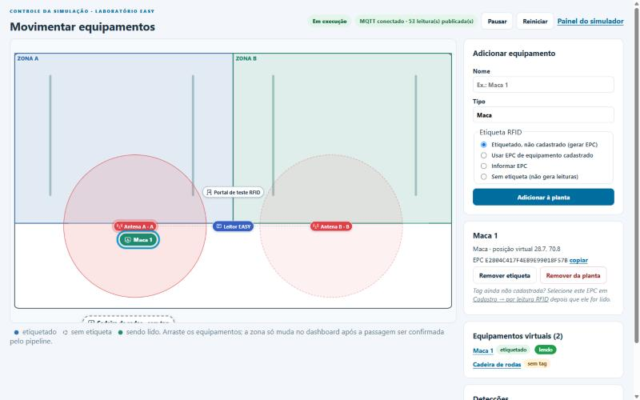
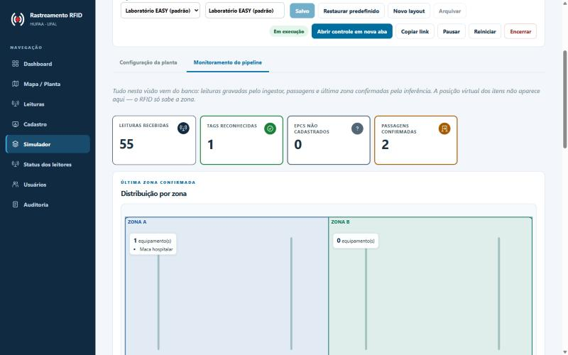
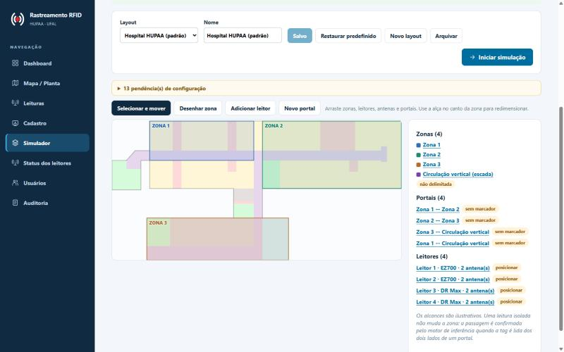

# Simulador web unificado (EASY e HUPAA)

## O problema

O simulador anterior era uma janela Flet (`tools/lab_simulator`), só com a
planta do laboratório EASY, aberta como aplicativo desktop no Windows ou
Ubuntu. Não servia para demonstrar ao hospital uma distribuição de leitores e
antenas pela planta do HUPAA, nem permitia configurar zonas e portais.

## Importância para o MVP

As apresentações ao HUPAA precisam mostrar o sistema real funcionando —
leitura, passagem, direção e última zona — sem hardware em todos os setores.
O simulador precisa substituir apenas a leitura física, sem atalhos que
"pintem" a zona no frontend, e precisa ser fácil de usar e gravar.

## O que foi feito

**Um único motor, dois cenários.** EASY e HUPAA são presets de configuração
do mesmo editor, das mesmas sessões e do mesmo motor de publicação
(`api/simulacao/`).

- *Layout* (`simulacao_layouts`): zonas (retângulos em coordenadas 0–100),
  portais (zona A ↔ zona B), leitores virtuais **Identix EZ700** e
  **Identix DR Max** com 1 a 4 antenas (porta física única, posição, alcance
  ilustrativo, portal, lado lógico A/B, zona). Validação no backend recusa
  portas duplicadas, mais de 4 antenas, lado sem portal, zona incoerente
  com o lado, portal ligando a mesma zona e `reader_id` sem prefixo `sim-`.
- *Presets*: EASY reproduz o Flet (salas A/B, "Portal de teste RFID",
  antenas em (28,66) e (72,66), raio 16, proporção 880×560). HUPAA traz
  quatro leitores (2 EZ700, 2 DR Max — o 4º para a circulação vertical),
  quatro zonas e quatro portais, **sem posições de leitores, antenas nem da
  escada**: o operador posiciona no editor. Os retângulos das zonas 1–3 são
  aproximações das áreas provisórias já documentadas.
- *Sessão* (`simulacao_sessoes`): ao iniciar, a topologia é **cadastrada
  como um técnico faria** (zonas, portais, leitores `sim-*` com serial
  `SIM-L<layout>-…`, antenas e mapeamentos versionados). O estado
  compartilhado (itens, posições, estado, versão) fica no banco.
- *Motor* (`api/simulacao/motor.py`): thread da API, ligada só com
  `SIMULADOR_HABILITADO=true`; lê sessões em execução, calcula alcance e
  publica no MQTT no contrato do EZ700 (uma leitura por item/antena a cada
  200 ms, como o Flet). Advisory lock garante um único publicador com vários
  workers. Itens sem EPC nunca geram leitura.
- *Fluxo real preservado*: posição virtual → leitura virtual → MQTT →
  ingestor → `leituras_brutas` → debounce/passagem/direção → histórico e
  última zona → API → dashboard. Nada no frontend altera zona.

**Interfaces**

- *Configuração e monitoramento* (`#/simulador`): escolha EASY/HUPAA, layouts
  salvos, editor visual (desenhar/mover/redimensionar zonas, posicionar
  leitores, antenas e portais, alcance por antena), salvar, restaurar preset,
  iniciar/pausar/retomar/reiniciar/encerrar e **monitoramento** só com dados
  do pipeline (leituras, tags reconhecidas e desconhecidas, passagens com
  estado confirmada/ambígua/desconhecida, leitores e equipamentos agrupados
  pela última zona confirmada — sem coordenadas).
- *Controle* (`#/simulador/controle/<código>`): tela limpa para gravação;
  adicionar equipamentos (etiquetado não cadastrado, EPC de equipamento
  cadastrado, EPC informado ou sem etiqueta), arrastar, etiquetar/remover
  etiqueta, área de leitura destacada e registro de detecções.

**Teste rápido e facilidades de configuração** (pedido após o primeiro uso: o
editor era pouco intuitivo e não havia como apagar tudo):

- *Testar agora* (`POST /api/simulacao/teste-rapido`): um clique cria (ou
  reaproveita) o layout "teste rápido" do cenário, inicia a sessão e coloca
  quatro equipamentos: **Maca 01** e **Cadeira de rodas 01** já cadastrados
  (tipo e identificador `LAB-RFID-<EPC>` do launcher, removíveis por
  `tools.limpeza_banco --escopo laboratorio`), **Monitor portátil** com tag
  não cadastrada (para testar o cadastro por leitura) e **Bomba de infusão**
  sem etiqueta. No EASY o layout é o preset; no HUPAA é um layout à parte com
  posições **ilustrativas** (antenas de cada portal uma em cada zona, sem
  alcances sobrepostos). O preset HUPAA padrão continua sem posições.
- *Apagar tudo* (`POST /api/simulacao/apagar-tudo`): encerra as sessões e
  exclui (arquiva) todos os layouts do cenário. Leituras, passagens e histórico
  do pipeline ficam; para eles use a limpeza do banco.
- Editor: *Novo portal* já cria o leitor com as antenas A e B posicionadas,
  uma em cada zona; *Limpar planta*; *Desfazer* (Ctrl+Z); Delete remove o
  selecionado e Esc cancela; chips "posicionar" clicáveis; passo a passo na
  planta vazia; lista do que falta para detectar passagens, atualizada a cada
  edição (ou "Planta pronta").
- Controle: botões *+ Maca*, *+ Cadeira de rodas*, *+ Bomba de infusão* (com
  EPC gerado), demais opções recolhidas, e *Remover todos*.
- `scripts/dev.py` sobe a API com recarga automática (o frontend já recarrega
  pelo Vite) e recusa subir com o banco atrás da migration mais recente.

**Layouts sem interferência e leitor da zona restrita** (relato do primeiro
uso com o layout do vídeo: "Iniciar" recusava porque o teste rápido, mesmo
excluído, continuava dono de `sim-hupaa-03/04`):

- Excluir um layout (ou "Apagar tudo") desliga os leitores virtuais dele e
  encerra os mapeamentos; o primeiro layout ativo que usar o mesmo
  `reader_id` assume o leitor. Dois layouts **ativos** com o mesmo
  `reader_id` continuam recusados, agora com o nome do layout na mensagem.
- O teste rápido usa leitores `sim-demo-*`, que nunca coincidem com os do
  preset nem com os do usuário.
- O leitor 4 do HUPAA é o **leitor da zona restrita** ("Leitor 4 · zona
  restrita (escada)"), um **ponto único de detecção** dentro da circulação
  vertical. Cada antena dele é o lado B de um portal ("Entrada pela Zona 1",
  "Entrada pela Zona 3"), e as duas podem ficar no mesmo ponto. O modelo
  continua com uma antena por portal (o mapeamento antena → portal do
  pipeline não mudou), mas a inferência agrupa por tag + portal, então cada
  entrada confirma a própria passagem. O editor marca esse leitor e o alcance
  em roxo.
- Novos avisos: lados A/B do mesmo portal com alcances sobrepostos (a direção
  nunca seria confirmada) e antenas no mesmo ponto, exceto o ponto único
  (mesmo lado e mesma zona, em portais diferentes).
- O layout do vídeo no Neon foi corrigido: os lados A dos portais da escada
  foram aproximados das entradas e o portal Zona 1 ↔ Zona 2 deixou de ter
  lados sobrepostos. O leitor 4 ficou com as duas antenas num ponto só, no
  meio da escada. Ensaio pelo pipeline com essa planta: Zona 1 → escada,
  volta para a Zona 1, Zona 1 → escada → Zona 3, Zona 3 → escada e
  Zona 1 → Zona 2, todas confirmadas.

Validado em 25/10/2026 com Mosquitto e ingestor locais: teste rápido HUPAA,
Maca 01 arrastada da Zona 1 para a Zona 2 → 14 leituras, passagem confirmada
e última zona "Zona 2".

**Hotfix (25/10/2026)**: MQTT pelo tópico autorizado do broker (sem mexer no
HiveMQ), antena direcional, alcance menor, cinco leitores no HUPAA com DR Max
de área restrita, planta limpa e arraste confiável. O leitor 4 com "ponto
único" descrito acima foi substituído pelo leitor 5 de alerta. Detalhes em
[simulador-web-hotfix-mqtt-visada.md](simulador-web-hotfix-mqtt-visada.md).

**Sincronização**: polling de 600 ms com `desde_versao` (resposta curta quando
nada mudou) no controle e 2 s no painel. Avaliado como suficiente: sem
infraestrutura nova, funciona atrás de qualquer proxy e recupera a sessão ao
recarregar. WebSocket/SSE ficam como evolução se houver muitas abas.

**Isolamento**: `APP_ENV=production` bloqueia o simulador (a API nem sobe
pedindo-o); `reader_id` e serial próprios; um `reader_id` de leitor físico
ou de outro layout é recusado; uma sessão aberta por layout (índice parcial);
credencial MQTT de publicação própria no broker externo, nunca no navegador.

**Transição e remoção do Flet**: equivalência validada (testes do preset EASY
com o mesmo raio, proporção, RSSI e período; passagens A→B e B→A pelo
pipeline real), então `tools/lab_simulator` e `flet` foram removidos; o
launcher (`scripts/dev.py` opções 1 e 4) sobe a API com o simulador e abre o
navegador. O registro histórico está em
[simulador-visual-laboratorio.md](simulador-visual-laboratorio.md).

## Validação

- `tests/test_simulacao.py`: presets, regras do layout, 4 antenas por leitor,
  vários portais, aplicação idempotente da topologia, versionamento de
  mapeamento, porta removida, conflito de `reader_id`, isolamento HUPAA, duas
  abas sobre a mesma sessão, recuperação após recarregar, isolamento entre
  sessões, versão otimista, produção/desligado; motor → ingestor → inferência
  com A→B, B→A, leitura isolada, alcances sobrepostos sem confirmação e EPC
  desconhecido na descoberta sem localização.
- `frontend/src/test/Simulador.test.tsx`: geometria igual ao motor, limite de
  antenas, aviso do DR Max, aba de controle e permissões.
- Ensaio manual (23/10/2026, Windows 11 + Docker Desktop, Mosquitto e
  ingestor reais em contêiner): 34 leituras publicadas, passagem A→B
  confirmada; após cadastro pela aba de leitura, B→A confirmada e última zona
  "Zona A". **Dados sintéticos; não é ensaio de RF.**

## Limitações

- Alcance, RSSI e período são ilustrativos, sem equivalência metrológica.
- DR Max é apenas virtual; a integração física ao MQTT não foi validada e o
  simulador usa o contrato canônico do EZ700 para ele.
- Estatísticas do motor exibidas na tela são as do processo da API que
  publica; com vários workers, use um só em demonstração.
- No broker externo, a credencial de publicação precisa de permissão nos
  tópicos dos leitores virtuais (ex.: `easy/dev/hupaa/+/+/readings`).
