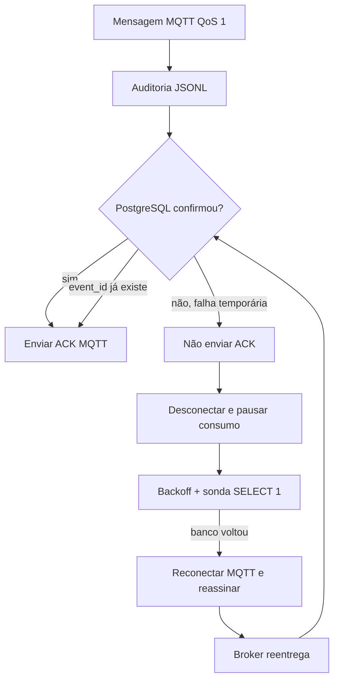

# ISS-007 — resiliência e recuperação do ingestor

## O que é e por que importa

A ISS-007 faz o ingestor se recuperar sozinho de indisponibilidades temporárias
do broker MQTT, da rede e do PostgreSQL. Em um MVP hospitalar, uma oscilação curta
de infraestrutura não deve exigir que alguém descubra o problema e reinicie o
processo manualmente para a coleta continuar.

Antes desta issue, uma conexão inicial indisponível ou uma falha do PostgreSQL
encerrava o ingestor. O ACK manual da ISS-006 protegia contra falso sucesso, mas
o serviço ainda precisava de intervenção.

```text
ANTES DA ISS-007:

falha temporária de infraestrutura
    ↓
ingestor encerra ou exige intervenção

DEPOIS DA ISS-007:

falha temporária de infraestrutura
    ↓
backoff controlado + jitter
    ↓
infraestrutura retorna
    ↓
recuperação automática
    ↓
processamento continua
```

## Fluxo seguro



Não existe fila nova na memória nem outro serviço de mensageria. O broker mantém
o trabalho MQTT pendente; o PostgreSQL continua usando a idempotência canônica da
ISS-005/006.

## O que acontece quando o MQTT sai do ar

O supervisor tenta novamente no mesmo host/porta configurados. Entre tentativas,
aguarda um atraso exponencial com jitter. A primeira espera padrão é 1 segundo,
depois aproximadamente 2, 4, 8, 16 e no máximo 30 segundos. Quando conecta:

1. confirma a sessão MQTT;
2. solicita novamente o filtro configurado com QoS 1;
3. só marca o receptor pronto depois do SUBACK com QoS 1;
4. zera o crescimento do backoff para a próxima queda.

Uma recusa explícita de autenticação, Client ID/protocolo ou autorização não é
tratada como oscilação de rede. O ingestor termina para que a configuração seja
corrigida, em vez de tentar agressivamente para sempre.

## Estratégia de sessão MQTT

O ingestor continua em MQTT 3.1.1 e usa um Client ID estável. Para ele,
`clean_session=false` é configurado explicitamente. Simuladores e probes mantêm
sessão limpa; não acumulam estado no broker.

O Mosquitto local usa persistência em `mosquitto_data`. Assim, sessão, assinatura
e mensagens compatíveis com a persistência do broker sobrevivem também à
reinicialização do contêiner. Mesmo quando `session_present=true`, o ingestor
reassina: isso restaura o filtro se o broker perdeu o estado e mantém a operação
previsível.

Essa estratégia oferece entrega **pelo menos uma vez**, não exatamente uma vez.
QoS 1 permite repetição. A biblioteca Paho não transforma a aplicação em uma fila
durável e suas estruturas internas não são um banco de mensagens. As políticas de
retenção/expiração do HiveMQ precisam continuar compatíveis com a operação real.

## O que acontece quando o PostgreSQL sai do ar

Se a auditoria JSONL foi escrita, mas o banco falha antes de confirmar a transação:

- nenhum ACK MQTT é enviado;
- o ingestor desconecta do broker para não formar uma fila ilimitada em memória;
- uma sonda segura `SELECT 1` verifica o banco com backoff e jitter;
- após a sonda funcionar, o ingestor reconecta ao MQTT e reassina;
- o broker pode reentregar a mensagem pendente;
- `INSERT ... ON CONFLICT DO NOTHING` usa o mesmo `event_id` canônico.

O pool SQLAlchemy usa `pool_pre_ping`, evitando reutilizar silenciosamente uma
conexão morta após a recuperação. Falhas SQL de schema/configuração e autenticação
identificável são permanentes e exigem operador. URLs, parâmetros SQL, senhas e
exceções originais não entram nos logs.

## Por que QoS 1, ACK manual e event_id trabalham juntos

QoS 1 permite ao broker repetir uma entrega sem ACK. O ACK manual só é emitido
depois da auditoria e de um resultado definitivo no banco. Se o processo cair
depois do commit e antes do ACK, a mensagem pode voltar; o `event_id` impede uma
segunda linha lógica em `leituras_brutas`.

O JSONL é append-only e representa entregas observadas. Portanto, ele pode conter
mais de um envelope para o mesmo `event_id`. Isso é esperado e não contradiz a
idempotência do PostgreSQL.

## Backoff e jitter em linguagem simples

Backoff é aumentar o tempo entre tentativas consecutivas. Jitter é uma pequena
variação aleatória nesse tempo. Sem isso, várias instâncias podem atacar um serviço
que acabou de voltar exatamente no mesmo instante. Loops agressivos também gastam
CPU, inundam logs e aumentam a carga de uma infraestrutura já degradada.

O atraso calculado nunca ultrapassa o máximo configurado. A espera usa um evento
cancelável: shutdown não precisa aguardar os 30 segundos completos.

## Falhas e decisões

| Categoria | Exemplos | Comportamento |
|---|---|---|
| Configuração/permanente | variável inválida, autenticação MQTT recusada, SUBACK sem QoS 1, autenticação PostgreSQL, schema/SQL incompatível | falha rápida e ação do operador |
| MQTT temporária | broker parado, TCP resetado, DNS/rede temporariamente indisponível | reconexão com backoff |
| PostgreSQL temporária | conexão recusada/resetada, shutdown do servidor, limite temporário de conexões | sonda com backoff, sem ACK |
| Mensagem RFID inválida | JSON/payload inválido ou topologia desconhecida | auditoria/rejeição definitiva e ACK; não repete para sempre |
| Shutdown do operador | SIGINT, SIGTERM ou parada normal | cancela espera, desconecta e encerra recursos |

## Configuração

| Variável | Padrão | Regra |
|---|---:|---|
| `MQTT_RECONNECT_INITIAL_DELAY` | `1` s | positivo |
| `MQTT_RECONNECT_MAX_DELAY` | `30` s | maior ou igual ao inicial |
| `MQTT_RECONNECT_MULTIPLIER` | `2` | pelo menos 1 |
| `MQTT_RECONNECT_JITTER` | `0.2` | entre 0 e 1 |
| `DB_RETRY_INITIAL_DELAY` | `1` s | positivo |
| `DB_RETRY_MAX_DELAY` | `30` s | maior ou igual ao inicial |
| `DB_RETRY_MULTIPLIER` | `2` | pelo menos 1 |
| `DB_RETRY_JITTER` | `0.2` | entre 0 e 1 |

Os exemplos `.env.example`, `.env.local.example`, `.env.cloud.example` e os dois
perfis Compose expõem os mesmos defaults. Valores inválidos impedem a inicialização.

## Logs esperados

Os logs são JSON dentro do formato padrão Python e mostram transições sem segredos:

```text
mqtt_disconnected
mqtt_reconnect_scheduled       attempt, delay_seconds, failure_category
mqtt_reconnect_attempt         attempt, failure_category
mqtt_recovered                 attempt, elapsed_seconds
mqtt_subscription_restored     topic, qos
database_unavailable           failure_category
database_retry_scheduled       attempt, delay_seconds, failure_category
database_retry_attempt         attempt, failure_category
database_recovered             attempt, elapsed_seconds
shutdown_requested
shutdown_complete
```

Não há URL de banco, senha, payload completo ou parâmetros SQL nesses eventos.

## Shutdown gracioso

SIGINT/KeyboardInterrupt, SIGTERM do Compose e `stop()` acionam o mesmo evento de
parada. Esse evento interrompe imediatamente backoffs MQTT/PostgreSQL, impede nova
tentativa, desconecta o cliente e aguarda o supervisor terminar. O `finally` da
aplicação descarta o engine SQLAlchemy; não ficam threads de recuperação vivas.

## Como testar

Testes rápidos, sem espera real longa:

```bash
python -m ruff check --select E4,E7,E9,F .
python -m ruff check --select I .
python -m pytest -q
git diff --check
```

Suíte completa com Mosquitto/PostgreSQL descartáveis e smoke de interrupção:

```bash
bash tests/reader-connectivity/mqtt/smoke-test.sh
bash tests/infrastructure/resilience-smoke-test.sh
```

O segundo script usa um projeto `rfid-iss007-smoke-*`, portas de loopback 18885 e
15433 por padrão e remove seus contêineres, rede, volumes e JSONL ao sair. Não use
Neon compartilhado para esse tipo de teste.

## Como reproduzir manualmente uma indisponibilidade

Com `make local-up` ativo:

```bash
# Broker fora e de volta
docker compose --env-file .env.local --profile local stop mosquitto
docker compose --env-file .env.local --profile local start mosquitto

# Banco fora e de volta
docker compose --env-file .env.local --profile local stop postgres
docker compose --env-file .env.local --profile local start postgres

make logs-local
```

Durante a queda do banco, publique um evento válido somente em ambiente local de
teste. Espere `database_unavailable`, restaure o banco e confirme
`database_recovered`, `mqtt_recovered` e uma única linha para o `event_id`.

## Evidência observada em 15/09/2026

- testes focados de backoff/configuração: **16 passed, 14 subtests passed**;
- testes focados MQTT: **48 passed, 38 subtests passed, 3 skipped opt-in**;
- testes focados PostgreSQL/ACK: **26 passed, 12 skipped sem serviços**;
- suíte descartável Mosquitto + PostgreSQL: **106 passed, 52 subtests passed** em 8,52 s;
- smoke ISS-007: passou broker inicialmente ausente, reinício do Mosquitto,
  interrupção/retorno do PostgreSQL, redelivery/idempotência e shutdown em backoff.

Os serviços e volumes dos smokes foram removidos ao final. Não foram usados Neon,
HiveMQ, credenciais externas, rede HUPAA ou EZ700 físico.

## Limitações e trabalho futuro

- Não existe exactly-once fim a fim; existe QoS 1 mais idempotência no banco.
- JSONL pode repetir entregas e `flush` não é `fsync`.
- A durabilidade gerenciada depende das políticas de sessão do broker contratado.
- Uma indisponibilidade maior que a retenção configurada no broker pode perder o
  trabalho que o broker não conservar.
- Não há fila durável própria, dead letter, Prometheus ou dashboard de estado.
- Debounce (ISS-014), inferência de passagem/direção (ISS-015), zonas e dashboard
  continuam fora do escopo.
- Timestamp/RSSI/MQTTS do EZ700 e a rede HUPAA continuam pendentes de validação
  física; a ISS-007 não afirma ter testado hardware.
