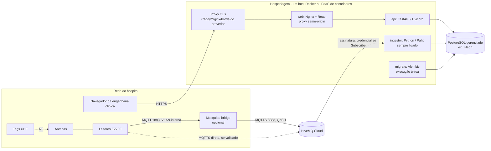

# Preparação para implantação (deploy)

Este guia registra o estudo de arquitetura para hospedar o MVP depois do
Marco 2 e o que já ficou pronto no repositório. **Nenhum deploy foi feito.**
O provedor ainda não foi escolhido; as configurações são independentes dele.

## 1. O que precisa rodar

| Componente | Natureza | Observação |
|---|---|---|
| Frontend React | Arquivos estáticos | Build do Vite; servido pelo mesmo domínio da API. |
| API FastAPI | Processo HTTP | Sessões opacas em cookie HttpOnly; precisa do banco. |
| Ingestor MQTT | **Processo contínuo** | Conexão MQTT permanente, ACK após commit, inferência em memória. Não pode "dormir" nem ser executado sob demanda. |
| PostgreSQL 16 | Banco gerenciado ou próprio | Fonte da verdade; backup é obrigatório. |
| Broker MQTT | HiveMQ Cloud (gerenciado) | Leitores publicam; o ingestor assina com credencial própria. |
| Bridge Mosquitto | Opcional, **na rede do hospital** | Necessária enquanto o EZ700 não publicar direto por MQTTS. |

O ponto que mais restringe a escolha é o **ingestor**: ele é um *worker*
sempre ligado. Plataformas que escalam a zero (funções, contêineres sob
demanda sem instância mínima) não servem para ele.

## 2. Arquitetura recomendada



**Recomendação:** manter o monólito modular em **uma imagem de backend**
(API, ingestor e migrations com comandos diferentes) mais **uma imagem web**
(Nginx com o build do React), orquestradas por Docker Compose num único host
(VPS) — ou os mesmos contêineres num PaaS que tenha *web service* e
*background worker* sempre ligado. Banco gerenciado (Neon, já usado nos
ensaios) e HiveMQ Cloud continuam como serviços externos.

Justificativa:

- O volume do piloto (poucos leitores, leituras a ~5 Hz por tag no alcance)
  cabe com folga em 1–2 vCPU; não há necessidade demonstrada de
  microsserviços nem de Kubernetes.
- Frontend e API na **mesma origem** dispensam CORS e mantêm o cookie
  `SameSite=Strict` — o modelo de segurança aprovado no Marco 2.
- O ingestor separado em processo próprio isola a ingestão da API: reiniciar
  a API não interrompe a confirmação (ACK) das leituras, e vice-versa.
- A imagem única evita divergência de versão entre API, ingestor e schema.

## 3. Alternativas consideradas

| Alternativa | Vantagens | Desvantagens / limitações |
|---|---|---|
| **VPS + Docker Compose** (recomendada para o piloto) | Custo previsível e baixo; controle total; o mesmo Compose dos testes; ingestor sempre ligado sem custo extra | A equipe administra SO, atualizações, firewall, TLS e backups do host |
| **PaaS de contêineres com worker** (ex.: Render, Railway, Fly.io) | TLS, deploy por Git, reinício automático e logs prontos | Ingestor exige plano pago sempre ligado (no Render, *background worker* não tem nível gratuito); custo por serviço; limites de rede de cada provedor |
| **Contêineres gerenciados de nuvem pública** (Azure Container Apps, Google Cloud Run, AWS ECS/Fargate) | Escala, identidade gerenciada, integração com cofre de segredos | Mais configuração; o ingestor precisa de instância mínima ≥ 1 e CPU sempre alocada; custo menos previsível |
| **Servidor on-premise no hospital** | Dados e leitores na mesma rede; sem dependência de internet para ingestão | Depende da TI do HUPAA para hardware, backup e acesso externo; contraria o objetivo de não depender de máquina local |
| Kubernetes / microsserviços | Escala horizontal fina | Complexidade injustificada para o volume atual |

Sobre o banco gerenciado: o Neon suspende a computação ociosa em planos
menores (retomada em fração de segundo) e oferece pooler PgBouncer
(host `-pooler`). Por isso o projeto já separa `DATABASE_URL` (endpoint
direto: API e migrations) de `APP_DATABASE_URL` (pooler: ingestor). Em
produção, avalie desligar a suspensão para não somar latência à primeira
leitura após períodos ociosos. Confirme limites e preços vigentes na
documentação oficial antes de contratar.

## 4. O que foi implementado nesta etapa

| Item | Onde |
|---|---|
| Imagem de backend sem root, com healthcheck | `deploy/production/Dockerfile.backend` |
| Build otimizado do frontend em Nginx sem privilégios | `deploy/production/Dockerfile.frontend` |
| Proxy same-origin, CSP, cabeçalhos, gzip, cache de assets, limite no login | `deploy/production/nginx.conf.template`, `proxy_params.inc` |
| Pilha de referência (migrate, api, ingestor, web; PostgreSQL opcional) | `deploy/production/compose.yaml` |
| Variáveis de produção sem segredos | `config/environments/.env.production.example` |
| Separação dev / demo / produção | `APP_ENV` (`api/ambiente.py`) |
| Liveness `/health` e readiness `/health/ready` (banco) | `api/main.py` |
| Cabeçalhos de segurança, verificação de Origin, CORS opcional | `api/seguranca_http.py` |
| Produção recusa cookie sem `Secure` e simulador ligado | `api/seguranca_http.py`, `api/simulacao/config.py` |
| Pool de conexões configurável (`DB_POOL_*`, `DB_CONNECT_TIMEOUT_S`) | `api/database.py` |
| Logs estruturados (`LOG_FORMAT=json`) | `api/logging_config.py` |
| Modelo de bridge Mosquitto → HiveMQ | `mosquitto/bridge-hospital.example.conf` |
| CI valida o Compose e constrói as imagens | `.github/workflows/ci.yml` (job *Artefatos de deploy*) |
| Limpeza segura e backup | [limpeza-banco.md](limpeza-banco.md) |

Validação local (Windows 11 + Docker Desktop, 23/10/2026): imagens
construídas; `migrate`, `api` e `web` subiram saudáveis contra um PostgreSQL
descartável; `Origin` de outro site recebeu 403; login pela mesma origem
chegou à autenticação; logins seguidos do mesmo IP passaram a receber 429 após a rajada permitida; o
contêiner da API roda como `app` com sistema de arquivos somente leitura e
emite logs JSON. O ingestor de produção não foi ligado ao HiveMQ real.

## 5. Variáveis de ambiente

Partida: `config/environments/.env.production.example`. Grupos:

- **Ambiente:** `APP_ENV=production`, `LOG_FORMAT=json`, `SIMULADOR_HABILITADO=false`.
- **Banco:** `DATABASE_URL` (direto, API/migrations), `APP_DATABASE_URL`
  (pooler, ingestor), `DB_POOL_SIZE`, `DB_MAX_OVERFLOW`, `DB_POOL_RECYCLE_S`,
  `DB_CONNECT_TIMEOUT_S`. Some `API_WORKERS × (pool + overflow)` + ingestor
  e compare com o limite de conexões do plano.
- **API:** `API_WORKERS`, `FORWARDED_ALLOW_IPS` (rede do proxy),
  `SESSAO_COOKIE_SEGURO=true`, `SESSAO_DURACAO_MINUTOS`,
  `LOGIN_MAX_TENTATIVAS`, `LOGIN_BLOQUEIO_MINUTOS`, `CORS_ORIGENS` (vazio).
- **Ingestor:** `MQTT_*` com credencial **só de assinatura**, `MQTT_TOPIC`
  do ambiente (`easy/prod/hupaa/+/+/readings`), parâmetros `RFID_*`.

Segredos (senhas do banco e do MQTT) vão no cofre do provedor ou em arquivo
`.env.production` fora do Git com permissão 600. O frontend nunca recebe
credenciais: ele fala só com a própria origem.

## 6. Rede, broker e bridge

- Leitores ficam numa VLAN interna; a TI do HUPAA define IPs, portas e saída
  para a internet. O notebook **não** é hotspot nem dependência permanente.
- Com bridge: leitores → Mosquitto local (usuário/senha, ACL) → HiveMQ por
  MQTTS 8883. Modelo em `mosquitto/bridge-hospital.example.conf`; o tópico
  sai com QoS 1 e `cleansession false`, preservando mensagens durante quedas.
- Sem bridge: se o EZ700 (ou outro leitor) for **validado** publicando direto
  por MQTTS, ele usa a credencial de publicação do HiveMQ e o tópico do
  ambiente. Não assuma que atualizações de firmware resolveram o problema
  observado no Marco 2 sem novo ensaio físico.
- Credenciais separadas: leitor/bridge (Publish), ingestor (Subscribe),
  simulador de demonstração (Publish, nunca em produção).

## 7. Migrações, inicialização e encerramento

```bash
cp config/environments/.env.production.example config/environments/.env.production
# preencher segredos fora do Git
docker compose -f deploy/production/compose.yaml up -d --build
docker compose -f deploy/production/compose.yaml ps
```

O serviço `migrate` aplica `alembic upgrade head` e encerra; `api` e
`ingestor` só sobem depois dele. Para atualizar: faça backup, `git pull`,
`up -d --build`. Para encerrar: `docker compose ... down` (sem `-v`, que
apagaria volumes). `restart: unless-stopped` reinicia processos que caírem;
o ingestor já se recupera sozinho de quedas do broker e do banco (ADR 0005).

O primeiro administrador é criado uma única vez:

```bash
docker compose -f deploy/production/compose.yaml run --rm api \
  python -m api.criar_admin --nome "Administrador" --email admin@hupaa.example
```

## 8. Segurança

Preservado do Marco 2: sessão opaca (hash SHA-256 no banco), cookie HttpOnly
`SameSite=Strict`, RBAC verificado no backend, Argon2id, auditoria
append-only por trigger. Acrescentado: verificação de `Origin` nas escritas,
cabeçalhos de segurança e CSP, limite de requisições no login por IP (além
do bloqueio por conta), contêineres sem root e somente leitura, simulador
bloqueado em produção.

TLS: termine HTTPS no proxy de borda (Caddy com certificado automático, Nginx
com Let's Encrypt ou o balanceador do provedor) e só então habilite o HSTS
comentado no `nginx.conf.template`. Publique a porta do `web` apenas para o
proxy (`WEB_BIND_ADDRESS=127.0.0.1`).

## 9. Logs e monitoramento

- `docker compose logs -f api ingestor` (rotação: 10 MB × 5 arquivos).
- `LOG_FORMAT=json` permite enviar os logs a qualquer coletor.
- Sondas: `/health` (liveness), `/health/ready` (banco), `/healthz` no Nginx,
  `python -m rfid_ingestion.health` no ingestor. A tela **Status dos
  leitores** mostra silêncio de leitores e portais.
- Sugestão: um monitor externo de disponibilidade apontando para
  `/health/ready` e alerta quando o ingestor ficar não saudável.

## 10. Backup e restauração

Banco gerenciado: habilite backups automáticos/PITR do provedor e teste uma
restauração antes do piloto. Banco próprio: `pg_dump -Fc` diário fora do host
(procedimento em [limpeza-banco.md](limpeza-banco.md#backup-e-restauração)).
Guarde também o `.env.production` no cofre de segredos.

## 11. Verificações após implantar

1. `docker compose ps`: `migrate` concluído; `api`, `ingestor`, `web` saudáveis.
2. `curl -fsS https://<domínio>/health/ready` → `{"status":"ok","banco":"ok"}`.
3. Login com o administrador; tela **Status dos leitores** acessível.
4. Leitor (ou bridge) publica; leitura aparece em **Leituras** e no ingestor.
5. Cadastro por leitura RFID de uma tag de teste; passagem pelo portal muda a
   última zona; histórico registra a movimentação; auditoria registra o cadastro.
6. `python -m tools.limpeza_banco verificar` com o `.env.production`.

## 12. Pendências que dependem do provedor e da TI do hospital

- Escolha do provedor, domínio, certificado e cofre de segredos.
- Plano do banco (limite de conexões, suspensão, PITR) e região.
- Rede do hospital: VLAN dos leitores, saída 8883, local físico da bridge,
  alimentação e reinício automático do host da bridge.
- Validação física de MQTTS direto no EZ700 e integração física do DR Max.
- Política de retenção de leituras brutas e de logs (LGPD institucional).
- Monitoramento externo e responsáveis por alertas.
- Teste de carga com a quantidade real de leitores/setores.
