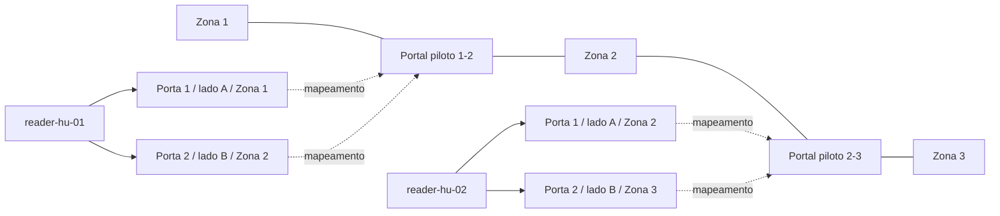
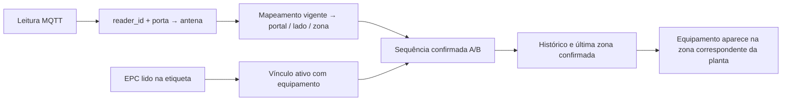

# Mapeamento e cadastro para um piloto no HUPAA

Este guia descreve como configurar o software existente para um setor do HU.
A planta atual é uma referência esquemática do segundo pavimento, com três
zonas provisórias. Os nomes oficiais, limites, pontos de passagem, quantidade
de leitores e cobertura RF precisam ser definidos com a equipe do hospital.
Os exemplos abaixo são lógicos, sem representar uma instalação já executada.


## 1. Relacionar o espaço físico com o cadastro

Cadastre **andar → setor → zonas**. Uma zona deve representar uma área cuja
entrada/saída possa ser observada pelos portais planejados. As cores da planta
representam contexto arquitetônico; não são automaticamente zonas de rastreamento.

| Elemento da planta atual | Campo `referencia_planta` da zona |
|---|---|
| Zona principal 1 | `zona-1` |
| Zona principal 2 | `zona-2` |
| Zona principal 3 | `zona-3` |

O nome exibido vem do cadastro e pode receber a nomenclatura oficial, mantendo
a referência. Cada referência deve resolver **uma única zona ativa** no mapa
atual. Referências duplicadas são consideradas ambíguas e não são desenhadas.
Para outro pavimento ou mais áreas, adapte também as âncoras e o contorno em
[`mapaConfig.ts`](../../frontend/src/config/mapaConfig.ts); apenas cadastrar
uma quarta zona no banco não cria uma região nova no SVG.

Use os endpoints existentes, com sessão administrativa:

| Cadastro | Operação |
|---|---|
| Andar | `POST /andares` |
| Setor e andar correspondente | `POST /setores` |
| Zona, setor e referência da planta | `POST /zonas` ou `PATCH /zonas/{id}` |
| Conferência da hierarquia | `GET /localizacoes/arvore` |

Exemplo de corpo de criação de zona; substitua `setor_id` pelo ID retornado
pelo cadastro do setor:

```json
{"nome":"Área piloto 1","setor_id":10,"referencia_planta":"zona-1"}
```

## 2. Cadastrar leitores, antenas e portais

Um **leitor** tem identidade lógica MQTT (`reader_id`) e serial de fábrica
separados. Uma **antena** pertence ao leitor e a uma porta normalizada pelo
adapter. Um **portal** liga duas zonas; suas antenas podem pertencer ao mesmo
leitor ou a leitores diferentes. O mapeamento vigente define lado A/B, zona e
função da antena. Leitores não possuem um único `portal_id` direto.



Dois leitores e duas portas por leitor servem apenas para explicar o cadastro.
A quantidade, portas disponíveis, cabos e pontos de instalação dependem do
levantamento físico e do equipamento efetivamente utilizado.

| Ordem | Operação | Campos que precisam corresponder à instalação |
|---|---|---|
| 1 | `POST /leitores` | `reader_id`, fabricante, modelo e `identificador_serial` |
| 2 | `POST /portais` | Nome, `zona_a_id`, `zona_b_id`, localização física |
| 3 | `POST /antenas` | `leitor_id`, `porta_numero`, `portal_id`, `zona_associada_id`, função |
| 4 | `POST /portais/{id}/mapeamentos` | `antena_id`, lado `a`/`b`, zona e função |
| 5 | `GET /portais/{id}/topologia` | Conferir leitores, portas, lados e zonas vigentes |

Por exemplo, após cadastrar uma antena do lado A, envie ao portal correspondente:

```json
{"antena_id":21,"lado":"a","zona_id":11,"funcao":"entrada"}
```

Os IDs são ilustrativos. A zona do lado A deve corresponder à `zona_a_id` do
portal e à zona associada da antena; o mesmo vale para B. O sentido é determinado
pela sequência das observações A→B ou B→A, não apenas pelo nome “entrada/saída”.
Mudanças de mapeamento encerram a vigência anterior e preservam o histórico;
consulte os registros existentes antes de criar um novo vínculo.

### Rede, identidade MQTT e apresentação na planta

O tópico segue o contrato do projeto, por exemplo:

```text
easy/dev/hupaa/portal-piloto-12/reader-hu-01/readings
```

O `reader_id` deve coincidir com o cadastro. A porta normalizada deve coincidir
com `porta_numero`. O segmento de portal no tópico não substitui a topologia
versionada no banco: é o par leitor/porta que resolve a antena e seu mapeamento.
Confirme transporte, payload, contador, porta e unidade de RSSI no firmware
usado. Não presuma suporte nativo ao heartbeat opcional do software.

Conecte leitores e notebook à rede autorizada; o notebook atua como broker e
receptor, sem hotspot. Use os [perfis de ambiente](execution.md) e credenciais
MQTT fora do Git, com ACL por tópico. Comece pelo painel
[Status dos leitores](../implementations/iss-024-status-leitores.md) para
distinguir contato recente, silêncio e falha parcial de um portal.

O cadastro no banco não posiciona fisicamente ícones na planta. Após confirmar
os portais, preencha `hospitalPortals` em `mapaConfig.ts`, relacionando as
referências das zonas ao ID ou nome exato do portal. Coordenadas `x`/`y` usam
a escala lógica 0–100 e devem ser obtidas da planta aprovada. O renderer só
exibe um portal quando cadastro ativo e lados A/B correspondem à configuração.

Ícones de leitores/antenas no mapa do HU exigem configurar suas posições e
repassá-las como `markers` em `MapaHospital`, seguindo o padrão existente em
`MapaLaboratorio`. A tela hospitalar atual desenha zonas, equipamentos e
portais configurados; não descobre posições de hardware automaticamente.

## 3. Cadastrar equipamentos e vincular as tags

Primeiro cadastre o tipo (`POST /tipos-equipamento`) e o equipamento
(`POST /equipamentos`), com nome legível e identificador patrimonial/interno
estável. Depois leia o EPC da etiqueta que será fixada nele e associe-o:

```text
POST /equipamentos/{equipamento_id}/tag
```

```json
{"epc":"E2804C410000000000000201"}
```

Esse EPC é fictício: use o valor efetivamente lido da etiqueta. A API normaliza
maiúsculas e aceita hexadecimal de comprimento par, entre 8 e 32 caracteres.
Existe no máximo um vínculo ativo por tag e por equipamento. Confirme com
`GET /equipamentos/{id}/tag` e `GET /tags/{epc}` antes do ensaio.
O cadastro da tag não a coloca automaticamente em uma zona. A posição inicial
deve surgir de passagem confirmada ou de correção manual autorizada e auditada.
Uma etiqueta substituída usa o fluxo de substituição do vínculo, preservando
as associações anteriores; não reutilize o EPC de outro equipamento ativo.



O mapa mostra última zona confirmada e agregação por área. As bolinhas são
ilustrativas: leituras recentes e RSSI não fornecem coordenadas exatas.

## 4. Conferir o piloto antes de uso em campo

No banco/perfil reservado ao ensaio, valide cada EPC, identidade do leitor,
porta e topologia. Faça travessias rotuladas nos dois sentidos; compare leituras,
passagens, histórico e zona apresentada. Confira também equipamento parado,
sobreposição entre antenas, perda de conexão e retorno do leitor.

Registre alcance e falsos positivos observados, limitações de cobertura e
ajustes necessários nas janelas de inferência. Preserve as evidências e só
adote nomes, limites e posições definitivos após a conferência com a equipe.
A captura desta página demonstra a visualização do software; não comprova
instalação, medição RF ou operação na rede do HU.
